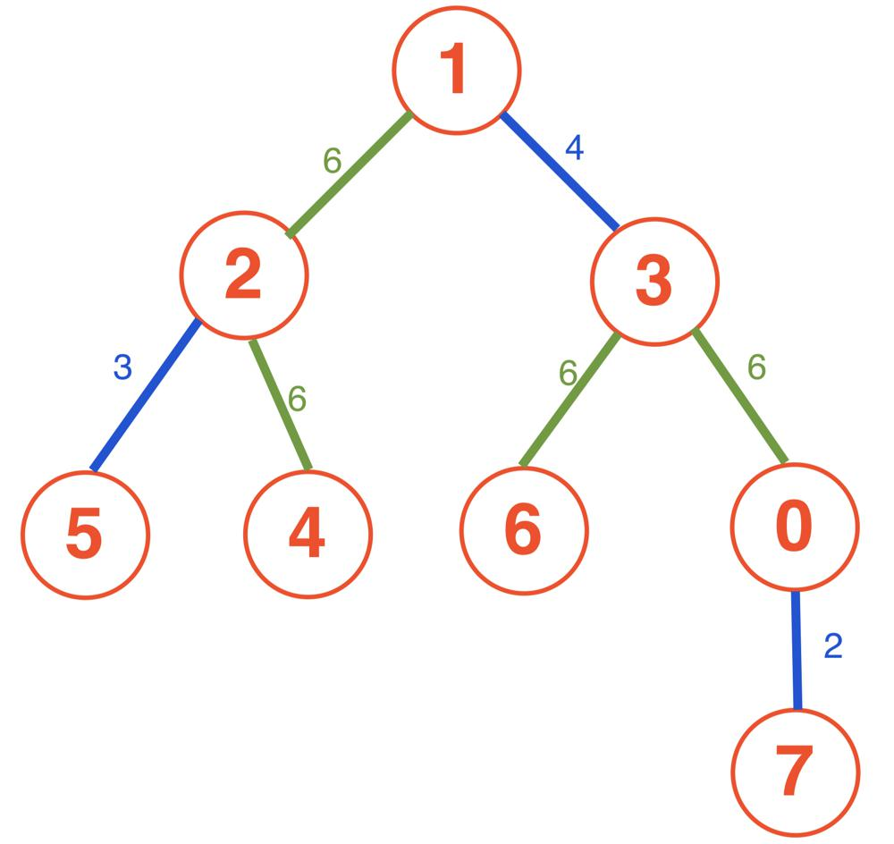
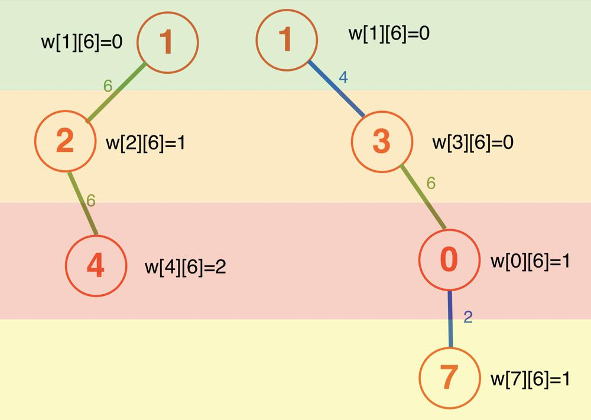

# 【C++ | Java | Python】Prefix-sum and LCA on the tree, explained in detail

**Author:** RealFan
**Votes:** 79
**Link:** [https://leetcode.com/problems/minimum-edge-weight-equilibrium-queries-in-a-tree/solutions/3996073/](https://leetcode.com/problems/minimum-edge-weight-equilibrium-queries-in-a-tree/solutions/3996073/)

---

> **I know almost nothing about English, pointing out the mistakes in my article would be much appreciated.**

> **In addition, I'm too weak, please be critical of my ideas.**
---

[toc]

# Intuition
1. For this kind of problem involves the "path between two nodes on the tree", **the first intuition is to consider their [lowest common ancestor](https://en.wikipedia.org/wiki/Lowest_common_ancestor)(LCA)**.
    Suppose we have known the LCA of every nodes pair. How to use it?
2. If we know the LCA of $$x$$ and $$y$$ is $$L$$, the path of $$x \\leftrightarrow y $$ can be divided into two segments: $$x \\leftrightarrow L$$ and $$y \\leftrightarrow L$$.
    So we can research them separately.
3. The problem requires the edge weights to be equal with minimum changes. **So we should retain a most occurrences weight $$z$$, and change the others.**
4. Notice that the range of edge weights is very small (26 in this problem), so immediately consider **enumerating all possible weights as retained weight $$z$$**.

5. Now, we have 2 problems: 
    1. **How to count the number of edges on the path of $$x \\leftrightarrow L$$?**
    2. **How to count the number of $$z$$ occurs on the path of $$x \\leftrightarrow L$$?** 
    (The $$y \\leftrightarrow L$$ can solved in the same way).

6. For the first problem:
    Because the $$L$$ is an ancestor of $$x$$, the edges must equals to the difference of their depth:
    $$edges = d[x] - d[L]$$
7.  For the second problem: 
    This is an interval summation problem, which can be solved by following the idea of prefix-sum.
    For each node $$x$$, we can maintain an array `w[x]`. **`w[x][i]` saves the prefix-count of weight $$i$$ until $$x$$.** *(More formally, `w[x][i]` saves "from $$root$$ to $$x$$, the number of edges which has weight $$i$$".)*
    As a result, the $$i$$'s count in $$ x \\leftrightarrow L $$ can be calculated easily:
    $$cnt(i) = w[x][i] - w[L][i]$$

    *Can read #example at the end of this article to enhance understanding*

8. And finally, how to calculate the LCA?
    There are many methods to find the LCA of nodes on a tree. The easiest way is to use [binary lifting](https://codeforces.com/blog/entry/100826). As I mentioned [last week](https://leetcode.com/problems/maximize-value-of-function-in-a-ball-passing-game/solutions/3965411/c-java-python-binary-lifting/) as well.
<!-- Describe your first thoughts on how to solve this problem. -->

# Approach
1. For convenience, in addition to the 2D array `fa` required by binary lifting, we also maintain an array `d` as the depth of each node. 
    The depth of root node is $$0$$, and the child node's depth is one more than its father. Easily use [dfs](https://en.wikipedia.org/wiki/Depth-first_search) to get these information.  
2. In `lca(x, y)` function, we first adjust the $$x$$ and $$y$$ to the same level, because the LCA will never be deeper than $$x$$ or $$y$$.
    **After the adjustment, the distant of $$x$$ to $$L$$ and $$y$$ to $$L$$ will be equal.** It's actually same with [Two Linked Lists Intersection](https://leetcode.com/problems/intersection-of-two-linked-lists/) problem.

    **So, we jump $$x$$ and $$y$$ upward together, they will first meet on their LCA.** 

    - If $$x = y$$, can directly return $$x$$ as the result. 
    - Otherwise, we want to **find the $$u,v$$ as the ancestor nodes of $$x,y$$ which are one level below their LCA**. Try going from long-step to short-step:
      - If jump $$2^p$$ steps makes $$x$$ and $$y$$ together, it means $$2^p$$ is too long.
      - If $$2^{p}$$ can't make them together, it means we can jump $$2^p$$ safely. 
      At the same time, the rest bits only allow jumping $$2^{p-1}+...+1 =2^p-1$$ steps at most. So if we don't jump this time, we will miss the $$u,v$$ forever.

      As a result, we choose to jump $$2^p$$ if it can't make $$x,y$$ equal.
      Finally, we can return the father of $$x$$ or $$y$$ as the LCA.

<!-- Describe your approach to solving the problem. -->

# Complexity
- Time complexity: $$O(n \\log n + q(C + \\log n))$$
- Space complexity: $$ O(n \\log n) $$
<!-- Add your space complexity here, e.g. $$O(n)$$ -->

# Code
``` C++ []
class Solution {
public:
    vector<int> minOperationsQueries(int n, vector<vector<int>>& edges, vector<vector<int>>& queries) {
        int m = (int)log2(n) + 1, C = 27;
        vector<vector<pair<int, int>>> g(n);
        for (auto& e : edges) {
            g[e[0]].push_back(make_pair(e[1], e[2]));
            g[e[1]].push_back(make_pair(e[0], e[2]));
        }

        // fa[i][j] means the 2^i -th father of vertex j:
        vector<vector<int>> fa(m, vector<int>(n));
        // w[i][j] means the count of j from root to vertex i:
        vector<vector<int>> w(n);
        // d[i] means the depth of vertex i:
        vector<int> d(n, 0);

        function<void(int, int, int)> dfs = [&](int x, int f, int dep) -> void {
            fa[0][x] = f;
            d[x] = dep;
            for (auto& [c, weight] : g[x]) {
                if (f == c) continue;
                w[c] = w[x];
                w[c][weight]++;
                dfs(c, x, dep + 1);
            }
        };
        w[0] = vector<int>(C, 0);
        dfs(0, 0, 0);
        // binary lifting: 
        for (int i = 1; i < m; ++i) {
            for (int j = 0; j < n; ++j) {
                fa[i][j] = fa[i-1][fa[i-1][j]];
            }
        }

        auto lca = [&](int x, int y) -> int {
            if (d[x] > d[y]) swap<int>(x, y);
            // adjust x and y to the same depth:
            for (int p = 0; (1 << p) <= d[y] - d[x]; ++p) 
                if ((1 << p) & d[y] - d[x]) y = fa[p][y];
            // conservatively jump x and y together:
            for (int p = m - 1; p >= 0; --p) {
                if (fa[p][x] != fa[p][y]) {
                    x = fa[p][x];
                    y = fa[p][y];
                }
            }
            return x == y ? x : fa[0][x];
        };
        
        vector<int> res;
        for (auto &q: queries) {
            int x = q[0], y = q[1], l = lca(x, y);
            // the total length between x and y:
            int len = d[x] + d[y] - 2 * d[l];
            // the mode of weight between x and y:
            int max_z = 0;
            for (int z = 1; z < C; ++z) {
                int num_z = w[x][z] + w[y][z] - w[l][z] * 2;
                max_z = max(max_z, num_z);
            }
            // the others must be changed:
            res.push_back(len - max_z);
        }
        return res;
    }
};
```
``` Java []
class Solution {
    public void dfs(int x, int f, int dep, List<Pair<Integer, Integer>> []g, int [][]fa, int [][]w, int []d) {
        fa[0][x] = f;
        d[x] = dep;
        for (Pair<Integer, Integer> p: g[x]) {
            //Pair<Integer, Integer> p = g[x].get(i);
            int c = p.getKey().intValue(), weight = p.getValue().intValue();
            if (f == c) continue;
            for (int j = 0; j < w[c].length; ++j)
                w[c][j] = w[x][j];
            w[c][weight]++;
            dfs(c, x, dep + 1, g, fa, w, d);
        }
    }
    public int lca(int x, int y, int [][]fa, int []d) {
        int m = fa.length;
        if (d[x] > d[y]) {
            int t = x;
            x = y;
            y = t;
        }
        // adjust x and y to the same depth:
        for (int p = 0; (1 << p) <= d[y] - d[x]; ++p) {
            if (((1 << p) & d[y] - d[x]) != 0) {
                y = fa[p][y];
            }
        }
        // conservatively jump x and y together:
        for (int p = m - 1; p >= 0; --p) {
            if (fa[p][x] != fa[p][y]) {
                x = fa[p][x];
                y = fa[p][y];
            }
        }
        return x == y ? x : fa[0][x];
    }
    public int[] minOperationsQueries(int n, int[][] edges, int[][] queries) {
        int m = 15, C = 27;
        List<Pair<Integer, Integer>> []g = new ArrayList[n];
        for (int i = 0; i < n; ++i)
            g[i] = new ArrayList<Pair<Integer, Integer>>();
        for (int[] e : edges) {
            g[e[0]].add(new Pair<Integer, Integer>(e[1], e[2]));
            g[e[1]].add(new Pair<Integer, Integer>(e[0], e[2]));
        }

        // fa[i][j] means the 2^i -th father of vertex j:
        int [][]fa = new int[m][n];
        // w[i][j] means the count of j from root to vertex i:
        int [][]w = new int[n][C];
        // d[i] means the depth of vertex i:
        int []d = new int[n];
        dfs(0, 0, 0, g, fa, w, d);
        // binary lifting: 
        for (int i = 1; i < m; ++i) {
            for (int j = 0; j < n; ++j) {
                fa[i][j] = fa[i-1][fa[i-1][j]];
            }
        }
        
        int []res = new int[queries.length];
        for (int i = 0; i < queries.length; ++i) {
            int x = queries[i][0], y = queries[i][1], l = lca(x, y, fa, d);
            // the total length between x and y:
            int len = d[x] + d[y] - 2 * d[l];
            // the mode of weight between x and y:
            int max_z = 0;
            for (int z = 1; z < C; ++z) {
                int num_z = w[x][z] + w[y][z] - w[l][z] * 2;
                max_z = Math.max(max_z, num_z);
            }
            // the others must be changed:
            res[i] = len - max_z;
        }
        return res;
    }
}
```
``` Python3 []
class Solution:
    def minOperationsQueries(self, n, edges, queries):
        m, C = n.bit_length() + 1, 27
        g = [[] for i in range(n)]
        for e in edges:
            g[e[0]].append((e[1], e[2]))
            g[e[1]].append((e[0], e[2]))

        # fa[i][j] means the 2^i -th father of vertex j:
        fa = [[0 for i in range(n)] for j in range(m)]
        # w[i][j] means the count of j from root to vertex i:
        w = [None for i in range(n)] 
        # d[i] means the depth of vertex i:
        d = [0] * n

        def dfs(x, f, dep):
            fa[0][x] = f  
            d[x] = dep 
            for (c, weight) in g[x]:
                if f == c: continue
                w[c] = w[x].copy()
                w[c][weight] += 1
                dfs(c, x, dep + 1)
        w[0] = [0] * C
        dfs(0, 0, 0)

        for i in range(1, m):
            for j in range(n):
                fa[i][j] = fa[i-1][fa[i-1][j]]

        def lca(x, y):
            if d[x] > d[y]: x, y = y, x
            # adjust x and y to the same depth:
            for p in range(m):
                if (1 << p) & (d[y] - d[x]): 
                    y = fa[p][y]
            # conservatively jump x and y together:
            for p in range(m-1, -1, -1):
                if fa[p][x] != fa[p][y]:
                    x = fa[p][x]
                    y = fa[p][y]
            return x if x == y else fa[0][x]

        res = []
        for q in queries:
            x, y, l = q[0], q[1], lca(q[0], q[1])
            # the total length between x and y:
            length = d[x] + d[y] - 2 * d[l]
            # the mode of weight between x and y:
            max_z = max([w[x][z] + w[y][z] - w[l][z] * 2 for z in range(1, C)])
            # the others must be changed:
            res.append(length - max_z)
        return res
```

# Example 
This is a tree:


Now we want to calculate the condition $$\\{z=6, x=4, y=7\\}$$, that is, for node pair $$(4,7)$$, how many edges must be changed to let all edges be $$6$$?


We find $$LCA(4,7)=1$$, and:
- the number of weight $$6$$ in $$4 \\leftrightarrow 1$$ is: $$w[4][6] - w[1][6] = 2$$
- the number of weight $$6$$ in $$7 \\leftrightarrow 1$$ is: $$w[7][6] - w[1][6] = 1$$.

So the total $$6$$ in $$4 \\leftrightarrow 1 \\leftrightarrow 7$$ is $$2+1=3$$.
While the number of edge is $$(d[4] - d[1]) + (d[7] - d[1]) = 5$$.

As a result, $$5-3=2$$ edges must be changed to $$6$$ in this condition.

