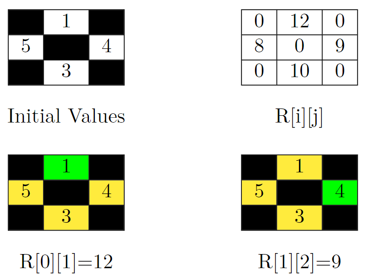
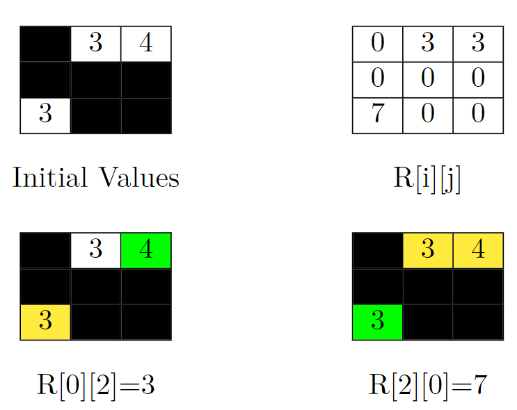

# [2852. Sum of Remoteness of All Cells](https://leetcode.com/problems/sum-of-remoteness-of-all-cells/)

| Category | Difficulty | Likes | Dislikes |
| :------: | :--------: | :---: | :------: |
| Algorithms | Medium | 58 | 15 |

**Tags:** [`array`](https://leetcode.com/tag/array), [`hash-table`](https://leetcode.com/tag/hash-table), [`depth-first-search`](https://leetcode.com/tag/depth-first-search), [`breadth-first-search`](https://leetcode.com/tag/breadth-first-search), [`union-find`](https://leetcode.com/tag/union-find), [`matrix`](https://leetcode.com/tag/matrix)

**Companies:** `medianet`

## Description

You are given a **0-indexed** matrix `grid` of order `n * n`. Each cell in this matrix has a value `grid[i][j]`, which is either a **positive** integer or `-1` representing a blocked cell.

You can move from a non-blocked cell to any non-blocked cell that shares an edge.

For any cell `(i, j)`, we represent its **remoteness** as `R[i][j]` which is defined as the following:

	- If the cell `(i, j)` is a **non-blocked** cell, `R[i][j]` is the sum of the values `grid[x][y]` such that there is **no path** from the **non-blocked** cell `(x, y)` to the cell `(i, j)`.

	- For blocked cells, `R[i][j] == 0`.

Return* the sum of *`R[i][j]`* over all cells.*

 

**Example 1:**



```

Input: grid = [[-1,1,-1],[5,-1,4],[-1,3,-1]]
Output: 39
Explanation: In the picture above, there are four grids. The top-left grid contains the initial values in the grid. Blocked cells are colored black, and other cells get their values as it is in the input. In the top-right grid, you can see the value of R[i][j] for all cells. So the answer would be the sum of them. That is: 0 + 12 + 0 + 8 + 0 + 9 + 0 + 10 + 0 = 39.
Let&#39;s jump on the bottom-left grid in the above picture and calculate R[0][1] (the target cell is colored green). We should sum up the value of cells that can&#39;t be reached by the cell (0, 1). These cells are colored yellow in this grid. So R[0][1] = 5 + 4 + 3 = 12.
Now let&#39;s jump on the bottom-right grid in the above picture and calculate R[1][2] (the target cell is colored green). We should sum up the value of cells that can&#39;t be reached by the cell (1, 2). These cells are colored yellow in this grid. So R[1][2] = 1 + 5 + 3 = 9.

```



**Example 2:**

```

Input: grid = [[-1,3,4],[-1,-1,-1],[3,-1,-1]]
Output: 13
Explanation: In the picture above, there are four grids. The top-left grid contains the initial values in the grid. Blocked cells are colored black, and other cells get their values as it is in the input. In the top-right grid, you can see the value of R[i][j] for all cells. So the answer would be the sum of them. That is: 3 + 3 + 0 + 0 + 0 + 0 + 7 + 0 + 0 = 13.
Let&#39;s jump on the bottom-left grid in the above picture and calculate R[0][2] (the target cell is colored green). We should sum up the value of cells that can&#39;t be reached by the cell (0, 2). This cell is colored yellow in this grid. So R[0][2] = 3.
Now let&#39;s jump on the bottom-right grid in the above picture and calculate R[2][0] (the target cell is colored green). We should sum up the value of cells that can&#39;t be reached by the cell (2, 0). These cells are colored yellow in this grid. So R[2][0] = 3 + 4 = 7.

```

**Example 3:**

```

Input: grid = [[1]]
Output: 0
Explanation: Since there are no other cells than (0, 0), R[0][0] is equal to 0. So the sum of R[i][j] over all cells would be 0.

```

 

**Constraints:**

	- `1 <= n <= 300`

	- `1 <= grid[i][j] <= 10^6` or `grid[i][j] == -1`

---

**Links:** [Submissions](https://leetcode.com/problems/sum-of-remoteness-of-all-cells/) | [Solutions](https://leetcode.com/problems/sum-of-remoteness-of-all-cells/)
