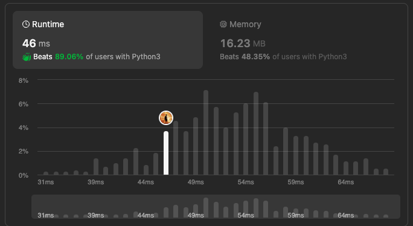

# [Python3] Two pointer || 46ms || beats 89%

**Author:** yourick
**Votes:** 3
**Link:** [https://leetcode.com/problems/minimum-right-shifts-to-sort-the-array/solutions/4349715/](https://leetcode.com/problems/minimum-right-shifts-to-sort-the-array/solutions/4349715/)

---

1. Iterate from the start while the array is increasing.
2. If the array was iterated to end without breaks \u2014 it's sorted. Return 0
3. Iterate from the end while the array is decreasing
4. If the array is sorted `i` and `j` will be point to one index, but it's not enough to be sure that array will be sorted after shift. Additionally neet to check end of right subarray `nums[-1]` with start of left subarray `nums[0]`. 
5. Example `[236] [45]`: these two parts won't make a sorted array, because 5(end of right subarray) > 2 (start left subarray)
```python3 []
class Solution:
    def minimumRightShifts(self, nums: List[int]) -> int:
        L = len(nums)
        for i in range(1, L):
            if nums[i-1] > nums[i] : break
        else:
            return 0 # sorted

        for j in reversed(range(L)):
            if nums[j-1] > nums[j]: break

        return L - i if i == j and nums[-1] < nums[0] else -1   
```

