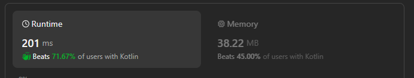

# fun used filter + countOneBits + sum

**Author:** SergioLuigi
**Votes:** 1
**Link:** [https://leetcode.com/problems/sum-of-values-at-indices-with-k-set-bits/solutions/5206527/](https://leetcode.com/problems/sum-of-values-at-indices-with-k-set-bits/solutions/5206527/)

---




# Complexity
- Time complexity:
O(n)

- Space complexity:
O(1)

# Code
```
class Solution {
    fun sumIndicesWithKSetBits(nums: List<Int>, k: Int): Int =
        nums.filterIndexed {index, value -> index.countOneBits() == k }.sum()
}
```