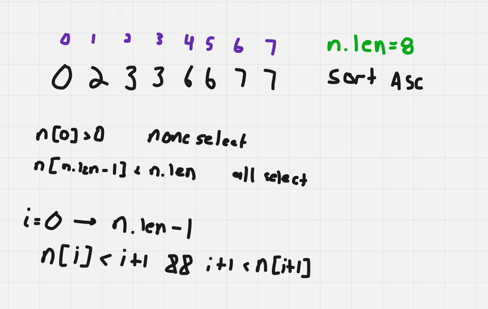

# Dart Solution

**Author:** Friendlygecko
**Votes:** 0
**Link:** [https://leetcode.com/problems/happy-students/solutions/4176182/](https://leetcode.com/problems/happy-students/solutions/4176182/)

---

# Intuition
<!-- Describe your first thoughts on how to solve this problem. -->

# Approach
<!-- Describe your approach to solving the problem. -->

# Complexity
- Time complexity:
<!-- Add your time complexity here, e.g. $$O(n)$$ -->

- Space complexity:
<!-- Add your space complexity here, e.g. $$O(n)$$ -->

# Code
```
class Solution {
  int countWays(List<int> nums) {
    nums.sort();
    var c = 0;
    if (nums.first > 0) {
      c += 1;
    }
    for (int i = 0; i < nums.length - 1; i++) {
      if (nums[i] < i + 1 && i + 1 < nums[i + 1]) {
        c += 1;
      }
    }
    if (nums.last < nums.length) {
      c += 1;
    }

    return c;
  }
}
```

