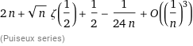

# Rust/Go/Python: O(n) with detailed description and math explanation

**Author:** SalvadorDali
**Votes:** 2
**Link:** [https://leetcode.com/problems/maximum-element-sum-of-a-complete-subset-of-indices/solutions/4057314/](https://leetcode.com/problems/maximum-element-sum-of-a-complete-subset-of-indices/solutions/4057314/)

---

# Intuition

Lets assume that our set is ${p_1, p_2, ..., p_n}$. Then we have the following equations:

 - $p_1 \\cdot p_2 = x_1^2$
 - $p_1 \\cdot p_3 = x_2^2$
 - ...
 - $p_1 \\cdot p_n = x_n^2$
 - $p_2 \\cdot p_3 = y_1^2$
 - ...

Lets look at the solutions for a few of the equation as the solutions to others are similar:

$p_i \\cdot p_j = x^2$. So $p_j = p_i \\cdot v^2$

----------------

This gives us the solution. For every possible position `p1` we need to find all other positions which are `p1 * 1^2, p1 * 2^2, p1 * 3^2, ..., p1 * v^2`. How many of them will it be? Until `p1 * v * v` fits our length of the array. 


# Code
```Go []
func maximumSum(nums []int) int64 {
  n, res := len(nums), int64(0)
  for p1 := 1; p1 <= n; p1++ {
    v, tmp := 1, int64(0)
    for p1 * v * v <= n {
      tmp += int64(nums[p1 * v * v - 1]) 
      v++
    }
    if tmp > res {
      res = tmp
    }
  }

  return res
}
```
```python []
class Solution:
  def maximumSum(self, nums: List[int]) -> int:
    n, res = len(nums), 0
    for p1 in range(1, n + 1):
      v, tmp = 1, 0
      while p1 * v * v <= n:
        tmp += nums[p1 * v * v - 1]
        v += 1
      res = max(res, tmp)
    
    return res
```
```Rust []
impl Solution {
  pub fn maximum_sum(nums: Vec<i32>) -> i64 {
    let (mut res, n) = (0, nums.len());
    for p1 in 1 ..= n {
      let (mut v, mut tmp) = (1, 0i64);
      while p1 * v * v <= n {
        tmp += nums[p1 * v * v - 1] as i64;
        v += 1;
      }
      res = res.max(tmp);
    }

    return res;
  }
}
```


# Complexity

- Space complexity: $O(1)$

As you see, the code is easy to implement and people might claim that the complexity is $O(n \\cdot \\sqrt n) = O(n^{1.5})$, but I **believe this is wrong**, and the complexity is linear $O(n)$.

From math point of view we do $f = \\sum_{i=1}^{n} 1 + \\sqrt{\\left\\lfloor \\frac{n}{i} \\right\\rfloor} = n + \\sum_{i=1}^{n} \\sqrt{\\left\\lfloor \\frac{n}{i} \\right\\rfloor} $ of computations. This is very hard to estimate, but we can take a look at a stricktly bigger sum

$\\sum_{i=1}^{n} \\sqrt{\\left\\lfloor \\frac{n}{i} \\right\\rfloor} < \\sum_{i=1}^{n} \\sqrt{\\frac{n}{i}}$

And take a look at [wolfram alpha](https://www.wolframalpha.com/input?i=limit+of+sum+from+1+to+n+sqrt%28n+%2F+k%29+where+n+is+infinity) 

Which tells that expansion at infinity is  


So we see that $n < f < 3n$ so the complexity is $O(n)$

- Time complexity: $O(n)$
