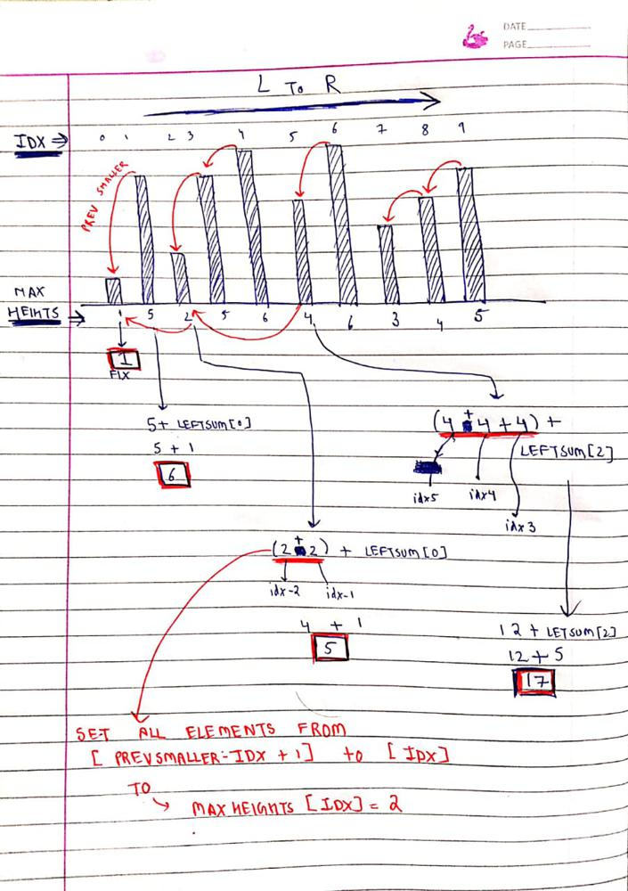

# Explained with image || Monotonic Stack

**Author:** MohakHarjani
**Votes:** 93
**Link:** [https://leetcode.com/problems/beautiful-towers-ii/solutions/4082802/](https://leetcode.com/problems/beautiful-towers-ii/solutions/4082802/)

---


Similarly do it for R to L also 

```
class Solution {
public:
    long long maximumSumOfHeights(vector<int>& maxHeights) 
    {
        int n = maxHeights.size();
        //===================================================================================================
        //PREVIOUS SMALLER ELEMENT USING STACK
        stack<int>st;
        vector<int>prevSmaller(n, -1); //stores the "index" of previous Smaller Element
        for (int i = 0; i < n; i++)
        {
            while(!st.empty() && maxHeights[st.top()] >= maxHeights[i])
            {
                st.pop(); 
            }
            
            if (!st.empty())
                prevSmaller[i] = st.top();
            st.push(i);
        }
        //=======================================================================================================
        //NEXT SMALLER ELEMENT USING STACK
        vector<int>nextSmaller(n, n);  //stores the "index" of next Smaller Elements
        st = stack<int>(); //new Stack
        for (int i = n - 1; i >= 0; i--)
        {
            while(!st.empty() && maxHeights[st.top()] >= maxHeights[i])
            {
                st.pop();
            }
            if (!st.empty())
                nextSmaller[i] = st.top();
            st.push(i);
        }
        //=========================================================================================================
        vector<long long>leftSum(n, 0);
        leftSum[0] = maxHeights[0];
        for (int i = 1; i < n; i++)
        {
            int prevSmallerIdx = prevSmaller[i];
            int equalCount = i - prevSmallerIdx; 
            //all elements from [prevSmallerIdx + 1] to [i] will be set to "maxHeights[i]"
            
            leftSum[i] = leftSum[i] + ((long long)equalCount * maxHeights[i]);
            
            if (prevSmallerIdx != -1)
                leftSum[i] += leftSum[prevSmallerIdx];
        }
        //========================================================================================================
        vector<long long>rightSum(n, 0);
        rightSum[n - 1] = maxHeights[n - 1];
        for (int i = n - 2; i >= 0; i--)
        {
            int nextSmallerIdx = nextSmaller[i];
            int equalCount = nextSmallerIdx - i;
            //all elements from [i] to [nextSmallerIdx - 1] will be set to "maxHeights[i]"
            
            rightSum[i] = rightSum[i] + ((long long)equalCount * maxHeights[i]);
            
            if (nextSmallerIdx != n)
                rightSum[i] += rightSum[nextSmallerIdx]; 
        }
        //=============================================================================================================
        long long ans = 0;
        for (int i = 0; i < n; i++)
        {
            long long totalSum = leftSum[i] + rightSum[i] - maxHeights[i];
            ans = max(ans, totalSum);
        }
        //===============================================================================================================
        return ans;
    }
};
```