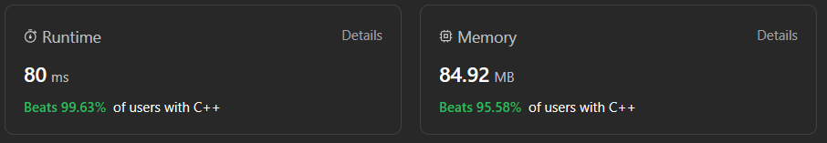

# ✅☑Beats 99.63% Users || [C++/Java/Python/JavaScript] || EXPLAINED🔥

**Author:** MarkSPhilip31
**Votes:** 165
**Link:** [https://leetcode.com/problems/minimum-number-of-operations-to-make-array-empty/solutions/4501929/](https://leetcode.com/problems/minimum-number-of-operations-to-make-array-empty/solutions/4501929/)

---

# PLEASE UPVOTE IF IT HELPED

---


---

# Approaches
(Also explained in the code)

1. It uses a map `mp` to calculate the frequency of each number in nums.

1. If any number occurs only once in `nums`, it's impossible to achieve the desired pattern, so the function returns -1.

1. It calculates the number of moves needed to make all occurrences of each number a multiple of 3. If there are remaining occurrences (not divisible by 3), it adds one more move for each such occurrence.

1. Finally, it returns the total number of moves needed to achieve the desired pattern.


# Complexity
- Time complexity:
   $$O(n)$$
    

- Space complexity:
   $$O(n)$$
    


# Code
```C++ []

class Solution {
public:
    int minOperations(vector<int>& nums) {
        unordered_map<int,int>mp;
        for(auto a: nums){
            mp[a]++;
        }

        int count=0;
        for(auto a: mp){
            int t = a.second;
            if(t==1)return -1;
            count += t/3;
            if(t%3)count++;
        }
        return count;
    }
};


```
```Java []
import java.util.HashMap;
import java.util.Map;

class Solution {
    public int minOperations(int[] nums) {
        // Create a HashMap to store the frequency of each element in 'nums'
        Map<Integer, Integer> mp = new HashMap<>();
        
        // Count the frequency of each element in 'nums'
        for (int num : nums) {
            // Put the element in the map and increment its count by 1
            mp.put(num, mp.getOrDefault(num, 0) + 1);
        }
        
        // Initialize a variable to count the minimum operations needed
        int count = 0;
        
        // Iterate through the entries in the HashMap
        for (Map.Entry<Integer, Integer> entry : mp.entrySet()) {
            // Get the frequency count of the current element
            int t = entry.getValue();
            
            // If there is only one occurrence of any element, it's not possible to make it divisible by 3
            if (t == 1)
                return -1;
            
            // Calculate the number of operations needed to make the frequency divisible by 3
            count += t / 3; // Count the complete sets of 3 elements
            if (t % 3 != 0) // If there are remaining elements, increment the count
                count++;
        }
        
        // Return the total count of operations needed
        return count;
    }
}


```
```python3 []
class Solution:
    def minOperations(self, nums: List[int]) -> int:
        from collections import Counter
        mp = Counter(nums)
        
        count = 0
        for t in mp.values():
            if t == 1:
                return -1
            count += t // 3
            if t % 3:
                count += 1
                
        return count


```
```javascript []
var minOperations = function(nums) {
    const mp = new Map();
    
    for (let num of nums) {
        mp.set(num, (mp.get(num) || 0) + 1);
    }
    
    let count = 0;
    for (let [key, value] of mp.entries()) {
        let t = value;
        if (t === 1) return -1;
        count += Math.floor(t / 3);
        if (t % 3 !== 0) count++;
    }
    
    return count;
};


```
---


# PLEASE UPVOTE IF IT HELPED

---
---


---