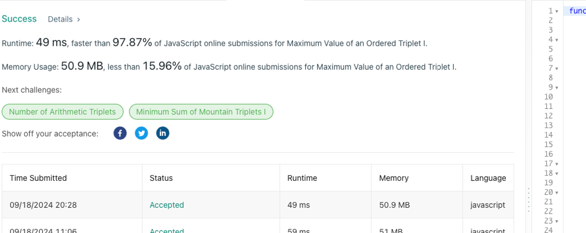

# ❇ maximum-value-of-an-ordered-triplet Images👌 🏆O(N)❤️ Javascript🎯 RunTime👀97%🕕 ++Explanation✍️

**Author:** anurag-sindhu
**Votes:** 2
**Link:** [https://leetcode.com/problems/maximum-value-of-an-ordered-triplet-i/solutions/5803007/](https://leetcode.com/problems/maximum-value-of-an-ordered-triplet-i/solutions/5803007/)

---

**Time Complexity: O(N)\uD83D\uDD55
Space Complexity: O(N)**

```
function maximumTripletValue(nums) {
    let maxDiff = -1;
    const maxNum = [nums[nums.length - 1]];
    for (let index = nums.length - 1 - 1; index >= 0; index--) {
        const element = nums[index];
        const lastNumOfMaxNum = maxNum[maxNum.length - 1];
        if (lastNumOfMaxNum < element) {
            maxNum.push(element);
        } else {
            maxNum.push(lastNumOfMaxNum);
        }
    }
    maxNum.reverse();
    let firstNum = nums[0];
    let secondNum = nums[1];
    maxDiff = (firstNum - secondNum) * nums[2];
    if (nums.length > 2) {
        for (let index = 1; index < nums.length; index++) {
            const element = nums[index];
            if (element > firstNum) {
                firstNum = element;
                secondNum = null;
            } else if (secondNum === null || element < secondNum) {
                secondNum = element;
            }
            if (secondNum) {
                maxDiff = Math.max(maxDiff, (firstNum - secondNum) * (maxNum[index + 1] || 0));
            }
        }
    }
    return maxDiff < 0 ? 0 : maxDiff;
}
```

`(firstNum - secondNum) * thirdNum`
Where:
firstNum is the largest element found so far.
secondNum is the next largest element that is smaller than firstNum.
thirdNum is any element after the pair firstNum and secondNum.
\u270D\uFE0F Code Breakdown:
Initialization:

```
let maxDiff = -1;
const maxNum = [nums[nums.length - 1]];
```
maxDiff is initialized to -1, which will eventually store the largest triplet value.
maxNum keeps track of the maximum element from the right side of the array as we traverse it.
Building maxNum Array \uD83D\uDD04:

```
for (let index = nums.length - 2; index >= 0; index--) {
```
We traverse the array backwards to construct maxNum, which will hold the largest elements encountered to the right of each position.
Explanation with an Example:

If the array is [1, 5, 3, 9], then maxNum would look like [9, 9, 9] because 9 is the largest number from the third position onward.

\uD83D\uDD0E Think of maxNum as a future look-up table for the largest numbers to the right!

Reversing maxNum \uD83D\uDD04:

maxNum.reverse();
Now, after building maxNum, we reverse it to align with the original order of nums.
Iterating through nums \u23E9:

```
let firstNum = nums[0];
let secondNum = nums[1];
maxDiff = (firstNum - secondNum) * nums[2];
```
We initialize the first two numbers firstNum and secondNum from the start of nums, and we calculate an initial triplet value using the first two numbers and the third one in nums.
Finding the Maximum Triplet Value \uD83D\uDD1D:

```
for (let index = 1; index < nums.length; index++) {
```
We iterate through the array, updating firstNum and secondNum as we go, and calculating possible triplet values using the maxNum array.
\uD83D\uDCA1 Key Insight:

The formula (firstNum - secondNum) * thirdNum is computed at every step. We track the largest triplet value by updating maxDiff.
Handling Edge Cases:

```
return maxDiff < 0 ? 0 : maxDiff;
```
If no valid triplet value is found (i.e., maxDiff remains negative), we return 0.

\uD83C\uDFC1 Conclusion:
This function efficiently finds the maximum triplet value by:

Tracking the largest elements on the right using maxNum.
Iterating through possible firstNum and secondNum combinations and calculating potential triplet values.
Happy Coding! \uD83D\uDE0E


