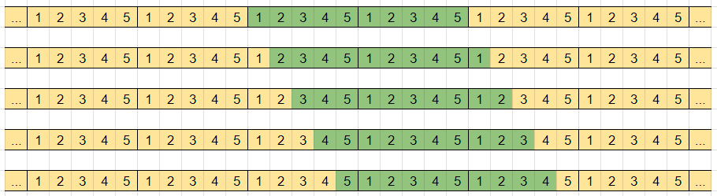
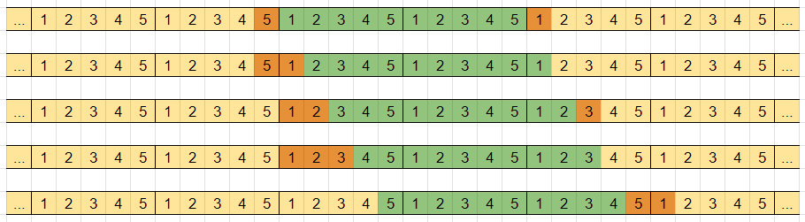
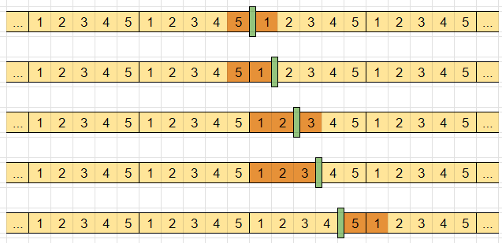
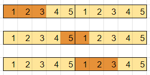

# [C++, Java, Python] Sliding Window | Example Image Explanation

**Author:** shivamaggarwal513
**Votes:** 34
**Link:** [https://leetcode.com/problems/minimum-size-subarray-in-infinite-array/solutions/4124360/](https://leetcode.com/problems/minimum-size-subarray-in-infinite-array/solutions/4124360/)

---

# Intuition
Since we have infinite copies of $nums$, we know $target$ can be much larger than total sum of $nums$ and still achievable. But we will have to take that many copies of complete array as required. And the remainder of target will be then made by some other part of array.

Let `total = sum(nums)`

Then, we will be taking `\u230Atarget / total\u230B` complete copies of `nums`. And remainder `target % total` will be achieved by some partial part of array.

> In other words, this can be just written in division form as
```
target = div * total + rem
where div = \u230Atarget / total\u230B and rem = target % total
```

Now,
```
complete = n * div = n * \u230Atarget / total\u230B
newTarget = target % total
```

The final answer will be dependent on whether we are able to make `newTarget` from the array. If we can make `newTarget` from `partial` number of elements, final answer will be `complete + partial`, otherwise `-1`.

But, what are all possible "kind" of subarrays we can use to make `newTarget`?
To answer this, first we need to see what are the ways we can select `div` number of complete copies of array.

**Example**
```
nums = [1, 2, 3, 4, 5], target = 36
total = sum(nums) = 15
target = 2 * total + 6
```
We need to take $2$ complete copies of array. There are `nums.length = 5` ways to do this (start from any one index and take $2$ complete copies)



Now, we have taken window of size `2 * 5 = 10` in our subarray, and are left to make `newTarget = target % total = 6`. This can be achieved for above different cases as:



But, how are we calculating the smallest size window to make `newTarget`? Let's *collapse* the $2$ complete copies of array to see what is actually happening with the remaining `newTarget`.



If you look carefully, collapsing any number of complete copies of array from `infinite_nums` will not change it. It will still be `infinite_nums`. But now we would be searching for smallest subarray making `newTarget = target % total` instead of whole big `target`.

```
newTarget = target % total
0 <= newTarget <= total - 1
```

Since, `newTarget` is atmost `total - 1`, it will be achieved from atmost `n - 1` elements. So, we need to search for `newTarget` in only one copy of array.

This will cover the cases of subarray `[1, 2, 3]` in above example. But it will ignore the cases of subarray `[5, 1]`. These are the cases where `newTarget` can be made by taking some elements from beginning of array and some elements from end of array and ignoring some elements in between them. To calculate for these cases, we need $2$ copies of array to search for `newTarget`.



Using this, we will be able to evaluate for these type of cases too and give minimum from them finally.

# Approach
- Calculate
  - `total = sum(nums)`
  - `complete = n * \u230Atarget / total\u230B`
  - `newTarget = target % total` (or just call it `target` only), `target = target % total`
- To operate on $2$ copies of `nums` to find `target`, either append one copy to given array (linear extra space), or use modular arithmetic.
  - For any index `i` where `0 <= i < 2n`, it's corresponding index in `nums` will be `i' = i % n`. 
  - For `0 <= i < n`, `i' = i`
  - For `n <= i < 2n`, `i' = i - n`
- Maintain variable `partial` that will store minimum size of subarray making `target`. It can be maximum `n - 1` so initialize it with `n`. Then if it is still `n` until last, we will know that `target` can't be achieved and return `-1`.
- Maintain `start`, `end` pointers of current window and its current `sum`.
- Loop over `end` from `0 <= end < 2n`, adding `nums[end']` to `sum`. Remove elements from beginning of window `nums[start']` if current window's `sum` is bigger `target`.
- Update the answer for `partial` if `sum = target`.

# Code
```C++ []
class Solution {
public:
    int minSizeSubarray(vector<int>& nums, int target) {
        long long total = accumulate(nums.begin(), nums.end(), 0LL), sum = 0;
        int n = nums.size(), partial = n, complete = n * (target / total), start = 0;
        target %= total;
        for (int end = 0; end < 2 * n; end++) {
            sum += nums[end % n];
            while (sum > target) {
                sum -= nums[start++ % n];
            }
            if (sum == target) {
                partial = min(partial, end - start + 1);
            }
        }
        return partial != n ? partial + complete : -1;
    }
};
```
```Java []
class Solution {
    public int minSizeSubarray(int[] nums, int target) {
        long total = Arrays.stream(nums).sum(), sum = 0;
        int n = nums.length, partial = n, complete = n * (int)(target / total), start = 0;
        target %= total;
        for (int end = 0; end < 2 * n; end++) {
            sum += nums[end % n];
            while (sum > target) {
                sum -= nums[start++ % n];
            }
            if (sum == target) {
                partial = Math.min(partial, end - start + 1);
            }
        }
        return partial != n ? partial + complete : -1;
    }
}
```
```Python []
class Solution:
    def minSizeSubarray(self, nums: List[int], target: int) -> int:
        n, total, windowSum, start = len(nums), sum(nums), 0, 0
        partial, complete = n, n * (target // total)
        target %= total
        for end in range(2 * n):
            windowSum += nums[end % n]
            while windowSum > target:
                windowSum -= nums[start % n]
                start += 1
            if windowSum == target:
                partial = min(partial, end - start + 1)
        return partial + complete if partial != n else -1
```

# Complexity
- Time complexity: $O(n)$
- Space complexity: $O(1)$

Find the solution helpful? Try the next problem of same contest, [2876. Count Visited Nodes in a Directed Graph](https://leetcode.com/problems/count-visited-nodes-in-a-directed-graph/description/). Refer to my solution post [[C++, Java, Python] Topological Sort | Intuition With Examples | Queue + Stack](https://leetcode.com/problems/count-visited-nodes-in-a-directed-graph/solutions/4112173/c-java-python-topological-sort-intuition-with-examples-queue-stack/).