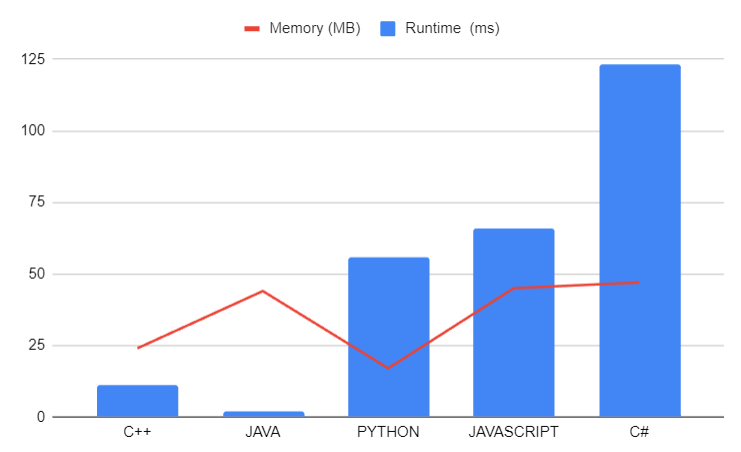

# Optimizing Memory and Performance in Last Visited Integers: A Code Solution Exploration || Mr. Robot

**Author:** LakshayBrejwal_1_0
**Votes:** 3
**Link:** [https://leetcode.com/problems/last-visited-integers/solutions/4168757/](https://leetcode.com/problems/last-visited-integers/solutions/4168757/)

---

# Last Visited Integers

## Approach 1: Tracking and Retrieving
### Explanation
In this approach, we maintain two vectors, `st` to store the integers we encounter and `ans` to record the last visited integers when encountering the word "prev." We also keep track of consecutive "prev" words using the `conspre` variable to determine how many positions to go back in `st` when "prev" is encountered.

### Dry Run
Let's dry run the code with a sample input:
```
words = ["3", "5", "prev", "prev", "1", "prev", "prev", "prev"]
```
- Initially, `st` and `ans` are empty.
- Iterating through the words:
  1. "3" is a number, so it's pushed onto `st`.
  2. "5" is also a number and is pushed onto `st`.
  3. "prev" is encountered. `conspre` becomes 1. We retrieve the last visited integer at position `st.size() - 1 - 1` (the first "prev") from `st`, which is 5, and push it onto `ans`.
  4. The next "prev" is encountered, and `conspre` is now 2. We retrieve the last visited integer at position `st.size() - 2 - 1` (the second "prev") from `st`, which is 3, and push it onto `ans`.
  5. "1" is a number and is pushed onto `st`.
  6. Another "prev" is encountered, but there are not enough "prev" words to go back 3 positions in `st,` so we push -1 onto `ans`.
  7. Similarly, the last "prev" also results in -1 being added to `ans`.

The final value of `ans` is `[5, 3, -1, -1]`.

### Edge Cases
This approach handles the following edge cases:
- Consecutive "prev" words: We track and retrieve the last visited integers accordingly.
- "prev" words without previous numbers: We return -1 in these cases.

### Complexity Analysis
- Time Complexity: O(N), where N is the number of words. We iterate through the words once.
- Space Complexity: O(N), where N is the number of words. We store the last visited integers in the `ans` vector.

## Codes in (C++) (Java) (Python) (C#) (JavaScript)
```cpp []
class Solution {
public:
    vector<int> lastVisitedIntegers(vector<string>& words) {
        vector<int> st;
        vector<int> ans;
        int conspre = 0;
        for (auto i : words) {
            if (i == "prev") {
                conspre++;
                if (conspre <= st.size()) {
                    ans.push_back(st[st.size() - conspre]);
                } else {
                    ans.push_back(-1);
                }
            } else {
                st.push_back(stoi(i));
                conspre = 0;
            }
        }
        return ans;
    }
};
```

### Java
```java []
import java.util.ArrayList;
import java.util.List;

class Solution {
    public List<Integer> lastVisitedIntegers(List<String> words) {
        List<Integer> st = new ArrayList<>();
        List<Integer> ans = new ArrayList<>();
        int conspre = 0;
        for (String word : words) {
            if (word.equals("prev")) {
                conspre++;
                if (conspre <= st.size()) {
                    ans.add(st.get(st.size() - conspre));
                } else {
                    ans.add(-1);
                }
            } else {
                st.add(Integer.parseInt(word));
                conspre = 0;
            }
        }
        return ans;
    }
}
```

### Python
```python []
from typing import List

class Solution:
    def lastVisitedIntegers(self, words: List[str]) -> List[int]:
        st = []
        ans = []
        conspre = 0
        for word in words:
            if word == "prev":
                conspre += 1
                if conspre <= len(st):
                    ans.append(st[-conspre])
                else:
                    ans.append(-1)
            else:
                st.append(int(word))
                conspre = 0
        return ans
```

### C#
```csharp []
using System;
using System.Collections.Generic;

public class Solution {
    public IList<int> LastVisitedIntegers(IList<string> words) {
        List<int> st = new List<int>();
        List<int> ans = new List<int>();
        int conspre = 0;
        foreach (string word in words) {
            if (word == "prev") {
                conspre++;
                if (conspre <= st.Count) {
                    ans.Add(st[st.Count - conspre]);
                } else {
                    ans.Add(-1);
                }
            } else {
                st.Add(int.Parse(word));
                conspre = 0;
            }
        }
        return ans;
    }
}
```

### JavaScript
```javascript []
/**
 * @param {string[]} words
 * @return {number[]}
 */
var lastVisitedIntegers = function(words) {
    const st = [];
    const ans = [];
    let conspre = 0;
    for (const word of words) {
        if (word === "prev") {
            conspre++;
            if (conspre <= st.length) {
                ans.push(st[st.length - conspre]);
            } else {
                ans.push(-1);
            }
        } else {
            st.push(parseInt(word));
            conspre = 0;
        }
    }
    return ans;
};
```    


---

| Language    | Runtime (ms) | Memory (MB) |
|-------------|--------------|-------------|
| C++         | 11           | 24          |
| Java        | 2            | 44          |
| Python      | 56           | 17          |
| JavaScript  | 66           | 45          |
| C#          | 123          | 47          |

---


---

# Consider UPVOTING\u2B06\uFE0F


# DROP YOUR SUGGESTIONS IN THE COMMENT

## Keep Coding\uD83E\uDDD1\u200D\uD83D\uDCBB

 -- *MR.ROBOT SIGNING OFF*
