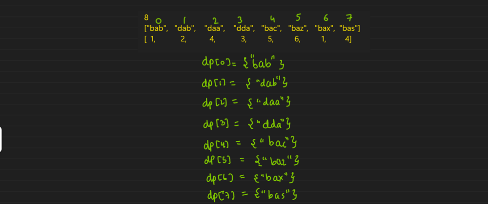
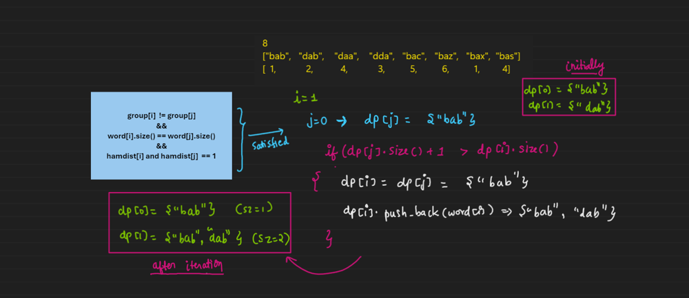
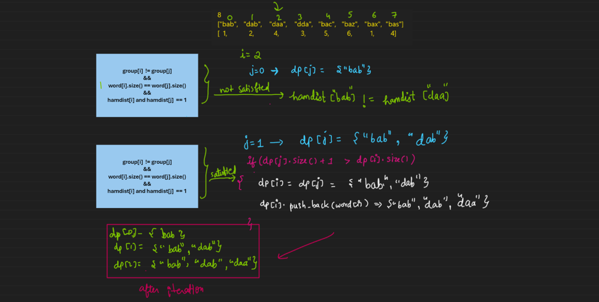
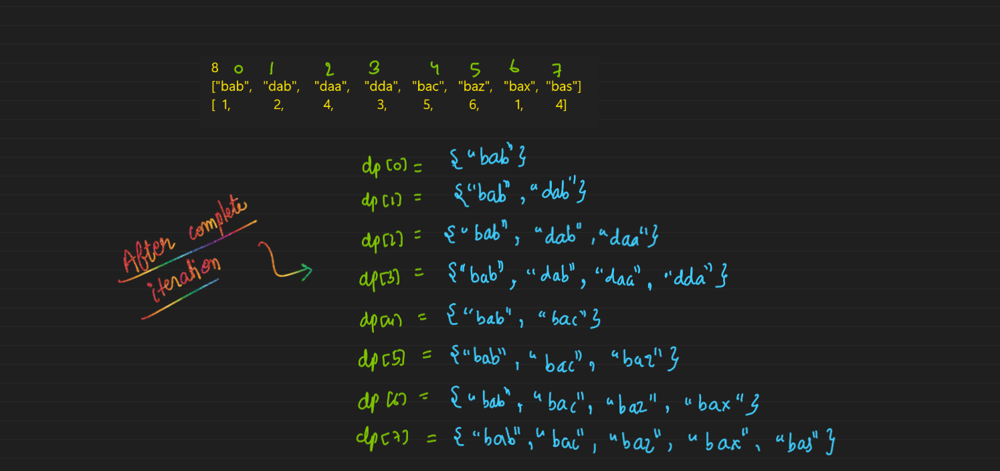

# ✅ Beginner friendly easy solution ( Image explanation)

**Author:** rishi800900
**Votes:** 26
**Link:** [https://leetcode.com/problems/longest-unequal-adjacent-groups-subsequence-ii/solutions/4168130/](https://leetcode.com/problems/longest-unequal-adjacent-groups-subsequence-ii/solutions/4168130/)

---

#### **Important:** If you want to learn and understand the patterns in problems and want to solve them using a single template you should definitely check my youtube channel by clicking my leetcode profile or search "**coding samurai**" on youtube. Template taught: sweepline, sliding window, backtracting and many more coming.......

### **Update: You may watch the video solution now on my channel for this problem.**







```
class Solution {
public:
    
  int calculate_ham_dist(string w1, string w2){
      int hamdist= 0;
      
      for (int k = 0; k < w1.size(); k++)
      {

          if (w1[k] != w2[k])
           {
                 hamdist++;
                 if (hamdist > 1) break;
           }
      }
      return hamdist;
  }
    
  vector<string> getWordsInLongestSubsequence(int n, vector<string>& words, vector<int>& groups) {
        vector<vector<string>> dp(n); // dp[i] stores the longest subsequence ending at index i

        for (int i = 0; i < n; i++) {
            dp[i].push_back(words[i]);
        }

        int maxLength = 1; // Initialize with the minimum length

        for (int i = 1; i < n; i++) {
            for (int j = 0; j < i; j++) {
                
                if (groups[j] != groups[i] && words[j].size() == words[i].size()) {  // checking the condition given in problem
                    
                    int hamDist = calculate_ham_dist(words[i], words[j]);
                
                    if (hamDist == 1)  // if all condition satisfied
                    {           
                        if (dp[j].size() + 1 > dp[i].size())   // and check whether from this index you are getting max length subsequence
                        {   
                            dp[i] = dp[j]; // Copy the longest subsequence found so far  
                            dp[i].push_back(words[i]);
                            maxLength = max(maxLength, int(dp[i].size()));
                        }
                    }
                }
            }
        }

        vector<string> longestSubsequence;
        for (int i = 0; i < n; i++) 
        {
            if (dp[i].size() == maxLength) 
            {             
                longestSubsequence = dp[i];
                break; // Break when the first longest subsequence is found
            }
        }

        return longestSubsequence;
    }
};
```