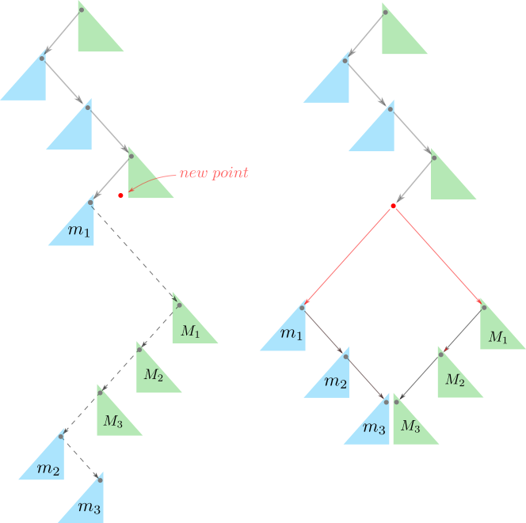

# treap avg. O(nlogn)^^

**Author:** andrii_khlevniuk
**Votes:** 0
**Link:** [https://leetcode.com/problems/maximum-profitable-triplets-with-increasing-prices-i/solutions/4215610/](https://leetcode.com/problems/maximum-profitable-triplets-with-increasing-prices-i/solutions/4215610/)

---

**avg. time: `O(nlogn)`; space: `O(n)`**



```
class Solution 
{
    struct node
    {
        node * left, * right;
        int i, b;
        node(node * left, node * right, int i, int b) : left(left), right(right), i(i), b(b) {}   
    };

    node * insert(node ** r, int i, vector<int>& price, vector<int>& profit)
    {
        int b{-1};
        for( ; *r and profit[i]<profit[(*r)->i]; ) 
            if(price[i]<=price[(*r)->i]) 
                r = &(*r)->left;
            else
            {
                if(b==-1 or profit[b]<profit[(*r)->i]) b=(*r)->i;
                r = &(*r)->right;
            }

        auto out   = new node(0,0,i,b);
        auto left  = & out->left,
             right = & out->right;
        for(auto R{r}; *R; )
            if(price[(*R)->i]<price[i])
            {
                if(b==-1 or profit[b]<profit[(*R)->i]) b=(*R)->i;
                *left  = *R;
                R      = & (*R)->right;
                left   = & (*left)->right;
            }
            else
            {
                *right = *R;
                R      = & (*R)->left;
                right  = & (*right)->left;
            }
        *left  = *right = 0;
        *r     = out;    
        out->b = b;
        return out;
    }
public:
    int maxProfit(vector<int>& price, vector<int>& profit) 
    {
        int out{-1};
        node * treap{}, * treap1{};
        auto profit1{profit};
        for(int i{}; i<size(price); ++i)
        {
            auto x = insert(&treap, i, price, profit);
            if(x->b!=-1)
            {
                profit1[i] = profit[i]+profit[x->b];
                auto y = insert(&treap1, i, price, profit1);
                if(y->b!=-1) out = max(out, profit[i]+profit1[y->b]);
            }
        }
        return out;    
    }
};
```