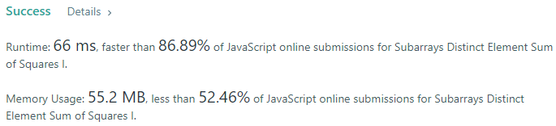
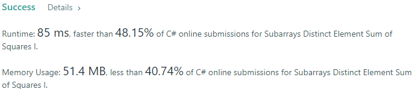
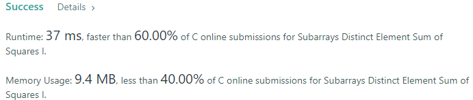
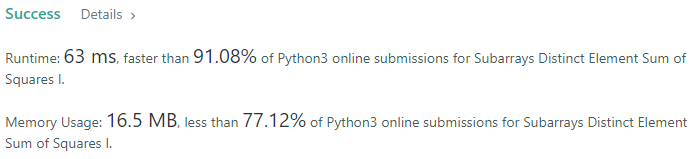
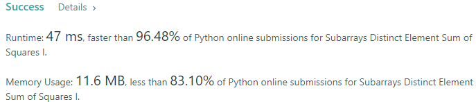
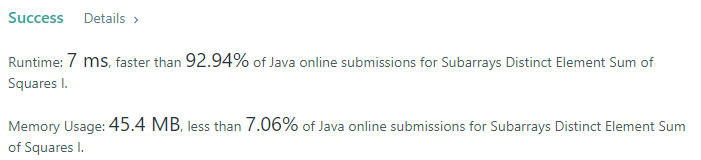

# 💢☠💫Easiest👾Faster✅💯 Lesser🧠 🎯 C++✅Python3🐍✅Java✅C✅Python🐍✅C#✅💥🔥💫Explained☠💥🔥 Beats 💯

**Author:** Edwards310
**Votes:** 4
**Link:** [https://leetcode.com/problems/subarrays-distinct-element-sum-of-squares-i/solutions/5598980/](https://leetcode.com/problems/subarrays-distinct-element-sum-of-squares-i/solutions/5598980/)

---

# Intuition







```javascript []
//JavaScript Code
/**
 * @param {number[]} nums
 * @return {number}
 */
var sumCounts = function(nums) {
    let n = nums.length;
    var ans = 0;
    for(let i = 0; i < n; ++i){
        const s = new Set();
        for(let j = i; j < n; ++j){
            s.add(nums[j]);
            ans += Math.pow(s.size, 2);
        }
    }
    return ans;
};
```
```C++ []
//C++ Code
#include <bits/stdc++.h>
using namespace std;

#define FOR(a, b, c) for (int a = b; a < c; a++)
#define FOR1(a, b, c) for (int a = b; a <= c; ++a)
#define Rep(i, n) FOR(i, 0, n)
#define Rep1(i, n) FOR1(i, 1, n)
#define RepA(ele, nums) for (auto& ele : nums)
#define usi unordered_set<int>
#define umsi unordered_map<string, int>
class Solution {
public:
    int sumCounts(vector<int>& nums) {
        ios_base::sync_with_stdio(false);
        cin.tie(NULL);
        int ans = 0;
        int n = nums.size();
        Rep(i, n) {
            usi help;
            FOR(j, i, n) {
                help.insert(nums[j]);
                ans += pow(help.size(), 2);
            }
        }
        return ans;
    }
};
```
```Python3 []
#Python3 Code
class Solution:
    def sumCounts(self, nums: List[int]) -> int:
        n = len(nums)
        result = 0
        for i in range(n):
            s = set()
            for j in range(i, n):
                s.add(nums[j])
                result += len(s) ** 2
        return result
```
```Java []
//Java Code
class Solution {
    public int sumCounts(List<Integer> nums) {
        int n = nums.size();
        int ans = 0;
        
        for(int i = 0; i < n; ++i){
            HashSet<Integer> help = new HashSet<>();
            
            for(int j = i; j < n; ++j){
                help.add(nums.get(j));
                ans += Math.pow(help.size(), 2);
            }
        }
        return ans;
    }
}
```
```C []
//C Code
int sumCounts(int* nums, int n){
    
    int res = 0;
    for(int i = 0; i < n; ++i){
        int hash[101] = {};
        for(int j = i; j < n; ++j){
            hash[nums[j]]++;
            int cnt = 0;
            for(int k = 0; k < 101; ++k)
                if(hash[k])
                    cnt++;
            res += pow(cnt, 2);
        }
    }
    return res;
}
```
```Python []
//Python Code
class Solution(object):
    def sumCounts(self, nums):
        """
        :type nums: List[int]
        :rtype: int
        """
        n = len(nums)
        res = 0
        for i in range(n):
            s = set()
            for j in range(i, n):
                s.add(nums[j])
                res += len(s) ** 2
        return res
```
```C# []
//C# Code
public class Solution {
    public int SumCounts(IList<int> nums) {
        int n = nums.Count();
        int res = 0;
        for(int i = 0; i < n; i++){
            HashSet<int> h = new HashSet<int>();
            for(int j = i; j < n; ++j){
                h.Add(nums[j]);
                res += (int)Math.Pow(h.Count(), 2);
            }
        }
        return res;
    }
}
```
<!-- Describe your first thoughts on how to solve this problem. -->

# Approach
<!-- Describe your approach to solving the problem. -->

# Complexity
- Time complexity:
<!-- Add your time complexity here, e.g. $$O(n)$$ -->
    O(N^3)
- Space complexity:
<!-- Add your space complexity here, e.g. $$O(n)$$ -->
    O(N)
# Code

