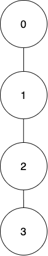
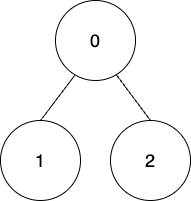

# [2920. Maximum Points After Collecting Coins From All Nodes](https://leetcode.com/problems/maximum-points-after-collecting-coins-from-all-nodes/)

| Category | Difficulty | Likes | Dislikes |
| :------: | :--------: | :---: | :------: |
| Algorithms | Hard | 232 | 18 |

**Tags:** [`array`](https://leetcode.com/tag/array), [`dynamic-programming`](https://leetcode.com/tag/dynamic-programming), [`bit-manipulation`](https://leetcode.com/tag/bit-manipulation), [`tree`](https://leetcode.com/tag/tree), [`depth-first-search`](https://leetcode.com/tag/depth-first-search), [`memoization`](https://leetcode.com/tag/memoization)

**Companies:** `de-shaw`

## Description

There exists an undirected tree rooted at node `0` with `n` nodes labeled from `0` to `n - 1`. You are given a 2D **integer** array `edges` of length `n - 1`, where `edges[i] = [a_i, b_i]` indicates that there is an edge between nodes `a_i` and `b_i` in the tree. You are also given a **0-indexed** array `coins` of size `n` where `coins[i]` indicates the number of coins in the vertex `i`, and an integer `k`.

Starting from the root, you have to collect all the coins such that the coins at a node can only be collected if the coins of its ancestors have been already collected.

Coins at `node_i` can be collected in one of the following ways:

	- Collect all the coins, but you will get `coins[i] - k` points. If `coins[i] - k` is negative then you will lose `abs(coins[i] - k)` points.

	- Collect all the coins, but you will get `floor(coins[i] / 2)` points. If this way is used, then for all the `node_j` present in the subtree of `node_i`, `coins[j]` will get reduced to `floor(coins[j] / 2)`.

Return *the **maximum points** you can get after collecting the coins from **all** the tree nodes.*

 

**Example 1:**


```

Input: edges = [[0,1],[1,2],[2,3]], coins = [10,10,3,3], k = 5
Output: 11                        
Explanation: 
Collect all the coins from node 0 using the first way. Total points = 10 - 5 = 5.
Collect all the coins from node 1 using the first way. Total points = 5 + (10 - 5) = 10.
Collect all the coins from node 2 using the second way so coins left at node 3 will be floor(3 / 2) = 1. Total points = 10 + floor(3 / 2) = 11.
Collect all the coins from node 3 using the second way. Total points = 11 + floor(1 / 2) = 11.
It can be shown that the maximum points we can get after collecting coins from all the nodes is 11. 

```

**Example 2:**

** **

```

Input: edges = [[0,1],[0,2]], coins = [8,4,4], k = 0
Output: 16
Explanation: 
Coins will be collected from all the nodes using the first way. Therefore, total points = (8 - 0) + (4 - 0) + (4 - 0) = 16.

```

 

**Constraints:**

	- `n == coins.length`

	- `2 <= n <= 10^5`

	- `0 <= coins[i] <= 10^4`

	- `edges.length == n - 1`

	- `0 <= edges[i][0], edges[i][1] < n`

	- `0 <= k <= 10^4`

---

**Links:** [Submissions](https://leetcode.com/problems/maximum-points-after-collecting-coins-from-all-nodes/) | [Solutions](https://leetcode.com/problems/maximum-points-after-collecting-coins-from-all-nodes/)
