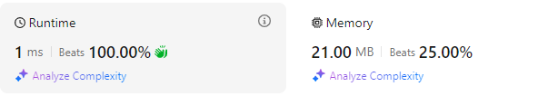

# Short and easy solution, beats 100%

**Author:** GVA-ranepa
**Votes:** 0
**Link:** [https://leetcode.com/problems/find-champion-i/solutions/6084506/](https://leetcode.com/problems/find-champion-i/solutions/6084506/)

---

# Intuition
If a team *i* is a chamion then sum of corresponding array *grid[i]* will be equal to (count(grid)-1).

# Approach
Iterate through grid until we find an array with *n-1* ones in it.




# Code
```php []
function findChampion($grid) {
    $n = count($grid);
    for ($i=0;$i<$n;$i++){
        if (array_sum($grid[$i]) == $n-1) return $i;
    }
}
```