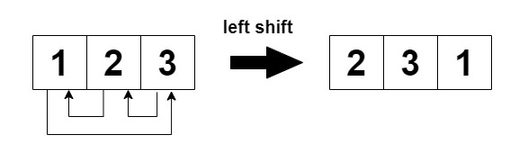
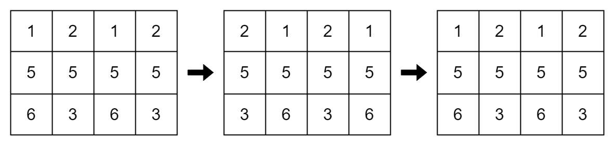

# [2946. Matrix Similarity After Cyclic Shifts](https://leetcode.com/problems/matrix-similarity-after-cyclic-shifts/)

| Category | Difficulty | Likes | Dislikes |
| :------: | :--------: | :---: | :------: |
| Algorithms | Easy | 192 | 68 |

**Tags:** [`array`](https://leetcode.com/tag/array), [`math`](https://leetcode.com/tag/math), [`matrix`](https://leetcode.com/tag/matrix), [`simulation`](https://leetcode.com/tag/simulation)

**Companies:** `salesforce`

## Description

You are given an `m x n` integer matrix `mat` and an integer `k`. The matrix rows are 0-indexed.

The following proccess happens `k` times:

	- **Even-indexed** rows (0, 2, 4, ...) are cyclically shifted to the left.

	- **Odd-indexed** rows (1, 3, 5, ...) are cyclically shifted to the right.

Return `true` if the final modified matrix after `k` steps is identical to the original matrix, and `false` otherwise.

 

**Example 1:**

**Input:** mat = [[1,2,3],[4,5,6],[7,8,9]], k = 4

**Output:** false

**Explanation:**

In each step left shift is applied to rows 0 and 2 (even indices), and right shift to row 1 (odd index).

**Example 2:**

**Input:** mat = [[1,2,1,2],[5,5,5,5],[6,3,6,3]], k = 2

**Output:** true

**Explanation:**

**Example 3:**

**Input:** mat = [[2,2],[2,2]], k = 3

**Output:** true

**Explanation:**

As all the values are equal in the matrix, even after performing cyclic shifts the matrix will remain the same.

 

**Constraints:**

	- `1 <= mat.length <= 25`

	- `1 <= mat[i].length <= 25`

	- `1 <= mat[i][j] <= 25`

	- `1 <= k <= 50`

---

**Links:** [Submissions](https://leetcode.com/problems/matrix-similarity-after-cyclic-shifts/) | [Solutions](https://leetcode.com/problems/matrix-similarity-after-cyclic-shifts/)
