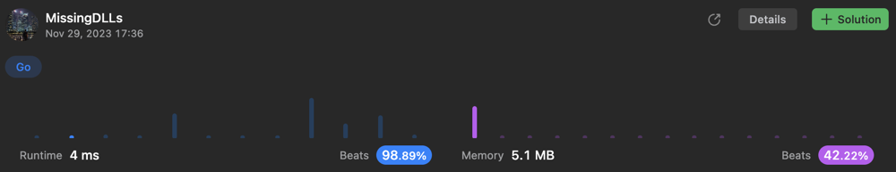

# Golang O(N ^ 2) solution with index comparison (98.89% Runtime)

**Author:** MissingDLLs
**Votes:** 1
**Link:** [https://leetcode.com/problems/matrix-similarity-after-cyclic-shifts/solutions/4342217/](https://leetcode.com/problems/matrix-similarity-after-cyclic-shifts/solutions/4342217/)

---

# Intuition
<!-- Describe your first thoughts on how to solve this problem. -->

Reduce k to "k % len(column)". Then compare elements with shifted indexes

# Approach
<!-- Describe your approach to solving the problem. -->
- K can be larger than column length. Thus change k to k % len(column)
- Define two column indexes:
  - Index j will be normal index starts with 0
  - Index "idx" means shifted index based on row's index
- Perform elementwise comparison between two indexes:
  - If row index is even (left shift), "idx" starts from k 
  - If row index is odd (right shift), "idx" starts from n - k

# Complexity
- Time complexity: O(N ^ 2)
<!-- Add your time complexity here, e.g. $$O(n)$$ -->

- Space complexity: O(1)
<!-- Add your space complexity here, e.g. $$O(n)$$ -->

# Code
If this solution is similar to yours or helpful, upvote me if you don't mind
```
func areSimilar(mat [][]int, k int) bool {
    n := len(mat[0])
    k = k % n
    idx := k

    for i, row := range(mat) {
        if i % 2 == 1 {
            idx = n - k
        } else {
            idx = k
        }
        for j := 0; j < n; j++ {
            if row[j] != row[idx % n] {
                return false
            }
            idx += 1
        }
    }

    return true
}
```