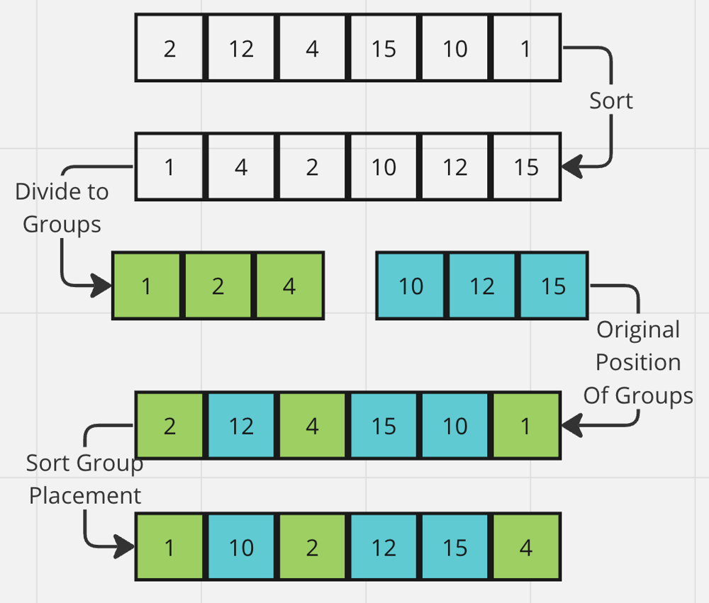

# 🥇 C++ | PYTHON | JAVA || EXPLAINED || ; ] ✅

**Author:** karan_8082
**Votes:** 62
**Link:** [https://leetcode.com/problems/make-lexicographically-smallest-array-by-swapping-elements/solutions/4330616/](https://leetcode.com/problems/make-lexicographically-smallest-array-by-swapping-elements/solutions/4330616/)

---

**UPVOTE IF HELPFuuL**

# Intuition
- We have to make the array lexicographically smallest by swapping elements.
- Only Those elements can be swapped whose difference is ```<= limit```
- We can form subarrays [By removing elements from orginal array] such that 
- - Difference between successive elements is ```<=k```
- - Array is sorted in ```non-dreasing``` order
- - No ```2 subarray``` should have a common element.

- Then we can combine all subarrays keeping their relative position to original array same.

# Approach
We create Tuples ```[array[i], index_of(array[i]) -> i]``` -> ```[a[i], i]```
* We sort array in ```non-decreasing``` manner.
* Then group the elements such that difference to its neighbor is ```<=k```

We get certain ``sorted`` groups.
For result to be in ``lexicographically`` smallest condition, elements in result should occur in same manner as they occur in groups.
With the help of ``index`` stored in tuples, we re-arrange elements in original array.

Example 
``Division into groups is done on basis of differnce <= limit``
``We kept the indexes stored to make replacements in final array``



# Complexity
- Time complexity:
<!-- Add your time complexity here, e.g. $$O(n)$$ -->

- Space complexity:
<!-- Add your space complexity here, e.g. $$O(n)$$ -->

```Python []
class Solution:
    def lexicographicallySmallestArray(self, a: List[int], k: int) -> List[int]:
        b = []
        n = len(a)
        for i in range(n):
            b.append((a[i],i))
        b = sorted(b,key=lambda x: x[0])
        
        c = [[b[0]]]
        for i in range(1,n):
            if b[i][0]-b[i-1][0] <= k:
                c[-1].append(b[i])
            else:
                c.append([b[i]])
        for t in c:
            ind = []
            for x,y in t:
                ind.append(y)
            ind.sort()
            for i in range(len(ind)):
                a[ind[i]] = t[i][0]
        return a
```
```C++ []
class Solution {
public:
    vector<int> lexicographicallySmallestArray(vector<int>& nums, int limit) {
        vector<pair<int, int>> b;
        int n = nums.size();

        for (int i = 0; i < n; ++i)
            b.push_back(make_pair(nums[i], i));

        sort(b.begin(), b.end(), [](const auto& x, const auto& y) {
            return x.first < y.first;
        });
        vector<vector<pair<int, int>>> c = {{b[0]}};

        for (int i = 1; i < n; ++i) {
            if (b[i].first - b[i - 1].first <= limit)
                c.back().push_back(b[i]);
            else
                c.push_back({b[i]});
        }

        for (const auto& t : c) {
            vector<int> ind;
            for (const auto& p : t)
                ind.push_back(p.second);
            sort(ind.begin(), ind.end());

            for (int i = 0; i < ind.size(); ++i)
                nums[ind[i]] = t[i].first;
        }
        return nums;
    }
};
```
```JAVA []
public class Solution {
    public static class Pair {
        int element;
        int index;

        Pair(int element, int index) {
            this.element = element;
            this.index = index;
        }
    }
    public int[] lexicographicallySmallestArray(int[] nums, int limit) {
        int n = nums.length;
        List<Pair> pairs = new ArrayList<>();
        for (int i = 0; i < n; ++i) 
            pairs.add(new Pair(nums[i], i));
        pairs.sort(Comparator.comparingInt(p -> p.element));

        List<List<Pair>> result = new ArrayList<>();
        result.add(new ArrayList<>(Arrays.asList(pairs.get(0))));

        for (int i = 1; i < n; ++i) {
            if (pairs.get(i).element - pairs.get(i - 1).element <= limit)
                result.get(result.size() - 1).add(pairs.get(i));
            else
                result.add(new ArrayList<>(Arrays.asList(pairs.get(i))));
        }

        for (List<Pair> group : result) {
            List<Pair> sortedGroup = new ArrayList<>(group);
            sortedGroup.sort(Comparator.comparingInt(p -> p.index));

            for (int i = 0; i < group.size(); ++i)
                nums[sortedGroup.get(i).index] = group.get(i).element;
        }
        return nums;
    }
}

```

