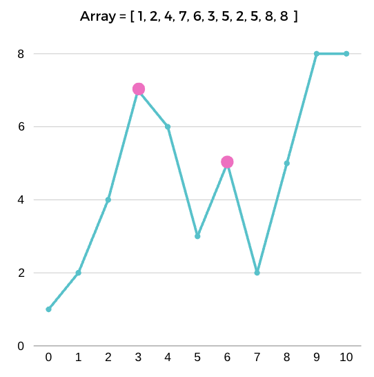

# 🥇 Simple Check | C++ | PYTHON | JAVA ; ] ✅

**Author:** karan_8082
**Votes:** 14
**Link:** [https://leetcode.com/problems/find-the-peaks/solutions/4356057/](https://leetcode.com/problems/find-the-peaks/solutions/4356057/)

---

# Approach

A peak occurs where an index has higher value than its neighbours.
Also endpoints do not form a peak.

`mountain[i] > mountain[i-1] && mountain[i] > mountain[i+1]`




# Complexity
- Time complexity:
<!-- Add your time complexity here, e.g. $$O(n)$$ -->

- Space complexity:
<!-- Add your space complexity here, e.g. $$O(n)$$ -->

# Code
``` C++ []
class Solution {
public:
    vector<int> findPeaks(vector<int>& mountain) {
        vector<int> res;
        for (int i = 1; i < mountain.size() - 1; ++i) {
            if (mountain[i] > mountain[i - 1] && mountain[i] > mountain[i + 1]) {
                res.push_back(i);
            }
        }
        return res;
    }
};
```
``` Python []
class Solution:
    def findPeaks(self, a: List[int]) -> List[int]:
        res = []
        for i in range(1,len(a)-1):
            if a[i]>a[i-1] and a[i]>a[i+1]:
                res.append(i)
        return res
```
``` JAVA []
class Solution {
    public List<Integer> findPeaks(int[] mountain) {
        List<Integer> res = new ArrayList<>();
        for (int i = 1; i < mountain.length - 1; ++i) {
            if (mountain[i] > mountain[i - 1] && mountain[i] > mountain[i + 1]) {
                res.add(i);
            }
        }
        return res;
    }
}
```


