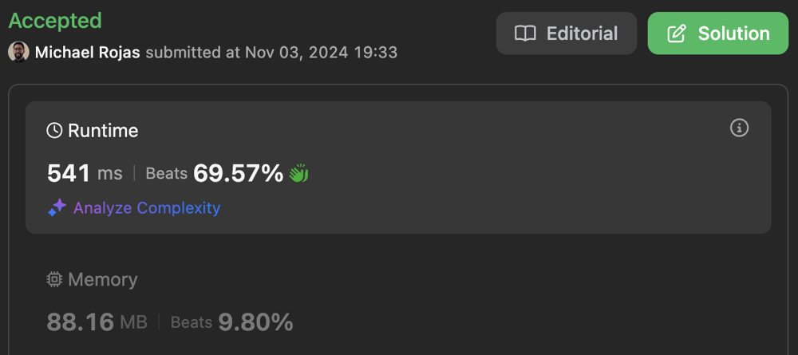
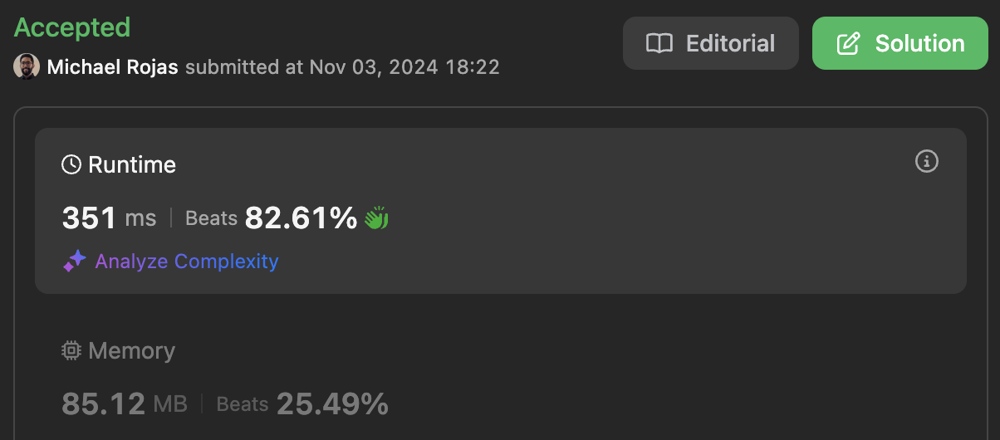

# 100% | 4 Solutions | Time: O(N + Q) | Space: O(N)

**Author:** rojas
**Votes:** 0
**Link:** [https://leetcode.com/problems/number-of-same-end-substrings/solutions/6003582/](https://leetcode.com/problems/number-of-same-end-substrings/solutions/6003582/)

---

# Table of Contents

[toc]

# Brute Force

## Complexity

- Time complexity: $$O(NQ)$$

- Space complexity: $$O(1)$$

## Performance

Time Limit Exceeded

## Code

```typescript []
const ALPHABET_LEN = 26;
const ALPHABET_MIN = 97;

function sameEndSubstringCount(s: string, queries: number[][]): number[] {
    const freqs: number[] = new Array(ALPHABET_LEN);
    const output: number[] = new Array(queries.length);
    for (let q = 0; q < queries.length; ++q) {
        const [left, right] = queries[q];
        
        freqs.fill(0);
        let numSameEnds = 0;
        for (let i = left; i <= right; ++i) {
            numSameEnds += ++freqs[s.charCodeAt(i) - ALPHABET_MIN];
        }

        output[q] = numSameEnds;
    }
    return output;
};
```

```javascript []
const ALPHABET_LEN = 26;
const ALPHABET_MIN = 97;

function sameEndSubstringCount(s, queries) {
    const freqs = new Array(ALPHABET_LEN);
    const output = new Array(queries.length);
    for (let q = 0; q < queries.length; ++q) {
        const [left, right] = queries[q];

        freqs.fill(0);
        let numSameEnds = 0;
        for (let i = left; i <= right; ++i) {
            numSameEnds += ++freqs[s.charCodeAt(i) - ALPHABET_MIN];
        }

        output[q] = numSameEnds;
    }
    return output;
};
```

# Segment Trees

## Complexity

- Time complexity: $$O((N + Q)\\log{N})$$

- Space complexity: $$O(N)$$

## Performance

[JavaScript](https://leetcode.com/problems/number-of-same-end-substrings/submissions/1442222584/)



## Code

```typescript []
const ALPHABET_LEN = 26;
const ALPHABET_MIN = 97;

function sameEndSubstringCount(s: string, queries: number[][]): number[] {
    const N = s.length;

    // Initialize Segment Trees
    const segTrees: SegmentTree[] = new Array(ALPHABET_LEN);
    for (let code = 0; code < ALPHABET_LEN; ++code) {
        segTrees[code] = new SegmentTree(N);
    }

    // Populate Segment Trees
    for (let i = 0; i < N; ++i) {
        segTrees[s.charCodeAt(i) - ALPHABET_MIN].add(i, 1);
    }

    // For each query
    const output: number[] = new Array(queries.length);
    for (let q = 0; q < queries.length; ++q) {
        const [left, right] = queries[q];

        // Find same-end substrings per letter
        let numSameEnds = 0;
        for (const seg of segTrees) {
            const count = seg.query(left, right+1);
            numSameEnds += (count * (count + 1)) >> 1;
        }

        output[q] = numSameEnds;
    }

    // Submit query responses
    return output;
};

class SegmentTree {
    private _min: number;
    private _sums: number[];

    constructor(N: number) {
        this._min = 1 << Math.ceil(Math.log2(N));
        this._sums = new Array(this._min + N).fill(0);
    }

    add(i: number, val: number): void {
        for (i += this._min; i > 0; i >>= 1) {
            this._sums[i] += val;
        }
    }

    query(left: number, right: number): number {
        left += this._min;
        right += this._min;

        let sum = 0;
        while (left < right) {
            sum += ((left & 1) > 0) ? this._sums[left++] : 0;
            sum += ((right & 1) > 0) ? this._sums[--right] : 0;
            left >>= 1;
            right >>= 1;
        }

        return sum;
    }
}
```

```javascript []
const ALPHABET_LEN = 26;
const ALPHABET_MIN = 97;

/**
 * @param {string} s
 * @param {number[][]} queries
 * @return {number[]}
 */
function sameEndSubstringCount(s, queries) {
    // Initialize Segment Trees
    const segTrees = new Array(ALPHABET_LEN);
    for (let code = 0; code < ALPHABET_LEN; ++code) {
        segTrees[code] = new SegmentTree(s.length);
    }

    // Populate Segment Trees
    for (let i = 0; i < s.length; ++i) {
        segTrees[s.charCodeAt(i) - ALPHABET_MIN].add(i, 1);
    }

    // For each query
    const output = new Array(queries.length);
    for (let q = 0; q < queries.length; ++q) {
        const [left, right] = queries[q];

        // Find same-end substrings per letter
        let numSameEnds = 0;
        for (const seg of segTrees) {
            const count = seg.query(left, right+1);
            numSameEnds += (count * (count + 1)) >> 1;
        }

        output[q] = numSameEnds;
    }

    // Submit query responses
    return output;
};

class SegmentTree {

    constructor(N) {
        this._min = 1 << Math.ceil(Math.log2(N));
        this._sums = new Array(this._min + N).fill(0);
    }

    add(i, val) {
        for (i += this._min; i > 0; i >>= 1) {
            this._sums[i] += val;
        }
    }

    query(left, right) {
        left += this._min;
        right += this._min;

        let sum = 0;
        while (left < right) {
            sum += (left & 1) ? this._sums[left++] : 0;
            sum += (right & 1) ? this._sums[--right] : 0;
            left >>= 1;
            right >>= 1;
        }

        return sum;
    }
}
```

# Binary Indexed Trees

## Complexity

- Time complexity: $$O((N + Q)\\log{N})$$

- Space complexity: $$O(N)$$

## Performance

[JavaScript](https://leetcode.com/problems/number-of-same-end-substrings/submissions/1442187395/)



## Code

```typescript []
const ALPHABET_LEN = 26;
const ALPHABET_MIN = 97;

function sameEndSubstringCount(s: string, queries: number[][]): number[] {
    // Initialize BITs
    const bits: BIT[] = new Array(ALPHABET_LEN);
    for (let code = 0; code < ALPHABET_LEN; ++code) {
        bits[code] = new BIT(s.length);
    }

    // Populate BITs
    for (let i = 0; i < s.length; ++i) {
        bits[s.charCodeAt(i) - ALPHABET_MIN].add(i, 1);
    }

    // For each query
    const output: number[] = new Array(queries.length);
    for (let q = 0; q < queries.length; ++q) {
        const [left, right] = queries[q];

        // Find same-end substrings per letter
        let numSameEnds = 0;
        for (const bit of bits) {
            const count = bit.range(left-1, right);
            numSameEnds += (count * (count + 1)) >> 1;
        }

        output[q] = numSameEnds;
    }

    // Submit query responses
    return output;
};

class BIT {
    protected _values: number[];

    constructor(N: number) {
        this._values = new Array(N + 1).fill(0);
    }

    add(index: number, value: number): void {
        if (++index <= 0) {
            return;
        }
        while (index < this._values.length) {
            this._values[index] += value;
            index += index & (-index);
        }
    }

    query(index: number): number {
        if (++index >= this._values.length) {
            index = this._values.length - 1;
        }
        let sum = 0;
        while (index > 0) {
            sum += this._values[index];
            index -= index & (-index);
        }
        return sum;
    }

    range(left: number, right: number): number {
        return this.query(right) - this.query(left);
    }
}
```

```javascript []
const ALPHABET_LEN = 26;
const ALPHABET_MIN = 97;

/**
 * @param {string} s
 * @param {number[][]} queries
 * @return {number[]}
 */
function sameEndSubstringCount(s, queries) {
    // Initialize BITs
    const bits = new Array(ALPHABET_LEN);
    for (let code = 0; code < ALPHABET_LEN; ++code) {
        bits[code] = new BIT(s.length);
    }

    // Populate BITs
    for (let i = 0; i < s.length; ++i) {
        bits[s.charCodeAt(i) - ALPHABET_MIN].add(i, 1);
    }

    // For each query
    const output = new Array(queries.length);
    for (let q = 0; q < queries.length; ++q) {
        const [left, right] = queries[q];

        // Find same-end substrings per letter
        let numSameEnds = 0;
        for (const bit of bits) {
            const count = bit.range(left-1, right);
            numSameEnds += (count * (count + 1)) >> 1;
        }

        output[q] = numSameEnds;
    }

    // Submit query responses
    return output;
};

class BIT {
    constructor(N) {
        this._values = new Array(N + 1).fill(0);
    }

    add(index, value) {
        if (++index <= 0) {
            return;
        }
        while (index < this._values.length) {
            this._values[index] += value;
            index += index & (-index);
        }
    }

    query(index) {
        if (++index >= this._values.length) {
            index = this._values.length - 1;
        }
        let sum = 0;
        while (index > 0) {
            sum += this._values[index];
            index -= index & (-index);
        }
        return sum;
    }

    range(left, right) {
        return this.query(right) - this.query(left);
    }
}
```

# Prefix Sums

## Complexity

- Time complexity: $$O(N + Q)$$

- Space complexity: $$O(N)$$

## Performance

[JavaScript](https://leetcode.com/problems/number-of-same-end-substrings/submissions/1442228083/)


## Code

```typescript []
const ALPHABET_LEN = 26;
const ALPHABET_MIN = 97;

function sameEndSubstringCount(s: string, queries: number[][]): number[] {
    // Initialize prefix sums
    const N = s.length;
    const prefixSums: number[][] = new Array(ALPHABET_LEN);
    for (let i = 0; i < ALPHABET_LEN; ++i) {
        prefixSums[i] = new Array(N + 1).fill(0);
    }

    // Populate prefix sums
    for (let i = 0; i < N; ++i) {
        ++prefixSums[s.charCodeAt(i) - ALPHABET_MIN][i+1];
        for (const sums of prefixSums) {
            sums[i+1] += sums[i];
        }
    }

    // For each query
    const output: number[] = new Array(queries.length);
    for (let q = 0; q < queries.length; ++q) {
        const [left, right] = queries[q];

        // Find same-end substrings per letter
        let numSameEnds = 0;
        for (const sums of prefixSums) {
            const sum = sums[right+1] - sums[left];
            numSameEnds += (sum * (sum + 1)) >> 1;
        }

        // Save count
        output[q] = numSameEnds;
    }

    // Submit query responses
    return output;
};
```

```javascript []
const ALPHABET_LEN = 26;
const ALPHABET_MIN = 97;

/**
 * @param {string} s
 * @param {number[][]} queries
 * @return {number[]}
 */
function sameEndSubstringCount(s, queries) {
    // Initialize prefix sums
    const N = s.length;
    const prefixSums = new Array(ALPHABET_LEN);
    for (let i = 0; i < ALPHABET_LEN; ++i) {
        prefixSums[i] = new Array(N + 1).fill(0);
    }

    // Populate prefix sums
    for (let i = 0; i < N; ++i) {
        ++prefixSums[s.charCodeAt(i) - ALPHABET_MIN][i+1];
        for (const sums of prefixSums) {
            sums[i+1] += sums[i];
        }
    }

    // For each query
    const output = new Array(queries.length);
    for (let q = 0; q < queries.length; ++q) {
        const [left, right] = queries[q];

        // Find same-end substrings per letter
        let numSameEnds = 0;
        for (const sums of prefixSums) {
            const sum = sums[right+1] - sums[left];
            numSameEnds += (sum * (sum + 1)) >> 1;
        }

        // Save count
        output[q] = numSameEnds;
    }

    // Submit query responses
    return output;
};
```