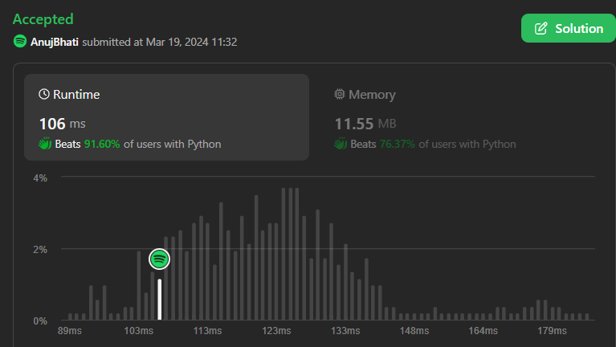
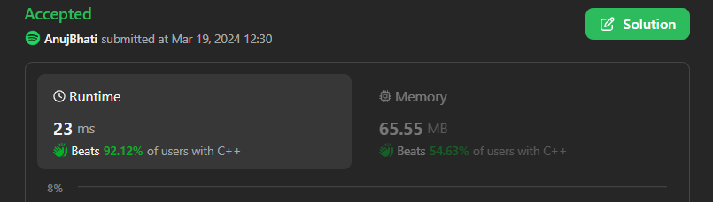
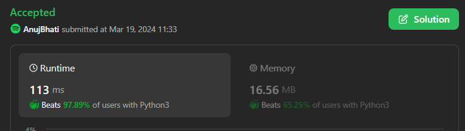
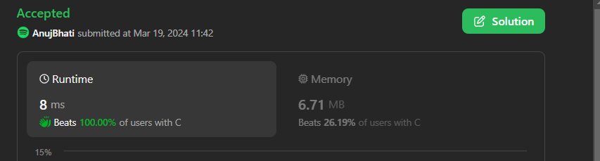

# Easiest [C++/Python3/C#/Python/Java ] Solutions beats 100% Only logic ...

**Author:** Edwards310
**Votes:** 3
**Link:** [https://leetcode.com/problems/find-common-elements-between-two-arrays/solutions/4895993/](https://leetcode.com/problems/find-common-elements-between-two-arrays/solutions/4895993/)

---

# Intuition





```C++ []
class Solution {
public:
    vector<int> findIntersectionValues(vector<int>& nums1, vector<int>& nums2) {
        unordered_set<int> set1(nums1.begin(), nums1.end());
        unordered_set<int> set2(nums2.begin(), nums2.end());
        int count1 = 0, count2 = 0;
        for (auto& num : nums1)
            count1 += set2.count(num);
        for (auto& num : nums2)
            count2 += set1.count(num);
        return {count1, count2};
    }
};
```
```python3 []
class Solution:
    def findIntersectionValues(self, nums1: List[int], nums2: List[int]) -> List[int]:
        set1 = set(nums1)
        set2 = set(nums2)

        first = 0
        for num in nums1:
            if num in set2:
                first += 1
        
        second = 0 
        for num in nums2:
            if num in set1:
                second += 1
        

        return [first, second]
```
```C# []
public class Solution
{
    public int[] FindIntersectionValues(int[] nums1, int[] nums2)
    {
        var set1 = new HashSet<int>(nums1);
        var set2 = new HashSet<int>(nums2);
        return new[] {nums1.Count(x => set2.Contains(x)), nums2.Count(x => set1.Contains(x))};
    }
}
```
```Java []
class Solution {
    public int[] findIntersectionValues(int[] nums1, int[] nums2) {
        int[] res = new int[2];
        int val1 = 0, val2 = 0;
        for (int i = 0; i < nums1.length; ++i) {
            for (int j = 0; j < nums2.length; j++)
                if (nums1[i] == nums2[j]) {
                    val1++;
                    break;
                }
        }
        for (int i = 0; i < nums2.length; ++i) {
            for (int j = 0; j < nums1.length; j++)
                if (nums2[i] == nums1[j]) {
                    val2++;
                    break;
                }
        }
        res[0] = val1;
        res[1] = val2;
        return res;
    }
}
```
```C++ []
class Solution {
public:
    vector<int> findIntersectionValues(vector<int>& nums1, vector<int>& nums2) {
        vector<int> f1(101, 0);
        vector<int> f2(101, 0);
        for (int i = 0; i < nums1.size(); i++)
            f1[nums1[i]]++;
        for (int i = 0; i < nums2.size(); i++)
            f2[nums2[i]]++;
    
        vector<int> result(2, 0);
        for (int i = 1; i < 101; i++) {
            if (f1[i] && f2[i]) {
                result[0] += f1[i];
                result[1] += f2[i];
            }
        }
        return result;
    }
};
```
```python []
class Solution(object):
    def findIntersectionValues(self, nums1, nums2):
        """
        :type nums1: List[int]
        :type nums2: List[int]
        :rtype: List[int]
        """
        s1 = set(nums1)
        s2 = set(nums2)
        cnt1 = cnt2 = 0
        for x in nums1:
            if x in s2:
                cnt1 += 1
        for y in nums2:
            if y in s1:
                cnt2 += 1
        lst = [0] * 2
        lst[0] = cnt1
        lst[1] = cnt2
        return lst
```
```C []
/**
 * Note: The returned array must be malloced, assume caller calls free().
 */
int* findIntersectionValues(int* nums1, int nums1Size, int* nums2, int nums2Size, int* returnSize) {
    bool set1[101] = {};
    bool set2[101] = {};
    for (int i = 0; i < nums1Size; i++)
        set1[nums1[i]] = true;
    for (int i = 0; i < nums2Size; i++)
        set2[nums2[i]] = true;
    int* res = (int*)malloc(sizeof(int) * 2);
    int cnt1 = 0, cnt2 = 0;
    for (int i = 0; i < nums1Size; i++)
        if (set2[nums1[i]] == true)
            cnt1++;

    for (int i = 0; i < nums2Size; i++)
        if (set1[nums2[i]] == true)
            cnt2++;
    res[0] = cnt1;
    res[1] = cnt2;
    *returnSize  = 2;
    return res;
    free(res);
}
```

<!-- Describe your first thoughts on how to solve this problem. -->

# Approach
<!-- Describe your approach to solving the problem. -->
 Approach is very simple just make two sets of nums1 & nums2 so that the duplicates removed .. Then iterate over nums1 and check if the number is present in set2 or not if present increase count by 1 ... finally resulting array of size . set the res[0] = to that count variable .. Similary take another variable cnt2 iterate over nums2 and check for every element in set1 if true increase cnt2 by 1 .. finally set res[1] = cnt2 and return result
# Complexity
- Time complexity:
<!-- Add your time complexity here, e.g. $$O(n)$$ -->
    O(n)
- Space complexity:
<!-- Add your space complexity here, e.g. $$O(n)$$ -->
    O(101) --> O(1)
# Code
```
public class Solution
{
    public int[] FindIntersectionValues(int[] nums1, int[] nums2)
    {
        var set1 = new HashSet<int>(nums1);
        var set2 = new HashSet<int>(nums2);
        return new[] {nums1.Count(x => set2.Contains(x)), nums2.Count(x => set1.Contains(x))};
    }
}
```
# Please upvote if my solution helps you to solve or understand any part of the code .. Your like motivates me to do better .. Thanks 

