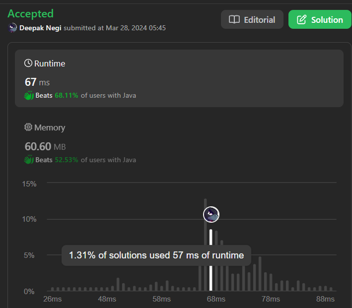

# ✅ Conquering Subarrays: Find the Longest Good Sequence with Frequency Limits! ✅✅🔥🔥

**Author:** Hunter_0718
**Votes:** 13
**Link:** [https://leetcode.com/problems/length-of-longest-subarray-with-at-most-k-frequency/solutions/4934988/](https://leetcode.com/problems/length-of-longest-subarray-with-at-most-k-frequency/solutions/4934988/)

---




**Intuition:**

The problem asks us to find the longest subarray where each element's frequency is less than or equal to `k`. We can solve this efficiently using a sliding window technique with a frequency tracker.

Here's the thought process:

1. We can imagine a window that slides across the array, keeping track of the elements within it.
2. As the window moves, we maintain a dictionary (unordered_map) to store the frequencies of each element encountered so far within the window.
3. A good subarray is one where all element frequencies are less than or equal to `k`.
4. We'll use two pointers, `i` and `j`, to define the window's boundaries (`i` for the start and `j` for the end).
5. We'll iterate through the array, expanding the window to the right using `j`.
6. While expanding, we'll update the frequency map for the newly added element.
7. If the current window becomes invalid (any element's frequency exceeds `k`), we'll shrink it from the left side using `i`, removing elements and updating their frequencies until it becomes valid again.
8. At each step, we'll keep track of the maximum length of a valid subarray encountered so far.

**Approach:**

1. **Sliding Window with Frequency Tracker:**
   - Use a sliding window approach to iterate through the array.
   - Maintain a dictionary (unordered_map) named `freq` to track the frequency of each element encountered within the window.
   - Two pointers, `i` and `j`, define the window's boundaries (left and right endpoints).
   - Initialize `i`, `j`, and `ans` (maximum length) to 0.

2. **Iterate and Expand Window:**
   - While `j` (right pointer) is less than the array's length (`n`):
     - Add the current element (`nums[j]`) to the frequency map `freq`. Increment its count if it already exists.
     - Update `j` to expand the window to the right.

3. **Shrink Window if Invalid:**
   - While any element's frequency in `freq` is greater than `k`:
     - Remove the leftmost element (`nums[i]`) from the window by decrementing its frequency in `freq`. If its frequency becomes zero, remove it from the map completely.
     - Update `i` to shrink the window from the left.

4. **Update Maximum Length:**
   - After potentially shrinking the window, check if the current window is valid (all frequencies <= `k`).
   - If the current window is valid, calculate its length (`j - i + 1`) and update `ans` (maximum length) if it's greater than the current maximum.

5. **Return Maximum Length:**
   - After iterating through the entire array, return the value of `ans` which holds the length of the longest good subarray found.

**Time Complexity:**

- **O(n)**: The algorithm iterates through the array once using a single loop with `j` as the iterator. Inside the loop, the potential shrinking operation (`while` loop) also has a worst-case time complexity of O(n) in case all elements need to be removed. However, on average, it's expected to be much less than `n`. Overall, the time complexity remains linear.

**Space Complexity:**

- **O(n)**: The `freq` dictionary stores the frequencies of elements in the current window. In the worst case, it might hold all unique elements in the array, leading to a space complexity of O(n).

**Code :**

```C++ []
class Solution {
public:
    int maxSubarrayLength(vector<int>& nums, int k) {
        unordered_map<int,int>freq;
        int n = nums.size();
        int ans = 0;
        int i=0,j=0;
        while(j < n){
            freq[nums[j]]++;
            while(freq[nums[j]] > k){
                freq[nums[i]]--;
                i++;
            }
            ans = max(ans, j-i+1);
            j++;
        }
        return ans;
    }
};
```
```Java []
class Solution {
    public int maxSubarrayLength(int[] nums, int k) {
        HashMap<Integer,Integer> freq = new HashMap<>();
        int n = nums.length;
        int ans = 0;
        int i=0,j=0;
        while(j<n){
            freq.put(nums[j],freq.getOrDefault(nums[j],0) +1);
            while(freq.get(nums[j] )> k){
                freq.put(nums[i],freq.get(nums[i]) -1);
                i++;
            }
            ans = Math.max(ans,j-i+1);
            j++;
        }
        return ans;
    }
}
```
```Python3 []
class Solution:
    def maxSubarrayLength(self, nums: List[int], k: int) -> int:
        freq = {}
        n = len(nums)
        ans = 0
        i = 0
        j = 0
        while j < n:
            freq[nums[j]] = freq.get(nums[j], 0) + 1
            while freq[nums[j]] > k:
                freq[nums[i]] -= 1
                i += 1
            ans = max(ans, j - i + 1)
            j += 1
        return ans

```
```Kotlin []
class Solution {
    fun maxSubarrayLength(nums: IntArray, k: Int): Int {
        val freq = HashMap<Int, Int>()
        val n = nums.size
        var ans = 0
        var i = 0
        var j = 0
        while (j < n) {
            freq[nums[j]] = freq.getOrDefault(nums[j], 0) + 1
            while (freq[nums[j]]!! > k) {
                freq[nums[i]] = freq[nums[i]]!! - 1
                i++
            }
            ans = Math.max(ans, j - i + 1)
            j++
        }
        return ans
    }
}
```
```JavaScript []
/**
 * @param {number[]} nums
 * @param {number} k
 * @return {number}
 */
var maxSubarrayLength = function(nums, k) {
    const freq = {};
    const n = nums.length;
    let ans = 0;
    let i = 0;
    let j = 0;
    while (j < n) {
        freq[nums[j]] = (freq[nums[j]] || 0) + 1;
        while (freq[nums[j]] > k) {
            freq[nums[i]]--;
            i++;
        }
        ans = Math.max(ans, j - i + 1);
        j++;
    }
    return ans;
};
```


