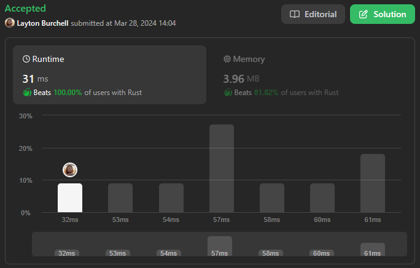

# RUST 31ms 🦀- Beats💯Time 💯Memory - Sliding window and maintain counts

**Author:** LaytonGB
**Votes:** 1
**Link:** [https://leetcode.com/problems/length-of-longest-subarray-with-at-most-k-frequency/solutions/4937987/](https://leetcode.com/problems/length-of-longest-subarray-with-at-most-k-frequency/solutions/4937987/)

---

[](https://leetcode.com/problems/length-of-longest-subarray-with-at-most-k-frequency/submissions/1216419417)

# Intuition
The problem requires a slice of the array where every number in the range is included, hence we probably need a low pointer and a high pointer to maintain the start and end of our slice.

If at all possible, maintaining a list of counts that adjusts with the movements of our high and low pointers would be much more efficient than recalculating our counts at each step.

The length of our slice can then be calculated using the pointer positions whenever our counts all `<= k`, which could give us our final answer.

# Approach
Ideally we would keep track of the counts within the slice using a list, but since the max value of any `num[i]` is $$10^9$$ a list of that size will be overwhelming, so we will need to use a HashMap instead.

If every value of `nums` is unique we can determine the maximum size we will need the HashMap to be, and we can tell Rust this size with the `HashMap::with_capacity` method to reduce memory usage.

Our high pointer will always be incrementing, so we can have that iterated by a for-loop. Out low pointer, on the other hand, is only going to increment when a count has gone beyond `k`, and so we must declare that separately.

1. Iterate `h` through `0..n`, adding `1` to each `nums[h]` as stored in our `counts` HashMap.
2. If the count we just added to is now greater than `k`, we need to reduce that count. However, pointer `l` might not be on the same value, so we repeat the following loop:
    1. Reduce the count of the value at `nums[l]`
    2. Increment `l`
    3. If `l` has reached `h`, or we reduced the count of `nums[h]` at all, break.
4. Find the length of our current slice. If it is longer than the length we had stored, keep it.
5. Return stored slice length.

# Complexity
- Time complexity: $$O(n)$$
- Space complexity: $$O(n)$$

# Code
```
use std::collections::HashMap;
impl Solution {
    pub fn max_subarray_length(nums: Vec<i32>, k: i32) -> i32 {        
        let mut res = 0;
        let mut counts = HashMap::with_capacity(nums.len());
        let mut l = 0;
        for h in 0..nums.len() {
            let num_h = nums[h];
            let new_count = *counts.entry(num_h)
                .and_modify(|e| *e += 1)
                .or_insert(1);

            if new_count > k {
                loop {
                    let num_l = nums[l];
                    *counts.get_mut(&num_l).unwrap() -= 1;
                    l += 1;

                    if l >= h || num_h == num_l {
                        break;
                    }
                }
            }

            res = res.max(h - l + 1);
        }

        res as i32
    }
}
```