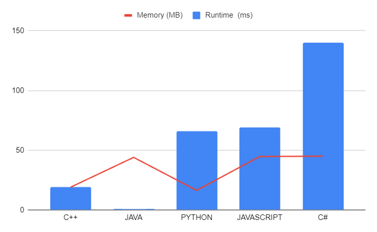

# 🚀 Mastering Modular Exponentiation 💡Beginner's Guide

**Author:** LakshayBrejwal_1_0
**Votes:** 15
**Link:** [https://leetcode.com/problems/double-modular-exponentiation/solutions/4384819/](https://leetcode.com/problems/double-modular-exponentiation/solutions/4384819/)

---

# \uD83D\uDE80 Mastering Modular Exponentiation 

---

## \uD83D\uDCA1 Problem Overview

The problem involves finding the indices of variables whose modular exponentiation matches a given target. The modular exponentiation is calculated using a custom function, and the indices of variables meeting the criteria are stored in a vector.

## \uD83D\uDCA1 Approach: Modular Exponentiation

### \u2728 Explanation

Modular exponentiation is a crucial operation in number theory and cryptography. The code utilizes a custom function, `customPow`, to efficiently calculate modular exponentiation. The main function, `getGoodIndices`, iterates through the given variables, calculates the modular exponentiation for each row, and checks if it matches the target. The indices of the variables satisfying the condition are stored in the `ans` vector.

### \uD83D\uDCDD Dry Run

*Input:*
```cpp
variables = {{2, 3, 4, 10}, {5, 2, 3, 13}, {3, 4, 2, 5}};
target = 1
```

#### Execution Steps:

1. **Iteration:**
   - For the first row: `ele1 = customPow(2, 3, 10) = 8`, `ele2 = customPow(8 % 10, 4, 10) = 2`
     - No match with the target.
   - For the second row: `ele1 = customPow(5, 2, 10) = 5`, `ele2 = customPow(5 % 10, 3, 13) = 5`
     - No match with the target.
   - For the third row: `ele1 = customPow(3, 4, 10) = 1`, `ele2 = customPow(1 % 10, 2, 5) = 1`
     - Match with the target, index 2 is added to `ans`.

2. **Result:**
   - `ans = {2}`
3. ## Custom Power function 
    The `customPow` function implements a technique known as binary exponentiation or exponentiation by squaring. This method is widely used to efficiently calculate large powers of a number while avoiding unnecessary multiplication operations.

### How Binary Exponentiation Works:

1. **Initialization:**
   - `long long result = 1;`: Initializes the result to 1, as any number raised to the power of 0 is 1.

2. **Main Loop:**
   - `while (exponent > 0) {`: The function uses a while loop to iterate until the exponent becomes 0.

3. **Check for Odd Exponent:**
   - `if (exponent % 2 == 1) {`: Checks if the current exponent is odd.
   - Inside this block, the result is updated by multiplying it with the base and taking the modulo `mod`.

4. **Update Base:**
   - `base = (base * base) % mod;`: Squares the base and takes the modulo `mod`. This is a key step in the exponentiation process.
   - This step effectively reduces the exponent by half in each iteration, leading to a logarithmic time complexity.

5. **Update Exponent:**
   - `exponent /= 2;`: Divides the exponent by 2, effectively reducing it for the next iteration.

6. **Repeat:**
   - The process continues until the exponent becomes 0.

7. **Return Result:**
   - `return result;`: Finally, the function returns the calculated result.

### Why Binary Exponentiation:

1. **Optimization:**
   - Binary exponentiation optimizes the calculation of powers by reducing the number of multiplications.
   - It takes advantage of the fact that for any even number `n`, `a^n` can be expressed as `(a^(n/2))^2`.

2. **Efficiency:**
   - The time complexity of binary exponentiation is logarithmic, specifically O(log n), where `n` is the exponent.
   - Compared to naive exponentiation, which has a time complexity of O(n), binary exponentiation is much more efficient for large exponents.

3. **Modular Arithmetic:**
   - The use of modulo `mod` ensures that the result stays within manageable bounds, which is crucial in many mathematical and programming contexts.

4. **Divide and Conquer:**
   - The binary exponentiation technique follows a divide-and-conquer approach, breaking down the problem into smaller subproblems and efficiently combining the results.

### \uD83D\uDD0D Edge Cases
The code handles different sets of variables and targets. It efficiently performs modular exponentiation.

### \uD83D\uDD78\uFE0F Complexity Analysis

- **Time Complexity:** O(N), where N is the number of rows in the `variables` array.
- **Space Complexity:** O(1), as we only use a constant amount of extra space.

### \uD83E\uDDD1\uD83C\uDFFB\u200D\uD83D\uDCBB Code

```cpp []
class Solution {
public:
    long long customPow(int base, int exponent, int mod) {
        long long result = 1;
        while (exponent > 0) {
            if (exponent % 2 == 1) {
                result = (result * base) % mod;
            }
            base = (base * base) % mod;
            exponent /= 2;
        }
        return result;
    }

    vector<int> getGoodIndices(vector<vector<int>>& variables, int target) {
        vector<int> ans;
        int i = 0;
        for (auto row : variables) {
            long long ele1 = customPow(row[0], row[1], 10);
            long long ele2 = customPow(ele1 % 10, row[2], row[3]);

            if (ele2 == target) {
                ans.push_back(i);
            }

            i++;
        }
        return ans;
    }
};
```
```python []
class Solution:
    def customPow(self, base, exponent, mod):
        result = 1
        while exponent > 0:
            if exponent % 2 == 1:
                result = (result * base) % mod
            base = (base * base) % mod
            exponent //= 2
        return result

    def getGoodIndices(self, variables, target):
        ans = []
        i = 0
        for row in variables:
            ele1 = self.customPow(row[0], row[1], 10)
            ele2 = self.customPow(ele1 % 10, row[2], row[3])

            if ele2 == target:
                ans.append(i)

            i += 1
        return ans

```
```javascript []
var customPow = function (base, exponent, mod) {
  let result = 1;
  while (exponent > 0) {
    if (exponent % 2 === 1) {
      result = (result * base) % mod;
    }
    base = (base * base) % mod;
    exponent = Math.floor(exponent / 2);
  }
  return result;
};

var getGoodIndices = function (variables, target) {
  const ans = [];
  let i = 0;
  for (const row of variables) {
    const ele1 =  customPow(row[0], row[1], 10);
    const ele2 =  customPow(ele1 % 10, row[2], row[3]);

    if (ele2 === target) {
      ans.push(i);
    }

    i++;
  }
  return ans;
};

```
```java []
import java.util.ArrayList;
import java.util.List;

public class Solution {
    public long customPow(int base, int exponent, int mod) {
        long result = 1;
        while (exponent > 0) {
            if (exponent % 2 == 1) {
                result = (result * base) % mod;
            }
            base = (base * base) % mod;
            exponent /= 2;
        }
        return result;
    }

    public List<Integer> getGoodIndices(int[][] variables, int target) {
        List<Integer> ans = new ArrayList<>();
        int i = 0;
        for (int[] row : variables) {
            long ele1 = customPow(row[0], row[1], 10);
            long ele2 = customPow((int) (ele1 % 10), row[2], row[3]);

            if (ele2 == target) {
                ans.add(i);
            }

            i++;
        }
        return ans;
    }
}

```
```csharp []
using System;
using System.Collections.Generic;

public class Solution {
    public long CustomPow(int baseNum, int exponent, int mod) {
        long result = 1;
        while (exponent > 0) {
            if (exponent % 2 == 1) {
                result = (result * baseNum) % mod;
            }
            baseNum = (baseNum * baseNum) % mod;
            exponent /= 2;
        }
        return result;
    }

    public List<int> GetGoodIndices(int[][] variables, int target) {
        List<int> ans = new List<int>();
        int i = 0;
        foreach (int[] row in variables) {
            long ele1 = CustomPow(row[0], row[1], 10);
            long ele2 = CustomPow((int) (ele1 % 10), row[2], row[3]);

            if (ele2 == target) {
                ans.Add(i);
            }

            i++;
        }
        return ans;
    }
}

```

---
## \uD83D\uDCCAAnalysis
| Language    | Runtime (ms) | Memory (MB) |
|-------------|--------------|-------------|
| C++         | 19           | 19          |
| JAVA        | 1            | 44          |
| PYTHON      | 66           | 16.4        |
| JAVASCRIPT  | 69           | 44.7        |
| C#          | 140          | 45          |




---

# Consider UPVOTING\u2B06\uFE0F


# DROP YOUR SUGGESTIONS IN THE COMMENT

## Keep Coding\uD83E\uDDD1\u200D\uD83D\uDCBB

 -- *MR.ROBOT SIGNING OFF*