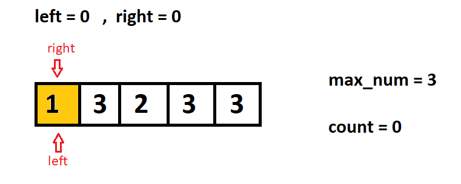
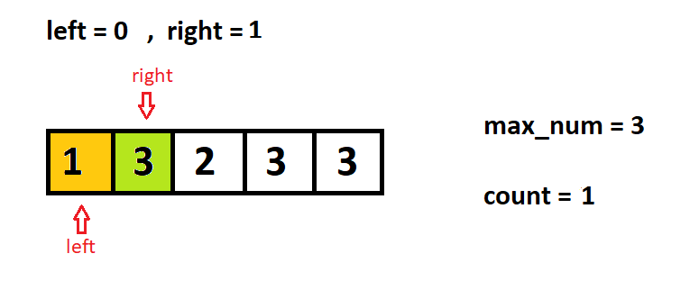
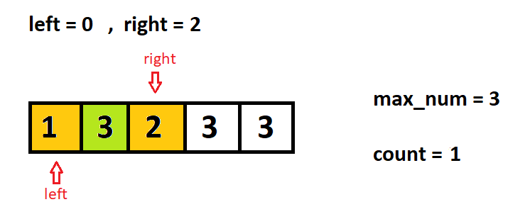
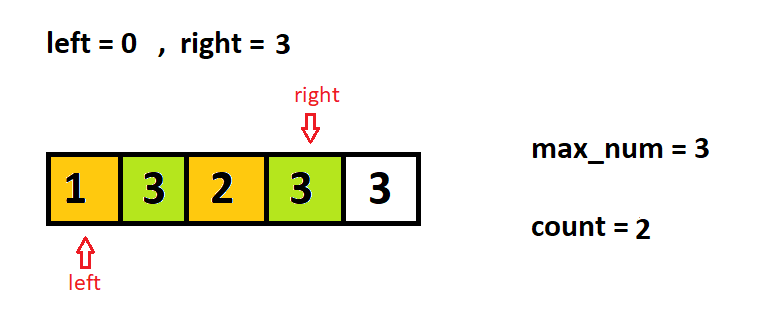
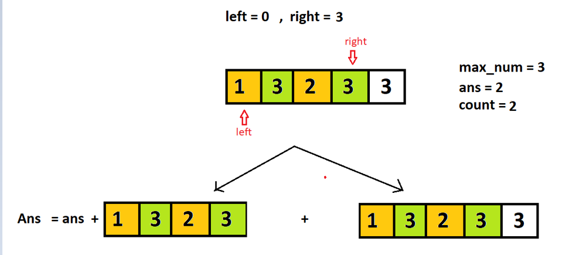
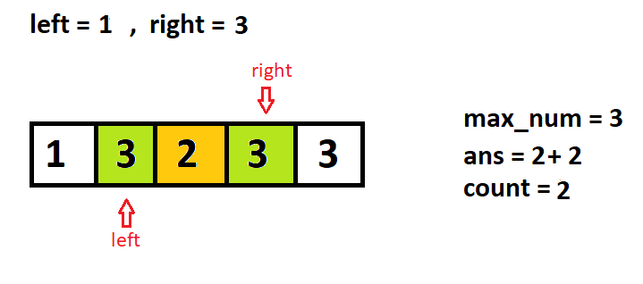
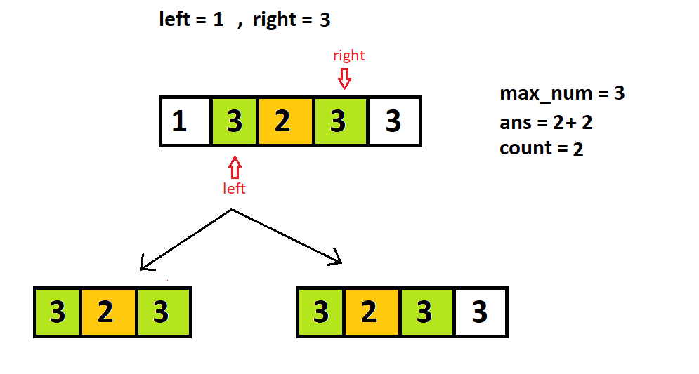
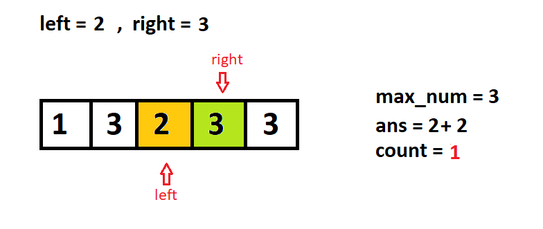
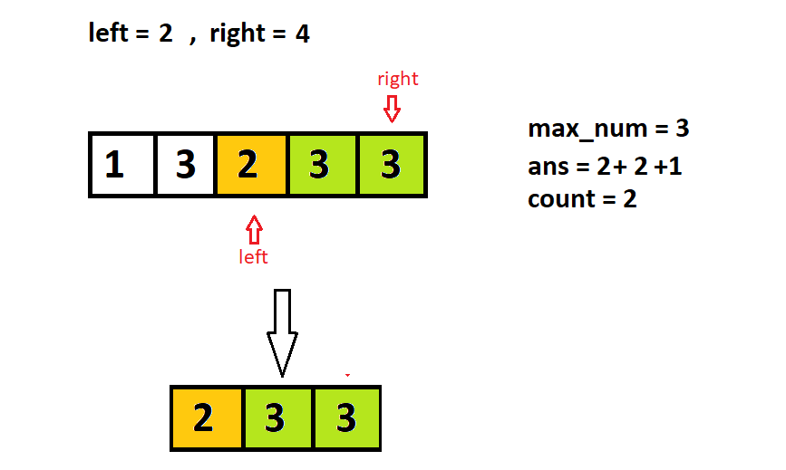
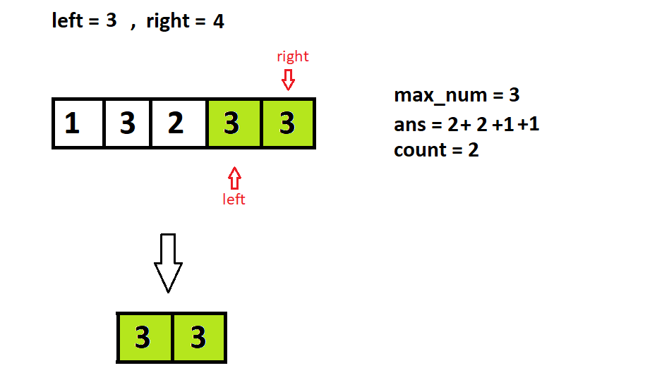

# Simplified algorithm explained with visual example🔥 | C++ ✔| Java ✔|

**Author:** Recode_-1
**Votes:** 211
**Link:** [https://leetcode.com/problems/count-subarrays-where-max-element-appears-at-least-k-times/solutions/4940242/](https://leetcode.com/problems/count-subarrays-where-max-element-appears-at-least-k-times/solutions/4940242/)

---

Please Upvote if u like it \uD83D\uDE0A\uD83D\uDE3F


---


# Example
Let's take the following example
```
Input: nums = [1,3,2,3,3], k = 2
Output: 6

```
```
step 1 
```


```
step 2
```


```
step 3
```


```
step 4
```

```
step 5
```


```
step 6
```



```
step 7
```



```
step 8
```


```
step 9
```


```
step 10
```



# Algorithm
1. **Find the Maximum Element**: 
   - Find the maximum element (`max_num`) in the array `nums`.

2. **Initialize Variables**: 
   - Initialize `left`, `right` to 0, `count` to 0, and `ans` to 0.

3. **Sliding Window Technique**:
   - Use a sliding window approach to iterate through `nums`.
   - Move `right` pointer from left to right.
   - Increment `count` if `nums[right]` equals `max_num`.

4. **Count Subarrays**:
   - If `count >= k`, calculate subarrays count:
     - Add `nums.size() - right` to `ans`.
     - This accounts for all subarrays ending at `right` with at least `k` occurrences of `max_num`.
   
5. **Adjusting Window**:
   - Shrink window from left if necessary:
     - Move `left` pointer rightwards.
     - Decrement `count` if `nums[left]` equals `max_num`.

6. **Move Right Pointer**:
   - Move `right` pointer to continue expanding the window.

7. **Return Answer**:
   - Return `ans` as the total count of subarrays satisfying the condition.

# Code in C++
```
class Solution {
public:
    long long countSubarrays(vector<int>& nums, int k) {
        long long int max_num = *max_element(nums.begin(),nums.end()),count = 0;
        long long int left = 0,right = 0,ans = 0;
        while(right<nums.size()){
            if(nums[right] == max_num)count++;
            
            while(count>=k){
                if(nums[left]==max_num)count--;
                left++;
                ans += nums.size()-right;
            }    
            right++;
        }


        return ans;
        
    }
};
```
# code in java

```
import java.util.*;

class Solution {
    public long countSubarrays(int[] nums, int k) {
        long maxNum = Long.MIN_VALUE, count = 0;
        long left = 0, right = 0, ans = 0;
        
        // Find the maximum element in the array
        for (int num : nums) {
            maxNum = Math.max(maxNum, num);
        }
        
        while (right < nums.length || left > right) {
            if (nums[(int)right] == maxNum) {
                count++;
            }
            // If count is greater than or equal to k, calculate subarrays count
            while (count >= k) {
                if (nums[(int)left] == maxNum) {
                    count--;
                }
                left++;
                ans += nums.length - right;
            }
            right++;
        }
        return ans;
    }
}

```