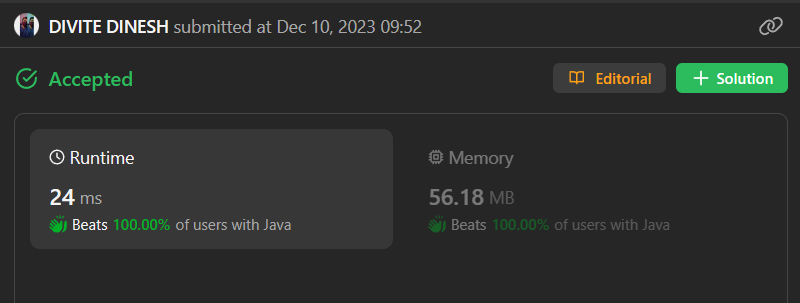

# BEATS - 100% || EASY 🔥🚀|| HASHMAP || O(N) || PREFIX SUM

**Author:** dineshd7
**Votes:** 8
**Link:** [https://leetcode.com/problems/count-subarrays-where-max-element-appears-at-least-k-times/solutions/4384705/](https://leetcode.com/problems/count-subarrays-where-max-element-appears-at-least-k-times/solutions/4384705/)

---

# Intuition
using hashmap for tracing the minimum length of subarray.


<!-- Describe your first thoughts on how to solve this problem. -->

# Approach
1) find max
2) make **count array** to count the max element occurance till **i**
3) keep track of **max occurance indices**  with hashmap
4) find the minimum length of subarray and add that to answer
<!-- Describe your approach to solving the problem. -->

# Complexity
- Time complexity:
- O(n)
<!-- Add your time complexity here, e.g. $$O(n)$$ -->

- Space complexity:
- O(n) 
<!-- Add your space complexity here, e.g. $$O(n)$$ -->




```java []
import java.util.*;
class Solution {
    public long countSubarrays(int[] nums, int k) {
        int max = 0;
        for(int i: nums)
            max = Math.max(i, max);
        int[] cnt = new int[nums.length];
        int m = 0;
        int j = 0;
        HashMap<Integer, Integer>map = new HashMap<>();
        for(int i: nums){
            if(i == max){
                m++;
                map.put(m, j);
            }
            cnt[j++] = m;
        }
        long ans = 0;
        j = 0;
        for(int i : cnt){
            if(i >= k){
                int last = map.getOrDefault(i-k+1,i);
                ans += last+1;
            }
            j++;
        }
        return ans;
    }
}
```

``` c++ []
#include <iostream>
#include <vector>
#include <unordered_map>

using namespace std;

class Solution {
public:
    long countSubarrays(vector<int>& nums, int k) {
        int max = 0;
        for(int i: nums)
            max = std::max(i, max);
        vector<int> cnt(nums.size());
        int m = 0;
        int j = 0;
        unordered_map<int, int> map;
        for(int i: nums){
            if(i == max){
                m++;
                map[m] = j;
            }
            cnt[j++] = m;
        }
        long ans = 0;
        j = 0;
        for(int i : cnt){
            if(i >= k){
                int last = map.count(i-k+1) ? map[i-k+1] : i;
                ans += last+1;
            }
            j++;
        }
        return ans;
    }
};

```

```javascript []
/**
 * @param {number[]} nums
 * @param {number} k
 * @return {number}
 */
var countSubarrays = function(nums, k) {
        let max = 0;
        for(let i of nums)
            max = Math.max(i, max);
        let cnt = new Array(nums.length);
        let m = 0;
        let j = 0;
        let map = new Map();
        for(let i of nums){
            if(i === max){
                m++;
                map.set(m, j);
            }
            cnt[j++] = m;
        }
        let ans = 0;
        j = 0;
        for(let i of cnt){
            if(i >= k){
                let last = map.get(i-k+1) || i;
                ans += last+1;
            }
            j++;
        }
        return ans;

};


```
```python []
class Solution:
    def countSubarrays(self, nums, k):
        max_val = max(nums)
        cnt = [0] * len(nums)
        m = 0
        j = 0
        map = {}
        for i in nums:
            if i == max_val:
                m += 1
                map[m] = j
            cnt[j] = m
            j += 1
        ans = 0
        j = 0
        for i in cnt:
            if i >= k:
                last = map.get(i-k+1, i)
                ans += last + 1
            j += 1
        return ans


```


