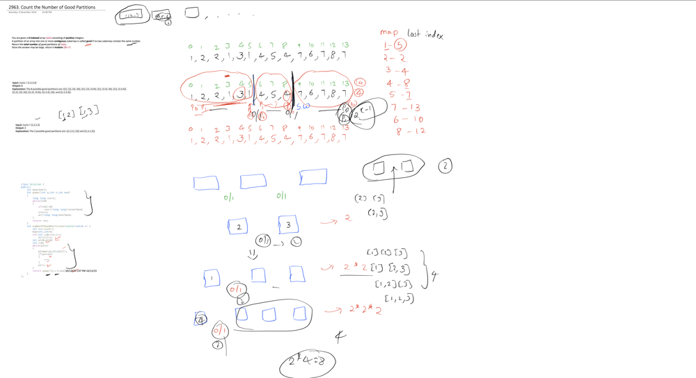

# Easy Video Solutions with Proofs 🔥 || Last index match + Sliding window 🔥

**Author:** ayushnemmaniwar12
**Votes:** 15
**Link:** [https://leetcode.com/problems/count-the-number-of-good-partitions/solutions/4385345/](https://leetcode.com/problems/count-the-number-of-good-partitions/solutions/4385345/)

---

# Intuition
<!-- Describe your first thoughts on how to solve this problem. -->



***Easy Video Explanation***

https://youtu.be/XfzjyBIBcTE


# Approach
<!-- Describe your approach to solving the problem. -->
The code calculates the number of good partitions in an array v where each partition contains its maximum element at the last occurrence. It uses a sliding window approach, counting the partitions and calculating the power of 2 for the result.

# Complexity
- Time complexity:
<!-- Add your time complexity here, e.g. $$O(n)$$ -->
    O(N)
    

- Space complexity:
<!-- Add your space complexity here, e.g. $$O(n)$$ -->
    O(M)
    

# Code


```C++ []
class Solution {
public:
    int mod=1e9+7;
    int power(int a,int n,int mod)
    {
        long long res=1;
        while(n>0)
        {
            if(n%2!=0)
                res=((long long)res*a)%mod;
            n=n>>1;
            a=((long long)a*a)%mod;
        }
        return res;
    }
    int numberOfGoodPartitions(vector<int>& v) {
        int n=v.size();
        map<int,int>m;
        for(int i=0;i<n;i++)
            m[v[i]]=i;
        int p1=0,p2=0;
        int c=0;
        while(p1<n)
        {
            p2=max(p2,m[v[p1]]);
            if(p1==p2)
            {
                c++;
            }
            p1++;
        }
        return power(2,c-1,mod);
    }
};
```
```python []
class Solution:
    mod = 10**9 + 7

    def power(self, a, n, mod):
        res = 1
        while n > 0:
            if n % 2 != 0:
                res = (res * a) % mod
            n = n >> 1
            a = (a * a) % mod
        return res

    def number_of_good_partitions(self, v):
        n = len(v)
        m = {}
        for i in range(n):
            m[v[i]] = i
        p1, p2, c = 0, 0, 0
        while p1 < n:
            p2 = max(p2, m[v[p1]])
            if p1 == p2:
                c += 1
            p1 += 1
        return self.power(2, c - 1, self.mod)

```
```Java []
import java.util.*;

public class Solution {
    final int mod = 1000000007;

    public int power(int a, int n, int mod) {
        long res = 1;
        while (n > 0) {
            if (n % 2 != 0)
                res = (res * (long) a) % mod;
            n = n >> 1;
            a = (int) (((long) a * a) % mod);
        }
        return (int) res;
    }

    public int numberOfGoodPartitions(ArrayList<Integer> v) {
        int n = v.size();
        Map<Integer, Integer> m = new HashMap<>();
        for (int i = 0; i < n; i++)
            m.put(v.get(i), i);
        int p1 = 0, p2 = 0, c = 0;
        while (p1 < n) {
            p2 = Math.max(p2, m.get(v.get(p1)));
            if (p1 == p2) {
                c++;
            }
            p1++;
        }
        return power(2, c - 1, mod);
    }
}


```

# ***If you like the solution Please Upvote and subscribe to my youtube channel***
***It Motivates me to record more videos***

*Thank you* \uD83D\uDE00