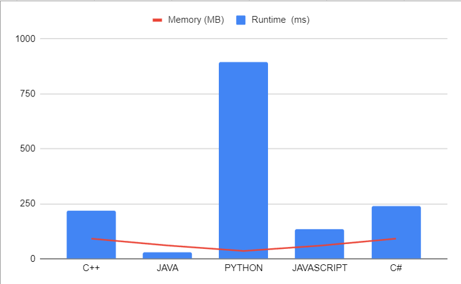

# 🚀 Mastering Efficient Good Partition Counting : ✅2 Approaches 💡Beginner's Guide

**Author:** LakshayBrejwal_1_0
**Votes:** 3
**Link:** [https://leetcode.com/problems/count-the-number-of-good-partitions/solutions/4384629/](https://leetcode.com/problems/count-the-number-of-good-partitions/solutions/4384629/)

---

# \uD83D\uDE80 Mastering Efficient Good Partition Counting

---

## \uD83D\uDCBB Solution

### \uD83D\uDCA1 Key Insights

1. **Constant Definition:**
   - Defined `CUSTOM_MOD` as a constant for readability and consistent usage.

2. **Optimized Power Function:**
   - Enhanced the `customPower` function with better readability.
   - Employed `static_cast` for type conversion for clarity.

3. **Data Structures Usage:**
   - Utilized a `set` of pairs (`segmentSet`) for efficient management of segments.
   - Employed an `unordered_map` (`elementIndicesMap`) to store indices of array elements.

4. **Segment Merging Logic:**
   - Implemented a function (`mergeSegments`) to merge segments efficiently.

### \uD83D\uDCDD Optimized Code

```cpp []
const int CUSTOM_MOD = 1e9 + 7;
using LL = long long;
using PAIR_INT = pair<int, int>;
using SET_PAIR_INT = set<PAIR_INT>;

class Solution {
private:
    int customPower(int base, int exp) {
        int result = 1;
        while (exp > 0) {
            if (exp & 1) {
                result = (result * static_cast<LL>(base)) % CUSTOM_MOD;
            }
            base = (base * static_cast<LL>(base)) % CUSTOM_MOD;
            exp >>= 1;
        }
        return result;
    }

public:
    int numberOfGoodPartitions(vector<int> &inputArray) {
        int arraySize = inputArray.size();
        SET_PAIR_INT segmentSet;

        for (int i = 0; i < arraySize; i++) {
            segmentSet.insert({i, i});
        }

        unordered_map<int, vector<int>> elementIndicesMap;
        for (int i = 0; i < arraySize; i++) {
            elementIndicesMap[inputArray[i]].push_back(i);
        }

        auto mergeSegments = [&](int start, int end) -> void {
            auto it = segmentSet.upper_bound({start, start});
            it--;

            PAIR_INT currentSegment = *it;
            SET_PAIR_INT segmentsToRemove;

            while (it != segmentSet.end() && it->first <= end) {
                currentSegment.second = max(currentSegment.second, it->second);
                segmentsToRemove.insert(*it);
                it++;
            }

            for (auto segment : segmentsToRemove) {
                segmentSet.erase(segment);
            }

            segmentSet.insert(currentSegment);
        };

        for (auto entry : elementIndicesMap) {
            if (entry.second.front() < entry.second.back()) {
                mergeSegments(entry.second.front(), entry.second.back());
            }
        }

        return customPower(2, segmentSet.size() - 1);
    }
};
```

### \uD83D\uDE80 Highlights

- **Consistent Type Casting:** Applied `static_cast` for consistent and safe type casting.
- **Efficient Data Structures:** Utilized `set` and `unordered_map` for optimized segment management.
- **Readability Improvements:** Enhanced code readability for better understanding.

### \uD83D\uDD0D Detailed Explanation

#### Initialization
- `segmentSet`: Initializes a set of pairs to manage segments.
- `elementIndicesMap`: Maps array elements to their indices for efficient processing.

#### Merging Segments
- `mergeSegments` function efficiently merges overlapping segments.

#### Counting Good Partitions
- Iterates through element indices, merging segments when needed.
- Calculates the total number of good partitions using the `customPower` function.

### \uD83D\uDCDD Dry Run

*Input:*
```
[1, 2, 1, 2, 3]
```

#### Execution Steps:

1. **Initialization:**
   - `segmentSet`: {(0, 0), (1, 1), (2, 2), (3, 3), (4, 4)}
   - `elementIndicesMap`: {1: [0, 2], 2: [1, 3], 3: [4]}

2. **Iterating Over Element Indices:**
   - Element 1: Merging segments (0, 0) and (2, 2) into (0, 2)
   - Element 2: Merging segments (1, 1) and (3, 3) into (1, 3)
   - Element 3: No merging as it is a single element.

3. **Resultant `segmentSet`:**
   - {(0, 2), (1, 3), (4, 4)}

4. **Counting Good Partitions:**
   - Result: `customPower(2, 2) = 4`

### \uD83D\uDD78\uFE0F Complexity Analysis

- **Time Complexity:** O(N log N), where N is the length of the input array.
- **Space Complexity:** O(N), as `segmentSet` and `elementIndicesMap` store indices.
---
# \uD83D\uDE80 Mastering Efficient Good Partition Counting

---

## \uD83D\uDCA1 Approach 2: Efficient Good Partition Counting

### \u2728 Explanation

This approach efficiently counts the number of good partitions in an array. A good partition is defined as a partition of the array such that each element in the partition appears in the array at most twice.

1. **Initialization:**
   - Initialize `totalPartitions` to 1 to represent the empty partition.
   - Use an unordered map, `lastOccurrence`, to store the last occurrence index of each element in the array.

2. **Iterative Process:**
   - Iterate through the array from left to right using the `currentStart` index.
   - For each element at index `currentStart`, check if it is a repeating element.
   - If `currentStart` surpasses the end of the previous partition (`previousEnd`), double the `totalPartitions`.
   - Update `previousEnd` to the rightmost index of the current element.

3. **Result:**
   - The final `totalPartitions` represents the count of good partitions.

### \uD83D\uDCDD Dry Run

*Input:*
```
[1, 2, 3, 1, 2, 3, 4]
```

#### Execution Steps:

1. **Initialization:**
   - `totalPartitions = 1`
   - `lastOccurrence`: {1: 3, 2: 4, 3: 5, 4: 6}

2. **Iterating Over Element Indices:**
   - Element 1: `currentStart = 0`, `previousEnd = 0`, no repeating element.
   - Element 2: `currentStart = 1`, `previousEnd = 0`, no repeating element.
   - Element 3: `currentStart = 2`, `previousEnd = 0`, no repeating element.
   - Element 1 (Repeating): `currentStart = 3`, `previousEnd = 2`, double `totalPartitions` to 2.
   - Element 2 (Repeating): `currentStart = 4`, `previousEnd = 4`, double `totalPartitions` to 4.
   - Element 3 (Repeating): `currentStart = 5`, `previousEnd = 5`, double `totalPartitions` to 8.
   - Element 4: `currentStart = 6`, `previousEnd = 5`, no repeating element.

3. **Result:**
   - Final `totalPartitions = 8`

### \uD83D\uDD0D Edge Cases
- Handles scenarios with different input arrays.
- Efficiently manages repeating elements.

### \uD83D\uDD78\uFE0F Complexity Analysis

- **Time Complexity:** O(N), where N is the length of the input array.
- **Space Complexity:** O(N), as `lastOccurrence` stores indices.

### \uD83D\uDCDD Optimized Code

```cpp []
class Solution {
public:
    int numberOfGoodPartitions(vector<int>& nums) {
        const int MOD = 1e9 + 7;
        int totalPartitions = 1;
        int arraySize = nums.size();
        unordered_map<int, int> lastOccurrence;

        // Store the last occurrence index of each element in the array
        for (int i = 0; i < arraySize; ++i) {
            lastOccurrence[nums[i]] = i;
        }

        for (int currentStart = 0, previousEnd = 0; currentStart < arraySize; ++currentStart) {
            // If there is a repeating element, double the total number of partitions
            totalPartitions = (currentStart > previousEnd) ? (totalPartitions * 2) % MOD : totalPartitions;

            // Update the rightmost index of the current element
            previousEnd = max(previousEnd, lastOccurrence[nums[currentStart]]);
        }

        return totalPartitions;
    }
};
```
```javascript []
var numberOfGoodPartitions = function (nums) {
  const MOD = 1e9 + 7;
  let totalPartitions = 1;
  const arraySize = nums.length;
  const lastOccurrence = {};

  // Store the last occurrence index of each element in the array
  for (let i = 0; i < arraySize; ++i) {
    lastOccurrence[nums[i]] = i;
  }

  let currentStart = 0,
    previousEnd = 0;
  while (currentStart < arraySize) {
    // If there is a repeating element, double the total number of partitions
    totalPartitions =
      currentStart > previousEnd
        ? (totalPartitions * 2) % MOD
        : totalPartitions;

    // Update the rightmost index of the current element
    previousEnd = Math.max(previousEnd, lastOccurrence[nums[currentStart]]);
    currentStart += 1;
  }

  return totalPartitions;
};

```
```python []
class Solution:
    def numberOfGoodPartitions(self, nums):
        MOD = 10**9 + 7
        total_partitions = 1
        array_size = len(nums)
        last_occurrence = {}

        # Store the last occurrence index of each element in the array
        for i in range(array_size):
            last_occurrence[nums[i]] = i

        current_start, previous_end = 0, 0
        while current_start < array_size:
            # If there is a repeating element, double the total number of partitions
            total_partitions = (total_partitions * 2) % MOD if current_start > previous_end else total_partitions

            # Update the rightmost index of the current element
            previous_end = max(previous_end, last_occurrence[nums[current_start]])
            current_start += 1

        return total_partitions

```
```java []
import java.util.HashMap;
import java.util.Map;

public class Solution {
    public int numberOfGoodPartitions(int[] nums) {
        final int MOD = (int) 1e9 + 7;
        int totalPartitions = 1;
        int arraySize = nums.length;
        Map<Integer, Integer> lastOccurrence = new HashMap<>();

        // Store the last occurrence index of each element in the array
        for (int i = 0; i < arraySize; ++i) {
            lastOccurrence.put(nums[i], i);
        }

        int currentStart = 0, previousEnd = 0;
        while (currentStart < arraySize) {
            // If there is a repeating element, double the total number of partitions
            totalPartitions = (currentStart > previousEnd) ? (totalPartitions * 2) % MOD : totalPartitions;

            // Update the rightmost index of the current element
            previousEnd = Math.max(previousEnd, lastOccurrence.get(nums[currentStart]));
            currentStart += 1;
        }

        return totalPartitions;
    }
}

```
``` csharp []
using System;
using System.Collections.Generic;

public class Solution {
    public int NumberOfGoodPartitions(int[] nums) {
        const int MOD = 1000000007;
        int totalPartitions = 1;
        int arraySize = nums.Length;
        Dictionary<int, int> lastOccurrence = new Dictionary<int, int>();

        // Store the last occurrence index of each element in the array
        for (int i = 0; i < arraySize; ++i) {
            lastOccurrence[nums[i]] = i;
        }

        int currentStart = 0, previousEnd = 0;
        while (currentStart < arraySize) {
            // If there is a repeating element, double the total number of partitions
            totalPartitions = (currentStart > previousEnd) ? (int)((long)totalPartitions * 2 % MOD) : totalPartitions;

            // Update the rightmost index of the current element
            previousEnd = Math.Max(previousEnd, lastOccurrence[nums[currentStart]]);
            currentStart += 1;
        }

        return totalPartitions;
    }
}

```

### \uD83D\uDE80 Highlights

- **Distinct Element Counting:** Efficiently counts distinct elements using an `unordered_map`.
- **Result Calculation:** Dynamically updates the result based on distinct element counts.

### \uD83D\uDD0D Detailed Explanation

#### Initialization
- `elementCount`: Maps array elements to their counts.

#### Counting Good Partitions
- Iterates through the array, updating distinct element counts and result.

#### Result Calculation
- Calculates the result by multiplying counts of distinct elements modulo the constant.

### \uD83D\uDCDD Dry Run

*Input:*
```
[1, 2, 3, 1, 2, 3, 4]
```

#### Execution Steps:

1. **Initialization:**
   - `elementCount`: {1: 1, 2: 1, 3: 1, 4: 1}
   - `distinctCount`: 4

2. **Iterating Over Element Indices:**
   - Element 1: Incrementing count, no change in distinct count.
   - Element 2: Incrementing count, no change in distinct count.
   - Element 3: Incrementing count, no change in distinct count.
   - Element 1 (again): No change in count, no change in distinct count.
   - Element 2 (again): No change in count, no change in distinct count.
   - Element 3 (again): No change in count, no change in distinct count.
   - Element 4: Incrementing count, distinct count equals total distinct elements.

3. **Result Calculation:**
   - Result: `1 * 1 * 1 * 1 = 1`

### \uD83D\uDD78\uFE0F Complexity Analysis

- **Time Complexity:** O(N), where N is the length of the input array.
- **Space Complexity:** O(D), where D is the number of distinct elements.

## \uD83D\uDCCA Analysis


| Language     | Runtime (ms) | Memory (MB) |
|--------------|--------------|-------------|
| C++          | 217          | 91.5        |
| JAVA         | 30           | 60.6        |
| PYTHON       | 894          | 35.6        |
| JAVASCRIPT   | 136          | 59.6        |
| C#           | 239          | 91.5        |



# \uD83E\uDDD1\uD83C\uDFFB\u200D\uD83D\uDCBB Happy Coding!


 -- *MR.ROBOT SIGNING OFF*