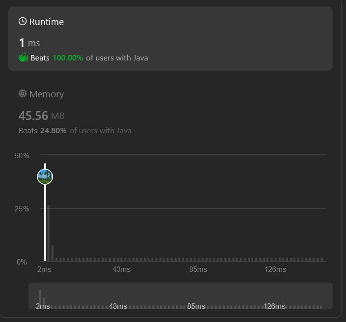

# ✅✅✅ Beats 100% solution 🔥🔥 with explanation ✅✅✅

**Author:** gdhanush270
**Votes:** 4
**Link:** [https://leetcode.com/problems/find-missing-and-repeated-values/solutions/4942619/](https://leetcode.com/problems/find-missing-and-repeated-values/solutions/4942619/)

---

# Intuition and Approach
- **Initialization:** Initialize variables r and m to store the repeated and missing numbers, respectively. Initialize an array a of size n*n to store the counts of numbers from 1 to n*n.

- **Counting Occurrences:** Iterate through each element of the grid. For each element grid[i][j], increment the count of a[grid[i][j] - 1]. This effectively counts the occurrences of each number in the grid.

- **Finding Missing and Repeated Numbers:** Iterate through the a array. If the count a[i] is 0, it indicates that i+1 is the missing number. If the count a[i] is 2, it indicates that i+1 is the repeated number.

- **Return Result:** Return an array containing the repeated and missing numbers.
---
# Beats 100%
>
---
# Complexity
- Time complexity:
    - Counting Occurrences: This step involves iterating through each element of the grid once, which takes $$O(n^2)$$ time, where n is the length of the grid (assuming the grid is square).
    - Finding Missing and Repeated Numbers: Iterating through the a array once to find the missing and repeated numbers also takes $$O(n^2)$$ time.
    - Overall, the time complexity is $$O(n^2)$$.

- Space complexity:
    - The array a of size n*n is used to store the counts of numbers from 1 to n*n, which requires $$O(n^2)$$ space.
    - Other than that, there are only a few integer variables (n, r, m) used, which require constant space.
    - Overall, the space complexity is $$O(n^2)$$.
> In summary, both the time and space complexity of the provided solution are $$O(n^2)$$, where n is the length of the grid.
---
# Code
```C++ []
class Solution {
public:
    vector<int> findMissingAndRepeatedValues(vector<vector<int>>& grid) {
        int n = grid.size(), r = 0, m = 0;
        vector<int> a(n * n, 0);
        for(int i = 0; i < n; i++) for(int j = 0; j < n; j++) a[grid[i][j] - 1]++;  
        for(int i = 0; i < n * n; i++) if(a[i] == 0) m = i + 1;  else if(a[i] == 2) r = i + 1; 
        return {r, m};
    }
};
```
```java []
class Solution {
    public int[] findMissingAndRepeatedValues(int[][] grid) {
        int n = grid.length, r=0, m=0;
        int[] a = new int[n*n];
        for(int i=0;i<n;i++) for(int j=0;j<n;j++) a[grid[i][j] - 1]++; 
        for(int i=0;i<n*n;i++) if(a[i]==0) m=i+1; else if(a[i]==2) r=i+1; 
        return new int[]{r,m};
    }
}
```

```python []
class Solution(object):
    def findMissingAndRepeatedValues(self, grid):
        count = [1] + [0] * len(grid)**2  
        for row in grid:
            for num in row:
                count[num] += 1
        return [count.index(2), count.index(0)]
        
```

```c []
/**
 * Note: The returned array must be malloced, assume caller calls free().
 */
int* findMissingAndRepeatedValues(int** grid, int gridSize, int* gridColSize, int* returnSize) {
    int n = gridSize, r = 0, m = 0, *a = (int*)calloc(n * n, sizeof(int)), *result = (int*)malloc(2 * sizeof(int)); 
    for(int i = 0; i < n; i++) for(int j = 0; j < n; j++) a[grid[i][j] - 1]++; 
    for(int i = 0; i < n * n; i++) if(a[i] == 0) m = i + 1; else if(a[i] == 2) r = i + 1;  
    result[0] = r;
    result[1] = m; 
    *returnSize = 2;
    free(a);
    return result;
}
```

```javascript []
/**
 * @param {number[][]} grid
 * @return {number[]}
 */
var findMissingAndRepeatedValues = function(grid) {
    const n = grid.length;
    let r = 0, m = 0;
    const a = new Array(n * n).fill(0);
    for (let i = 0; i < n; i++) for (let j = 0; j < n; j++) a[grid[i][j] - 1]++; 
    for (let i = 0; i < n * n; i++) if (a[i] === 0) m = i + 1; else if (a[i] === 2) r = i + 1; 
    return [r, m];
};
```

---
# Upvote


---
---