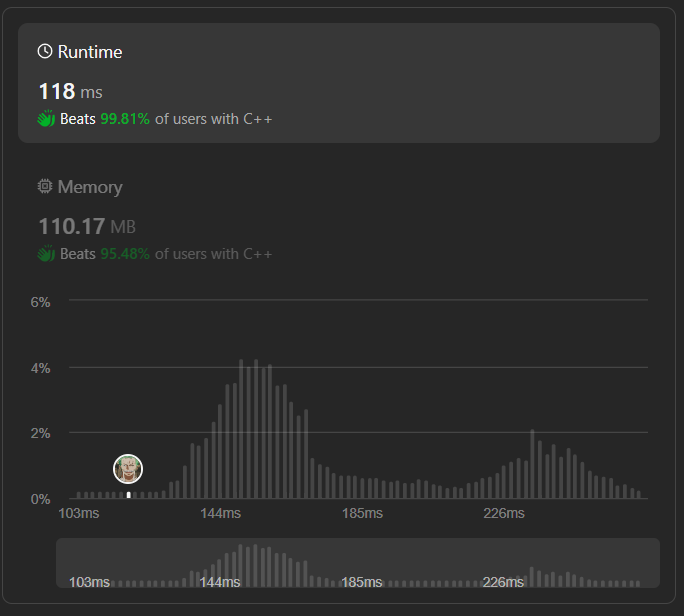

# ✅☑Beats 100% || [C++/Java/Python/JavaScript] EXPLAINED🔥

**Author:** MarkSPhilip31
**Votes:** 109
**Link:** [https://leetcode.com/problems/divide-array-into-arrays-with-max-difference/solutions/4656909/](https://leetcode.com/problems/divide-array-into-arrays-with-max-difference/solutions/4656909/)

---

# PLEASE UPVOTE IF IT HELPED

---



---

# Approaches
(Also explained in the code)


1. **Dividing into Groups of Three:**
    - The goal is to divide the given array into groups of three consecutive elements. This decision likely comes from the requirement or nature of the problem being solved.

1. **Sorting for Comparison:**
    - Sorting the array is done to simplify the process of comparing the elements within each group. When the array is sorted, the minimum and maximum elements for each group can be easily identified.

1. **Setting a Condition (k):**
    - The condition involving k is introduced to filter out groups based on the difference between the maximum and minimum elements within each group. This condition ensures that the elements in a group are within a certain range.

1. **Iterative Approach:**
    - The code iterates through the sorted array in steps of 3, forming groups and checking the condition for each group. If a group meets the condition, it is added to the result. If any group fails the condition, the function returns an empty result.


# Complexity
- Time complexity:
   $$O(nlogn)$$
    

- Space complexity:
   $$O(n)$$
    


# Code
```C++ []
class Solution {
public:
    vector<vector<int>> divideArray(vector<int>& nums, int k) {
        int size = nums.size();
        

        sort(nums.begin(), nums.end());

        vector<vector<int>> result(size / 3, vector<int>(3));
        int groupIndex = 0;
        for (int i = 0; i < size; i += 3) {
            if (i + 2 < size && nums[i + 2] - nums[i] <= k) {
                result[groupIndex] = { nums[i], nums[i + 1], nums[i + 2] };
                groupIndex++;
            }
            else {
                return vector<vector<int>>();
            }
        }
        return result;
    }
}; 


```
```Java []


class Solution {
    public List<List<Integer>> divideArray(int[] nums, int k) {
        int size = nums.length;
        if (size % 3 != 0)
            return new ArrayList<>();

        Arrays.sort(nums);

        List<List<Integer>> result = new ArrayList<>();
        int groupIndex = 0;
        for (int i = 0; i < size; i += 3) {
            if (i + 2 < size && nums[i + 2] - nums[i] <= k) {
                result.add(Arrays.asList(nums[i], nums[i + 1], nums[i + 2]));
                groupIndex++;
            } else {
                return new ArrayList<>();
            }
        }
        return result;
    }
}


```
```python3 []
class Solution:
    def divideArray(self, nums, k):
        size = len(nums)
        if size % 3 != 0:
            return []

        nums.sort()

        result = []
        group_index = 0
        for i in range(0, size, 3):
            if i + 2 < size and nums[i + 2] - nums[i] <= k:
                result.append([nums[i], nums[i + 1], nums[i + 2]])
                group_index += 1
            else:
                return []
        return result


```
```javascript []
class Solution {
    divideArray(nums, k) {
        const size = nums.length;
        if (size % 3 !== 0)
            return [];

        nums.sort((a, b) => a - b);

        const result = [];
        let groupIndex = 0;
        for (let i = 0; i < size; i += 3) {
            if (i + 2 < size && nums[i + 2] - nums[i] <= k) {
                result.push([nums[i], nums[i + 1], nums[i + 2]]);
                groupIndex++;
            } else {
                return [];
            }
        }
        return result;
    }
}


```
---


# PLEASE UPVOTE IF IT HELPED

---
---


---