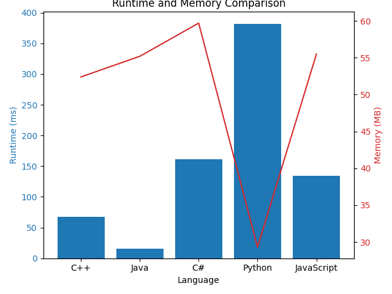

# 🔄 Transforming Arrays into Palindromes: Minimizing Costs 💡Beginner's Guide

**Author:** LakshayBrejwal_2_0
**Votes:** 1
**Link:** [https://leetcode.com/problems/minimum-cost-to-make-array-equalindromic/solutions/4415014/](https://leetcode.com/problems/minimum-cost-to-make-array-equalindromic/solutions/4415014/)

---

# \uD83D\uDD04 Finding Minimum Cost for Palindromic Transformation

## \uD83D\uDCA1 Problem Overview

Given an array of integers, the goal is to transform it into a palindrome by changing each element to the nearest palindrome. The cost of transformation is the sum of absolute differences between the original and transformed values. The objective is to minimize this cost.

## \u2728 Approach

1. **Check Palindrome:**
   - Implement a function to check if a given number is a palindrome.

2. **Find Median and Nearest Palindromes:**
   - Find the median of the sorted array.
   - Locate the nearest palindromes on both sides of the median.

3. **Calculate Costs:**
   - Calculate the cost of transforming the array to each of the nearest palindromes.
   - Return the minimum cost.

## \uD83D\uDCDD Step-by-Step Explanation

1. **Check Palindrome Function:**
   - Convert the number to a string for easy comparison of digits.
   - Use two pointers (left and right) to check if the string is a palindrome.

2. **Sort the Numbers:**
   - Create a copy of the input array and sort it to find the median.

3. **Find Nearest Palindromes:**
   - Starting from the median, increment and decrement until a palindrome is found on both sides.

4. **Calculate Costs:**
   - For each nearest palindrome, calculate the cost of transforming the array.
   - The cost is the sum of absolute differences between the original and transformed values.

5. **Return Minimum Cost:**
   - Return the minimum cost among the calculated costs.

### **Dry Run 1: Odd-Length Array**

**Input Array:** `[4, 9, 2, 6, 1]`

**Step 1: Sorting the Array**
Sorted array: `[1, 2, 4, 6, 9]`

**Step 2: Identify Nearest Palindromic Numbers**
- Median: 4
- Nearest Palindromic Numbers: 3 and 5

**Step 3: Calculate Costs**
- For Palindromic Number 3:
  - Cost: `abs(1-3) + abs(2-3) + abs(4-3) + abs(6-3) + abs(9-3) = 16`
- For Palindromic Number 5:
  - Cost: `abs(1-5) + abs(2-5) + abs(4-5) + abs(6-5) + abs(9-5) = 16`

**Step 4: Determine Minimum Cost**
Minimum Cost: 16

### **Dry Run 2: Even-Length Array**

**Input Array:** `[7, 2, 5, 9]`

**Step 1: Sorting the Array**
Sorted array: `[2, 5, 7, 9]`

**Step 2: Identify Nearest Palindromic Numbers**
- Median: 5
- Nearest Palindromic Numbers: 4 and 6

**Step 3: Calculate Costs**
- For Palindromic Number 4:
  - Cost: `abs(2-4) + abs(5-4) + abs(7-4) + abs(9-4) = 12`
- For Palindromic Number 6:
  - Cost: `abs(2-6) + abs(5-6) + abs(7-6) + abs(9-6) = 10`

**Step 4: Determine Minimum Cost**
Minimum Cost: 10


## \uD83D\uDE80 Efficiency of the Approach

1. **Time Complexity:**
   - The time complexity is determined by the sorting operation, resulting in O(N log N).

2. **Space Complexity:**
   - The space complexity is O(N) due to the sorted copy of the input array.

## \uD83D\uDD17 Related Problems

- [LeetCode - Palindrome Pairs](https://leetcode.com/problems/palindrome-pairs/)


## \uD83D\uDCDD Full Code 
```cpp []
class Solution {
public:
    bool isPalindrome(int number) {
        string strNumber = to_string(number);
        int left = 0, right = strNumber.length() - 1;

        while (left < right) {
            if (strNumber[left] != strNumber[right]) {
                return false;
            }
            left++;
            right--;
        }

        return true;
    }

    long long minimumCost(vector<int>& numbers) {
        vector<int> sortedNumbers = numbers;
        sort(sortedNumbers.begin(), sortedNumbers.end());

        int size = sortedNumbers.size();
        int median = sortedNumbers[size / 2];

        int nearestPalindromic1, nearestPalindromic2;
        int difference = 0;

        while (true) {
            int candidate1 = median + difference;

            if (isPalindrome(candidate1)) {
                nearestPalindromic1 = candidate1;
                break;
            }

            difference++;


        }

        difference = 0;

        while (true) {
            int candidate2 = median - difference;

            if (isPalindrome(candidate2)) {
                nearestPalindromic2 = candidate2;
                break;
            }

            difference++;
        }

        long long cost1 = 0, cost2 = 0;

        for (int i = 0; i < size; ++i) {
            cost1 += abs(sortedNumbers[i] - nearestPalindromic1);
            cost2 += abs(sortedNumbers[i] - nearestPalindromic2);
        }

        return min(cost1, cost2);
    }
};
```


```java []
import java.util.Arrays;

class Solution {
    public boolean isPalindrome(int number) {
        String strNumber = Integer.toString(number);
        int left = 0, right = strNumber.length() - 1;

        while (left < right) {
            if (strNumber.charAt(left) != strNumber.charAt(right)) {
                return false;
            }
            left++;
            right--;
        }

        return true;
    }

    public long minimumCost(int[] numbers) {
        int[] sortedNumbers = Arrays.copyOf(numbers, numbers.length);
        Arrays.sort(sortedNumbers);

        int size = sortedNumbers.length;
        int median = sortedNumbers[size / 2];

        int difference = 0;
        int nearestPalindromic1, nearestPalindromic2;

        while (true) {
            int candidate1 = median + difference;

            if (isPalindrome(candidate1)) {
                nearestPalindromic1 = candidate1;
                break;
            }

            difference++;
        }

        difference = 0;

        while (true) {
            int candidate2 = median - difference;

            if (isPalindrome(candidate2)) {
                nearestPalindromic2 = candidate2;
                break;
            }

            difference++;
        }

        long cost1 = 0, cost2 = 0;

        for (int i = 0; i < size; ++i) {
            cost1 += Math.abs(sortedNumbers[i] - nearestPalindromic1);
            cost2 += Math.abs(sortedNumbers[i] - nearestPalindromic2);
        }

        return Math.min(cost1, cost2);
    }
}
```

```javascript []

    var isPalindrome = function(number) {
        const strNumber = number.toString();
        let left = 0, right = strNumber.length - 1;

        while (left < right) {
            if (strNumber[left] !== strNumber[right]) {
                return false;
            }
            left++;
            right--;
        }

        return true;
    }

    var minimumCost= function (numbers) {
        const sortedNumbers = [...numbers].sort((a, b) => a - b);
        const size = sortedNumbers.length;
        const median = sortedNumbers[Math.floor(size / 2)];

        let difference = 0;
        let nearestPalindromic1, nearestPalindromic2;

        while (true) {
            const candidate1 = median + difference;

            if ( isPalindrome(candidate1)) {
                nearestPalindromic1 = candidate1;
                break;
            }

            difference++;
        }

        difference = 0;

        while (true) {
            const candidate2 = median - difference;

            if ( isPalindrome(candidate2)) {
                nearestPalindromic2 = candidate2;
                break;
            }

            difference++;
        }

        let cost1 = 0, cost2 = 0;

        for (let i = 0; i < size; ++i) {
            cost1 += Math.abs(sortedNumbers[i] - nearestPalindromic1);
            cost2 += Math.abs(sortedNumbers[i] - nearestPalindromic2);
        }

        return Math.min(cost1, cost2);
    }
```
``` python []
class Solution:
    def isPalindrome(self, number):
        strNumber = str(number)
        left, right = 0, len(strNumber) - 1

        while left < right:
            if strNumber[left] != strNumber[right]:
                return False
            left += 1
            right -= 1

        return True

    def minimumCost(self, numbers):
        sortedNumbers = sorted(numbers)
        size = len(sortedNumbers)
        median = sortedNumbers[size // 2]

        difference = 0
        while True:
            candidate1 = median + difference
            if self.isPalindrome(candidate1):
                nearestPalindromic1 = candidate1
                break
            difference += 1

        difference = 0
        while True:
            candidate2 = median - difference
            if self.isPalindrome(candidate2):
                nearestPalindromic2 = candidate2
                break
            difference += 1

        cost1, cost2 = 0, 0
        for i in range(size):
            cost1 += abs(sortedNumbers[i] - nearestPalindromic1)
            cost2 += abs(sortedNumbers[i] - nearestPalindromic2)

        return min(cost1, cost2)

```
```csharp []
using System;
using System.Linq;

public class Solution {
    public bool IsPalindrome(int number) {
        string strNumber = number.ToString();
        int left = 0, right = strNumber.Length - 1;

        while (left < right) {
            if (strNumber[left] != strNumber[right]) {
                return false;
            }
            left++;
            right--;
        }

        return true;
    }

    public long MinimumCost(int[] numbers) {
        int[] sortedNumbers = numbers.ToArray();
        Array.Sort(sortedNumbers);

        int size = sortedNumbers.Length;
        int median = sortedNumbers[size / 2];

        int difference = 0;
        int nearestPalindromic1, nearestPalindromic2;

        while (true) {
            int candidate1 = median + difference;

            if (IsPalindrome(candidate1)) {
                nearestPalindromic1 = candidate1;
                break;
            }

            difference++;
        }

        difference = 0;

        while (true) {
            int candidate2 = median - difference;

            if (IsPalindrome(candidate2)) {
                nearestPalindromic2 = candidate2;
                break;
            }

            difference++;
        }

        long cost1 = 0, cost2 = 0;

        for (int i = 0; i < size; ++i) {
            cost1 += Math.Abs(sortedNumbers[i] - nearestPalindromic1);
            cost2 += Math.Abs(sortedNumbers[i] - nearestPalindromic2);
        }

        return Math.Min(cost1, cost2);
    }
}
```
# \uD83D\uDCCAAnalysis


| Language    | Runtime (ms) | Memory (MB) |
|-------------|--------------|-------------|
| **C++**      | 68            | 52.4          |
| **Java**     | 16            | 55.2          |
| **C#**       | 161            | 59.7          |
| **Python**   | 382          | 29.3        |
| **JavaScript** | 134         | 55.5        |
---
# Consider UPVOTING\u2B06\uFE0F


# DROP YOUR SUGGESTIONS IN THE COMMENT

## Keep Coding\uD83E\uDDD1\u200D\uD83D\uDCBB

 -- *CodingCTL SIGNING OFF*

