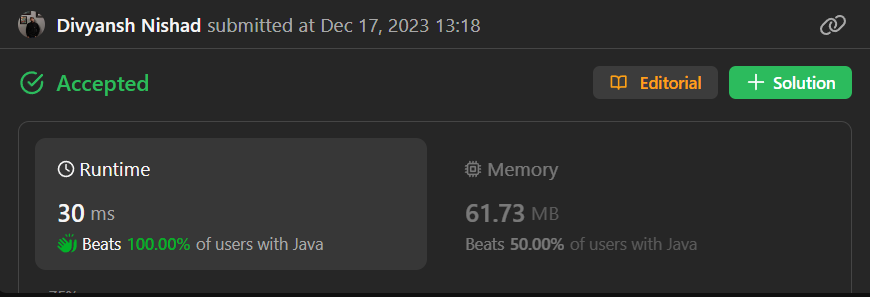

# ✅Beats 100% - Explained - Prefix Sum + Binary Search - C++/Java/Python/JS

**Author:** millenium103
**Votes:** 73
**Link:** [https://leetcode.com/problems/apply-operations-to-maximize-frequency-score/solutions/4415578/](https://leetcode.com/problems/apply-operations-to-maximize-frequency-score/solutions/4415578/)

---



# Intuition
<!-- Describe your first thoughts on how to solve this problem. -->
The goal is to maximize the score, which is the frequency of the most frequent element in the array. The operations allowed are incrementing or decrementing the values at any index in the array. The approach involves using binary search to find the optimal value for the most frequent element and then adjusting the array accordingly.

# Approach
<!-- Describe your approach to solving the problem. -->
1. Sort the array to make it easier to perform binary search.
2. Use binary search to find the target value for the most frequent element.
3. For each candidate target value, calculate the cost of making the array elements equal to the target value.
4. Adjust the array elements to minimize the cost while staying within the allowed number of operations (k).
5. Update the maximum score based on the frequency of the most frequent element achieved.
6. Continue the binary search until the optimal target value is found.

# Complexity
- Sorting the array takes O(n log n) time.
- Binary search is performed in each iteration, taking O(log n) time.
- The inner while loop adjusts the array elements and takes O(n) time in the worst case.
- Overall, the time complexity is O(n log n * log(max(nums))).
- The space complexity is O(n) for the prefix sum array.
- The algorithm uses binary search to optimize the target value, and then linearly adjusts the array to find the maximum score.

# Code
```java []
class Solution {
    public int maxFrequencyScore(int[] nums, long k) {
        Arrays.sort(nums);
        int n = nums.length;
        long[] prefixSum = new long[n + 1];
        for (int i = 0; i < n; i++) {
            prefixSum[i + 1] = prefixSum[i] + nums[i];
        }
        int start = 0;
        int end = 1;
        int out = 1;
        while (end < n) {
            end++;
            int mid = (start + end) / 2;
            long target = nums[mid];
            long cost = (target * (mid - start) - (prefixSum[mid] - prefixSum[start])) + (prefixSum[end] - prefixSum[mid] - target * (end - mid));
            while (start < end && cost > k) {
                start++;
                mid = (start + end) / 2;
                target = nums[mid];
                cost = (target * (mid - start) - (prefixSum[mid] - prefixSum[start])) + (prefixSum[end] - prefixSum[mid] - target * (end - mid));
            }
            out = Math.max(out, end - start);
        }
        return out;
    }
}
```
```C++ []
class Solution {
public:
    int maxFrequencyScore(vector<int>& nums, long long k) {
        sort(nums.begin(), nums.end());

    int n = nums.size();
    vector<long long> prefixSum(n + 1, 0);

    for (int i = 0; i < n; ++i) {
        prefixSum[i + 1] = prefixSum[i] + nums[i];
    }

    int start = 0;
    int end = 1;
    int maxScore = 1;

    while (end < n) {
        ++end;
        int mid = (start + end) / 2;
        long long target = nums[mid];
        long long cost = (target * (mid - start) - (prefixSum[mid] - prefixSum[start])) + (prefixSum[end] - prefixSum[mid] - target * (end - mid));

        while (start < end && cost > k) {
            ++start;
            mid = (start + end) / 2;
            target = nums[mid];
            cost = (target * (mid - start) - (prefixSum[mid] - prefixSum[start])) + (prefixSum[end] - prefixSum[mid] - target * (end - mid));
        }

        maxScore = max(maxScore, end - start);
    }

    return maxScore;
    }
};
```
```Python []
class Solution(object):
    def maxFrequencyScore(self, nums, k):
        nums.sort()

        n = len(nums)
        prefix_sum = [0] * (n + 1)

        for i in range(n):
            prefix_sum[i + 1] = prefix_sum[i] + nums[i]

        start = 0
        end = 1
        max_score = 1

        while end < n:
            end += 1
            mid = (start + end) // 2
            target = nums[mid]
        
            cost = (target * (mid - start) - (prefix_sum[mid] - prefix_sum[start])) + (prefix_sum[end] - prefix_sum[mid] - target * (end - mid))
        
            while start < end and cost > k:
                start += 1
                mid = (start + end) // 2
                target = nums[mid]
                cost = (target * (mid - start) - (prefix_sum[mid] - prefix_sum[start])) +(prefix_sum[end] - prefix_sum[mid] - target * (end - mid))

            max_score = max(max_score, end - start)

        return max_score
        
```
```JavaScript []
/**
 * @param {number[]} nums
 * @param {number} k
 * @return {number}
 */
var maxFrequencyScore = function(nums, k) {
    nums.sort((a, b) => a - b);

    const n = nums.length;
    const prefixSum = new Array(n + 1).fill(0);

    for (let i = 0; i < n; ++i) {
        prefixSum[i + 1] = prefixSum[i] + nums[i];
    }

    let start = 0;
    let end = 1;
    let maxScore = 1;

    while (end < n) {
        ++end;
        const mid = Math.floor((start + end) / 2);
        const target = nums[mid];
        let cost = (target * (mid - start) - (prefixSum[mid] - prefixSum[start])) + (prefixSum[end] - prefixSum[mid] - target * (end - mid));

        while (start < end && cost > k) {
            ++start;
            const mid = Math.floor((start + end) / 2);
            const target = nums[mid];
            cost = (target * (mid - start) - (prefixSum[mid] - prefixSum[start])) + (prefixSum[end] - prefixSum[mid] - target * (end - mid));
        }

        maxScore = Math.max(maxScore, end - start);
    }

    return maxScore;
};
```

