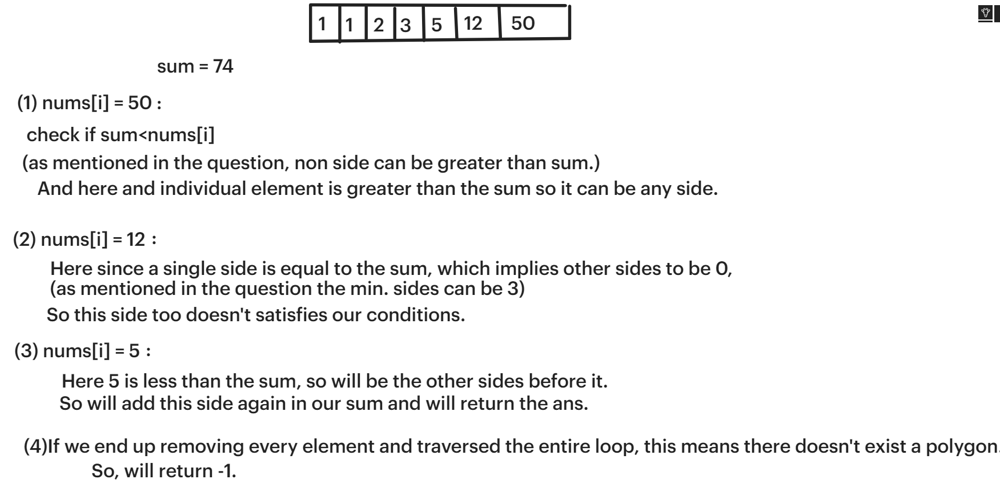

# ✅☑Beats 100% || [C++/Java/Python/JavaScript] || 2 Approaches || EXPLAINED🔥

**Author:** MarkSPhilip31
**Votes:** 153
**Link:** [https://leetcode.com/problems/find-polygon-with-the-largest-perimeter/solutions/4729097/](https://leetcode.com/problems/find-polygon-with-the-largest-perimeter/solutions/4729097/)

---

# DO GIVE IT A LIKE IF THAT WAS HELPFUL\uD83E\uDEE1\uD83D\uDC47


---


---


# Approaches
(Also explained in the code)

#### ***Approach 1( With Backward Iteration)***
1. Sum all the elements in the nums array.
1. Traverse the array backwards.
2. Check if the sum minus the current element is greater than the current element.
3. If the condition is met, return the sum plus the current element as the perimeter.
4. If no suitable perimeter is found, return -1.




# Complexity
- Time complexity:
   $$O(nlogn)$$
    

- Space complexity:
   $$O(1)$$
    


# Code
```C++ []
class Solution {
public:
    long long largestPerimeter(vector<int>& nums) {
        long long sum = 0;
        sort(nums.begin(),nums.end());
        for(auto i : nums) sum += i;
        int n = nums.size();
        for(int i = n - 1; i >= 2; i--){
            sum -= nums[i];
            if(sum > nums[i]){
                return sum + nums[i];
            }
        }
        return -1;
    }
};


```
```Java []


class Solution {
    public long largestPerimeter(int[] nums) {
        long sum = 0;
        Arrays.sort(nums);
        for (int num : nums) {
            sum += num;
        }
        int n = nums.length;
        for (int i = n - 1; i >= 2; i--) {
            sum -= nums[i];
            if (sum > nums[i]) {
                return sum + nums[i];
            }
        }
        return -1;
    }
}


```
```python3 []

class Solution:
    def largestPerimeter(self, nums: List[int]) -> int:
        nums.sort()
        _sum = sum(nums)
        n = len(nums)
        for i in range(n - 1, 1, -1):
            _sum -= nums[i]
            if _sum > nums[i]:
                return _sum + nums[i]
        return -1


```
```javascript []
var largestPerimeter = function(nums) {
    nums.sort((a, b) => a - b);
    let sum = nums.reduce((acc, val) => acc + val, 0);
    let n = nums.length;
    for (let i = n - 1; i >= 2; i--) {
        sum -= nums[i];
        if (sum > nums[i]) {
            return sum + nums[i];
        }
    }
    return -1;
};


```
---

#### ***Approach 2 ( With Forward Iteration )***

1. **Sort the array:** Start by sorting the array of numbers in ascending order.

1. **Initialize variables:** Set up variables to track the running sum (`sum`) and the largest perimeter found so far (`ans`).

1. **Iterate through the sorted array:** Loop through each number in the sorted array.

1. **Check polygon condition:** For each number, check if it's smaller than the sum of all previous numbers encountered.

1. **Update largest perimeter:** If the condition is met, update `ans` with the sum of the current number and the running `sum`. Finally, return the largest perimeter found (`ans`).


# Complexity
- Time complexity:
   $$O(nlogn)$$
    

- Space complexity:
   $$O(1)$$
    


# Code
```C++ []
class Solution {
public:
    long long largestPerimeter(vector<int>& nums) {
        sort(nums.begin(),nums.end());
        long long sum = 0;
        long long ans = -1;
        
        for(int i=0;i<nums.size();i++){
            if(nums[i]<sum)ans = nums[i] + sum;
            sum+=nums[i];
        }
        
        return ans;
    }
};


```
```Java []


class Solution {
    public long largestPerimeter(int[] nums) {
        Arrays.sort(nums);
        long sum = 0;
        long ans = -1;
        
        for (int i = 0; i < nums.length; i++) {
            if (nums[i] < sum) {
                ans = nums[i] + sum;
            }
            sum += nums[i];
        }
        
        return ans;
    }
}


```
```python3 []
class Solution:
    def largestPerimeter(self, nums: List[int]) -> int:
        nums.sort()
        sum_val = 0
        ans = -1
        
        for num in nums:
            if num < sum_val:
                ans = num + sum_val
            sum_val += num
            
        return ans


```
```javascript []
class Solution {
    largestPerimeter(nums) {
        nums.sort((a, b) => a - b);
        let sum = 0;
        let ans = -1;
        
        for (let i = 0; i < nums.length; i++) {
            if (nums[i] < sum) {
                ans = nums[i] + sum;
            }
            sum += nums[i];
        }
        
        return ans;
    }
}


```
---


# DO GIVE IT A LIKE IF THAT WAS HELPFUL\uD83E\uDEE1\uD83D\uDC47

---
---


---