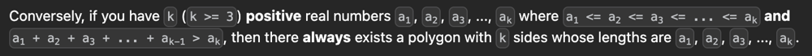

# 🎨  The ART of Dynamic Programming

**Author:** claytonjwong
**Votes:** 2
**Link:** [https://leetcode.com/problems/find-polygon-with-the-largest-perimeter/solutions/4732191/](https://leetcode.com/problems/find-polygon-with-the-largest-perimeter/solutions/4732191/)

---

# Synopsis

## The problem statement tells us **exactly** what to do here:



# Game Plan

## [\uD83C\uDFA8  The ART of Dynamic Programming:](https://leetcode.com/discuss/general-discussion/712010/The-ART-of-Dynamic-Programming-An-Intuitive-Approach%3A-from-Apprentice-to-Master)

1. Sort the input array `A`, such that a<sub>1</sub> <= a<sub>2</sub> <= a<sub>3</sub> <= ... <= a<sub>k</sub> (ie. `a[0] <= A[1] <= A[2] <= ... <= A[N-1]`)
1. Precalculate the suffix sums `S` of the input array `A` to calculate the sum of a<sub>1</sub> + a<sub>2</sub> + a<sub>1</sub> + ... + a<sub>k - 1</sub> in O(1) time to determine if the predicate a<sub>1</sub> + a<sub>2</sub> + a<sub>1</sub> + ... + a<sub>k - 1</sub> > a<sub>k</sub> is true or false
1. Greedily "consume" the largest `A[k]`<sup>th</sup> value `hi` as the maximum length side where the total `t` suffix sum **strictly exceeds** `hi`, ie. `hi < t`

# Implementations

*Kotlin: O(N) Memory*
```
class Solution {
    fun largestPerimeter(A: IntArray): Long {
        A.sort()
        var N = A.size
        var S = LongArray(N + 1){ 0 }
        for (i in N - 1 downTo 0)
            S[i] += A[i] + S[i + 1]
        for (k in N - 1 downTo 0) {
            var (hi, t) = Pair(A[k], S[0] - S[k])
            if (hi < t)
                return hi + t
        }
        return -1
    }
}
```

*Kotlin: O(1) Memory*
```
class Solution {
    fun largestPerimeter(A: IntArray): Long {
        var t = A.map{ it.toLong() }.sum()
        for (hi in A.sorted().reversed()) {
            t -= hi
            if (hi < t)
                return hi + t
        }
        return -1
    }
}
```

*Javascript: O(N) Memory*
```
let largestPerimeter = (A, N = A.length) => {
    A.sort((a, b) => a - b)
    let S = [...A].concat([0]);
    for (let i = N - 1; 0 <= i; --i)
        S[i] += S[i + 1];
    for (let k = N - 1; 0 <= k; --k) {
        let [hi, t] = [A[k], S[0] - S[k]];
        if (hi < t)
            return hi + t;
    }
    return -1;
};
```

*Javascript: O(1) Memory*
```
let largestPerimeter = (A, t = _.sum(A)) => {
    A.sort((a, b) => b - a);
    for (let hi of A) {
        t -= hi;
        if (hi < t)
            return hi + t;
    }
    return -1;
};
```

*Python3: O(N) Memory*
```
class Solution:
    def largestPerimeter(self, A: List[int]) -> int:
        A.sort()
        N = len(A)
        S = A[:] + [0]
        for i in reversed(range(N)):
            S[i] += S[i + 1]
        for k in reversed(range(N)):
            hi, t = A[k], S[0] - S[k]
            if hi < t:
                return hi + t
        return -1
```

*Python3: O(1) Memory*
```
class Solution:
    def largestPerimeter(self, A: List[int]) -> int:
        t = sum(A)
        for hi in reversed(sorted(A)):
            t -= hi
            if hi < t:
                return hi + t
        return -1
```

*Rust: O(N) Memory*
```
impl Solution {
    pub fn largest_perimeter(mut A: Vec<i32>) -> i64 {
        A.sort();
        let N = A.len();
        let mut S = vec![0i64; N + 1];
        for i in (0..N).rev() {
            S[i] += A[i] as i64 + S[i + 1];
        }
        for k in (0..N).rev() {
            let (hi, t) = (A[k] as i64, S[0] - S[k]);
            if hi < t {
                return hi + t;
            }
        }
        -1i64
    }
}
```

*Rust: O(1) Memory*
```
impl Solution {
    pub fn largest_perimeter(mut A: Vec<i32>) -> i64 {
        A.sort();
        let N = A.len();
        let mut t = A.iter().map(|&x| x as i64).sum::<i64>();
        for k in (0..N).rev() {
            let hi = A[k] as i64;
            t -= hi;
            if hi < t {
                return hi + t;
            }
        }
        -1i64
    }
}
```

*C++: O(N) Memory*
```
class Solution {
public:
    using LL = long long;
    using VL = vector<LL>;
    using VI = vector<int>;
    LL largestPerimeter(VI& A) {
        sort(A.begin(), A.end());
        int N = A.size();
        VL S(N + 1);
        for (auto i{ N - 1 }; 0 <= i; --i)
            S[i] += A[i] + S[i + 1];
        for (auto k{ N - 1 }; 0 <= k; --k) {
            auto [hi, t] = make_pair(A[k], S[0] - S[k]);
            if (hi < t)
                return hi + t;
        }
        return -1;
    }
};
```

*C++: O(1) Memory*
```
class Solution {
public:
    using LL = long long;
    using VI = vector<int>;
    LL largestPerimeter(VI& A) {
        sort(A.rbegin(), A.rend());
        auto t = accumulate(A.begin(), A.end(), 0LL, [](auto t, auto x) { return t + x; });
        for (auto hi: A) {
            t -= hi;
            if (hi < t)
                return hi + t;
        }
        return -1;
    }
};
```

---

# Supplemental: \uD83C\uDF5E "Breadcrumbs" for how we arrived "here" \uD83C\uDFAF

*Python3*
```
# 6:28am - 

# sort input A

# then prefix sums for i..j <--- smaller sides ...k <--- longest side

# for each longest side, find the smallest i..j prefix sum of smaller sides where sum of i..j strictly exceeds the longest side
# so we can perform binary search

# 6:30am - imeplementation begins

# class Solution:
#     def largestPerimeter(self, A: List[int], best = -1) -> int:
#         A.sort()
#         N = len(A)
#         S = A[:] + [0]
#         for i in reversed(range(N)):
#             S[i] += S[i + 1]
#         for hi in reversed(2, range(N)):
#             i, j = 0, hi - 1
#             while i < j:
#                 k = (i + j) // 2
#                 t = S[0] - S[k + 1]
#                 if hi < t:
#                     i = k
#                 else:
#                     j = k - 1
#             cand = S[0] - S[j + 1]

#         return best

# KISS == keep it super simple -> I wonder if a sliding window would be better?

# 6:37am -
# 6:39am - \uD83D\uDCA9 the problem statement clearly tells us what to do here!!! PAY ATTENTION DUDE!!!

# Conversely, if you have k (k >= 3) positive real numbers a1, a2, a3, ..., ak
# where a1 <= a2 <= a3 <= ... <= ak and a1 + a2 + a3 + ... + ak-1 > ak,
# then there always exists a polygon with k sides whose lengths are a1, a2, a3, ..., ak.

# so we sort A and then consider each k index, from right-to-left, that sounds more simple than above approach
# ie. A[0] + A[1] + A[2] + ... + A[k - 2] + A[k - 2] > A[k]

# 6:41am - implementation begins
# 6:43am - implementation ends

# class Solution:
#     def largestPerimeter(self, A: List[int]) -> int:
#         A.sort()
#         N = len(A)
#         S = A[:] + [0]
#         for i in reversed(range(N)):
#             S[i] += S[i + 1]
#         for k in reversed(range(N)):
#             hi, t = A[k], S[0] - S[k + 1]
#             if hi < t:
#                 return hi + t
#         return -1

# Wrong Answer
# Runtime: 51 ms
# Input
# nums =
# [5,5,5]
# Output
# 20
# Expected
# 15

# 6:46am - oops, off-by-1 error for suffix sum total t calculatation where k is NON-INCLUSIVE!

# class Solution:
#     def largestPerimeter(self, A: List[int]) -> int:
#         A.sort()
#         N = len(A)
#         S = A[:] + [0]
#         for i in reversed(range(N)):
#             S[i] += S[i + 1]
#         for k in reversed(range(N)):
#             hi, t = A[k], S[0] - S[k]
#             if hi < t:
#                 return hi + t
#         return -1

# O(N) -> O(1) memory optimization

class Solution:
    def largestPerimeter(self, A: List[int]) -> int:
        t = sum(A)
        for hi in reversed(sorted(A)):
            t -= hi
            if hi < t:
                return hi + t
        return -1
```