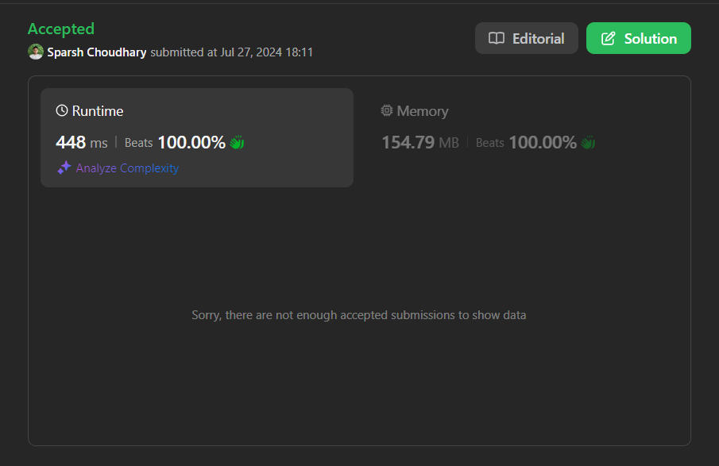

# BEATS 100 % 🎯|  Floyd-Warshall 🍭

**Author:** CodeWithSparsh
**Votes:** 2
**Link:** [https://leetcode.com/problems/minimum-cost-to-convert-string-i/solutions/5543813/](https://leetcode.com/problems/minimum-cost-to-convert-string-i/solutions/5543813/)

---



# Intuition
<!-- Describe your first thoughts on how to solve this problem. -->
The problem involves finding the minimum cost to convert a source string into a target string using given character conversion costs. This can be thought of as a shortest path problem in a graph where nodes represent characters, and edges represent conversion costs.

# Approach
<!-- Describe your approach to solving the problem. -->
1. **Build the Conversion Graph**: Represent the conversion costs as a graph with 26 nodes (one for each lowercase letter). Initialize the graph with infinite costs and set the cost to convert a character to itself as zero.
2. **Optimize Conversion Paths**: Use the Floyd-Warshall algorithm to find the shortest paths between all pairs of nodes. This will give the minimum cost to convert any character to any other character.
3. **Compute Total Conversion Cost**: Iterate through each character of the source and target strings. Sum the minimum conversion costs for each pair of characters. If any conversion is impossible, return -1.

# Complexity
- Time complexity:
<!-- Add your time complexity here, e.g. $$O(n)$$ -->
$$O(n^3 + m + l)$$ where \\( n \\) is the number of characters (26 for lowercase letters), \\( m \\) is the number of conversions, and \\( l \\) is the length of the source/target strings.

- Space complexity:
<!-- Add your space complexity here, e.g. $$O(n)$$ -->
$$O(n^2)$$ for storing the conversion graph.

# Code
```dart
const int charCount = 26;
const int inf = 1 << 31 - 1; // Dart equivalent of Integer.MAX_VALUE / 2

class Solution {
  int minimumCost(String source, String target, List<String> original, List<String> changed, List<int> cost) {
    List<List<int>> conversionGraph = buildConversionGraph(original, changed, cost);
    optimizeConversionPaths(conversionGraph);
    return computeTotalConversionCost(source, target, conversionGraph);
  }

  List<List<int>> buildConversionGraph(List<String> original, List<String> changed, List<int> cost) {
    List<List<int>> graph = List.generate(charCount, (_) => List.filled(charCount, inf));
    for (int i = 0; i < charCount; i++) {
      graph[i][i] = 0;
    }
    for (int i = 0; i < cost.length; i++) {
      int from = original[i].codeUnitAt(0) - 'a'.codeUnitAt(0);
      int to = changed[i].codeUnitAt(0) - 'a'.codeUnitAt(0);
      graph[from][to] = min(graph[from][to], cost[i]);
    }
    return graph;
  }

  void optimizeConversionPaths(List<List<int>> graph) {
    for (int k = 0; k < charCount; k++) {
      for (int i = 0; i < charCount; i++) {
        if (graph[i][k] < inf) {
          for (int j = 0; j < charCount; j++) {
            if (graph[k][j] < inf) {
              graph[i][j] = min(graph[i][j], graph[i][k] + graph[k][j]);
            }
          }
        }
      }
    }
  }

  int computeTotalConversionCost(String source, String target, List<List<int>> graph) {
    int totalCost = 0;
    for (int i = 0; i < source.length; i++) {
      int sourceChar = source.codeUnitAt(i) - 'a'.codeUnitAt(0);
      int targetChar = target.codeUnitAt(i) - 'a'.codeUnitAt(0);
      if (sourceChar != targetChar) {
        if (graph[sourceChar][targetChar] == inf) {
          return -1;
        }
        totalCost += graph[sourceChar][targetChar];
      }
    }
    return totalCost;
  }
}
```

