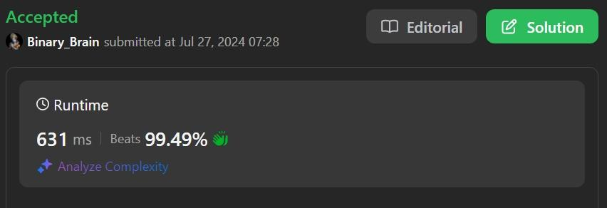

# Simplest form of Code in 3 Languages|| Beats 99% users

**Author:** Success_Code
**Votes:** 67
**Link:** [https://leetcode.com/problems/minimum-cost-to-convert-string-i/solutions/5541353/](https://leetcode.com/problems/minimum-cost-to-convert-string-i/solutions/5541353/)

---

>Simple yet effective with 99% dominance


# Result: 


# Code
```python []
from collections import defaultdict
from heapq import heappush, heappop
from math import inf

class Solution:
    def minimumCostFrom(self, sourceChar):
        bests = {}
        seenCost = defaultdict(lambda: inf)
        seenCost[sourceChar] = 0
        frontier = [(0, sourceChar)]
        while len(frontier) > 0:
            reachCost, current = heappop(frontier)
            if current in bests:
                continue
            bests[current] = reachCost
            for d, edgeCost in self.edges[current].items():
                totalCost = reachCost + edgeCost
                if totalCost < seenCost[d]:
                    heappush(frontier, (totalCost, d))
                    seenCost[d] = totalCost
        return bests
    def minimumCost(self, source: str, target: str, original: List[str], changed: List[str], cost: List[int]) -> int:
        self.edges = defaultdict(lambda: {})
        for i in range(len(original)):
            s = original[i]
            d = changed[i]
            c = cost[i]
            if d not in self.edges[s] or c < self.edges[s][d]:
                self.edges[s][d] = c

        bests = defaultdict(lambda: {})
        totalCost = 0
        for s, t in zip(source, target):
            if s != t:
                if t in bests[s]:
                    totalCost += bests[s][t]
                elif len(bests[s]) > 0:
                    return -1
                else:
                    best = self.minimumCostFrom(s)
                    bests[s] = best
                    if t in best:
                        totalCost += best[t]
                    else:
                        return -1
        return totalCost
```
```java []
class Solution {
    public long minimumCost(String source, String target, char[] original, char[] changed, int[] cost) {
        int[][] dis = new int[26][26];
        for (int i = 0; i < 26; i++) {
            Arrays.fill(dis[i], Integer.MAX_VALUE);
            dis[i][i] = 0;
        }
        for (int i = 0; i < cost.length; i++) {
            dis[original[i] - 'a'][changed[i] - 'a'] = Math.min(dis[original[i] - 'a'][changed[i] - 'a'], cost[i]);
        }
        for (int k = 0; k < 26; k++) {
            for (int i = 0; i < 26; i++)
                if (dis[i][k] < Integer.MAX_VALUE) {
                    for (int j = 0; j < 26; j++) {
                        if (dis[k][j] < Integer.MAX_VALUE) {
                            dis[i][j] = Math.min(dis[i][j], dis[i][k] + dis[k][j]);
                        }
                    }
                }
        }
        long ans = 0L;
        for (int i = 0; i < source.length(); i++) {
            int c1 = source.charAt(i) - 'a';
            int c2 = target.charAt(i) - 'a';
            if (dis[c1][c2] == Integer.MAX_VALUE) {
                return -1L;
            } else {
                ans += (long)dis[c1][c2];
            }
        }
        return ans;
    }
}
```
```C++ []
class Solution {
public:
    long long minimumCost(string source, string target, vector<char>& original, vector<char>& changed, vector<int>& cost) {
        const int inf = 1 << 29;
        int g[26][26];
        for (int i = 0; i < 26; ++i) {
            fill(begin(g[i]), end(g[i]), inf);
            g[i][i] = 0;
        }

        for (int i = 0; i < original.size(); ++i) {
            int x = original[i] - 'a';
            int y = changed[i] - 'a';
            int z = cost[i];
            g[x][y] = min(g[x][y], z);
        }

        for (int k = 0; k < 26; ++k) {
            for (int i = 0; i < 26; ++i) {
                for (int j = 0; j < 26; ++j) {
                    g[i][j] = min(g[i][j], g[i][k] + g[k][j]);
                }
            }
        }

        long long ans = 0;
        int n = source.length();
        for (int i = 0; i < n; ++i) {
            int x = source[i] - 'a';
            int y = target[i] - 'a';
            if (x != y) {
                if (g[x][y] >= inf) {
                    return -1;
                }
                ans += g[x][y];
            }
        }
        return ans;
    }
};
```

