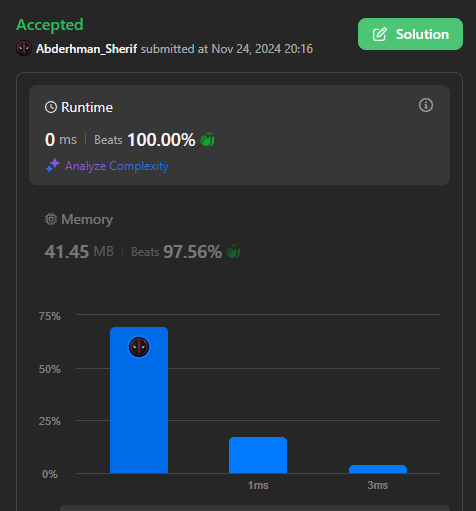

# Easy Solution for Understanding Without Sorting (Beats 100.00% , 0 ms)

**Author:** Abderhman_Sherif
**Votes:** 0
**Link:** [https://leetcode.com/problems/smallest-missing-integer-greater-than-sequential-prefix-sum/solutions/6079877/](https://leetcode.com/problems/smallest-missing-integer-greater-than-sequential-prefix-sum/solutions/6079877/)

---

# Intuition

<!-- Describe your first thoughts on how to solve this problem. -->

# Approach
<!-- Describe your approach to solving the problem. -->
The code aims to find the smallest missing integer from an array of numbers such that the integer is greater than or equal to the sum of the longest sequential prefix in the array.

1 - Handling edge cases for an empty array or single element:
"=========="
if (nums.Length == 1 && nums[0] == 0)
    return 1;
else if (nums.Length == 0)
    return 0;
"=========="
If the array contains only one element and that element is 0, it returns 1 because the smallest missing integer in this case would be 1.
If the array is empty (i.e., it has no elements), it returns 0, as no number is missing.

2 - Finding the longest sequential prefix:
"=========="
int end = nums[0];
"=========="
The variable end is initialized with the first element of the array. This is used to keep track of the last element in the longest sequential prefix found so far.

3 - Iterating over the array to find the sequential prefix:
"=========="
for (int i = 0; i < nums.Length; i++)
{
    if (i + 1 < nums.Length)
    {
        if (nums[i] + 1 == nums[i + 1])
        {
            Sum += nums[i];
            end = nums[i + 1];
        }
        else
        {
            break;
        }
    }
}
"=========="

The code iterates through the array to find a sequential prefix.
For each pair of consecutive elements, it checks if they are sequential (i.e., if nums[i] + 1 == nums[i + 1]).
If they are sequential, it adds the value of nums[i] to the Sum and updates the end to nums[i + 1].
If the sequence breaks (i.e., the current element is not one more than the previous), it exits the loop.

 4 - Adding the last element of the sequential prefix to the sum:

"=========="
Sum += end;
"=========="
After finishing the loop, the end element (the last element of the sequential prefix) is added to Sum.


5 - Handling the case when the sum is still zero:

"=========="
if (Sum == 0)
    Sum += nums[0];
"=========="

If Sum is still 0, meaning no sequential prefix was found, it adds the first element of the array to Sum.

6 - Finding the smallest missing number:

"=========="
while (nums.Contains(Sum))
    Sum++;
"=========="

The code enters a while loop and keeps incrementing Sum until it finds a number that is not present in the array. This gives the smallest missing number greater than or equal to the sum of the sequential prefix.


And Return Sum 

Sorry for the long post

# Complexity
- Time complexity:
<!-- Add your time complexity here, e.g. $$O(n)$$ -->

- Space complexity:
<!-- Add your space complexity here, e.g. $$O(n)$$ -->

# Code
```csharp []
    public class Solution
    {
        public int MissingInteger(int[] nums)
        {
            
            int Sum = 0;
            if (nums.Length == 1 && nums[0] == 0)
                return 1;
            else if (nums.Length == 0)
                return 0;
          
            int end = nums[0];

            for (int i = 0; i < nums.Length; i++)
            {
                if(i+1<nums.Length)
                {
                    if (nums[i] + 1 == nums[i + 1])
                    {

                        Sum += nums[i];
                        end = nums[i + 1];
                       
                    }
                    else
                    {
                        break;
                    }
                   
                  
                  
                }
            }
            Sum += end;
            if (Sum == 0)
                Sum += nums[0];
            while (nums.Contains(Sum))
                Sum++;
            return Sum;

        }
    }

```