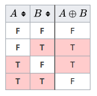

# bitmagic solution explained

**Author:** codeninja8
**Votes:** 1
**Link:** [https://leetcode.com/problems/minimum-number-of-operations-to-make-array-xor-equal-to-k/solutions/5088627/](https://leetcode.com/problems/minimum-number-of-operations-to-make-array-xor-equal-to-k/solutions/5088627/)

---

# Intuition
Sum all numbers with `xor`. Compare with `k`. The number of minimum changes should be the difference between the sum and `k`. We needn't find the operations themselves; we need only the count.



`xor` gives 1 if the numbers are different and 0 if they are the same.
Therefore if we `xor` the xor-sum of the `nums` with `k` we will get the number `x`. Numbers of 1 in `x` is the number of operations needed to get `k`. So we need to count how many `1` contain `x`.

Consider the example 1
Input: nums = [2,1,3,4], k = 1

```
2 ^ 1 ^ 3 ^ 4 ^ 1= 5 or 
010 ^ 001 ^ 011 ^ 100 ^ 001 = 101
```

`101` has 2 ones. `2` is the number of operations


# Approach
We are going to reuse `k` 
1. `xor` all elements in `nums` and `k` togather and put the result in `k`
2. Shift `k` until its zero and increase `count` if the last digit is `1`
3. return `count`

The code
``` java
int count = 0;
while (k != 0) {
    if ((k & 1) == 1) count++;
    k = k >> 1;
}
```
can be simplified to
``` java
int count = 0;
while (k != 0) {
    count += k & 1;
    k >>= 1;
}
```


# Complexity
- Time complexity:
$$O(n)$$

- Space complexity:
$$O(1)$$

# Code
``` java []
class Solution {
    public int minOperations(int[] nums, int k) {
        for (int val : nums) {
            k ^= val;
        }

        int count = 0;
        while (k != 0) {
            count += k & 1;
            k >>= 1;
        }

        return count;
    }
}
```
``` c []
int minOperations(int* nums, int numsSize, int k) {
    for (int i = 0; i < numsSize; i++) {
        k ^= nums[i];
    }

    int count = 0;
    while (k != 0) {
        count += k & 1;
        k >>= 1;
    }

    return count;
}
```
``` python []
class Solution(object):
    def minOperations(self, nums, k):
        k ^= reduce(operator.xor, nums)
        count = 0
        while k != 0:
            count += k & 1
            k >>= 1
        return count
```
``` javascript []
var minOperations = function(nums, k) {
    nums.forEach((val) => k ^= val);
    var count = 0;
    while (k != 0) {
        count += k & 1;
        k >>= 1;
    }

    return count;
};
```
``` php []
class Solution {
    function minOperations($nums, $k) {
        foreach ($nums as $val) {
            $k ^= $val;
        }
        $count = 0;
        while ($k != 0) {
            $count += $k & 1;
            $k >>= 1;
        }

        return $count;
    }
}
```
``` golang []
func minOperations(nums []int, k int) int {
    for _, val := range nums {
        k ^= val
    }
    count := 0
    for k != 0 {
        count += k & 1
        k >>= 1
    }

    return count
}
```
``` ruby []
def min_operations(nums, k)
    k ^= nums.reduce(:^)
    count = 0
    while k != 0 do
        count += k & 1
        k >>= 1
    end

    return count
end
```
``` racket []
(define (min-operations nums k)
    (let loop ([k (foldl bitwise-xor k nums)]
               [count 0])
        (if (zero? k) count (loop (arithmetic-shift k -1) (+ count (bitwise-and k 1))))))
```