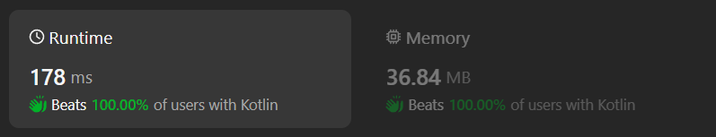

# Kotlin simple solution with sqrt

**Author:** chayangkoon
**Votes:** 0
**Link:** [https://leetcode.com/problems/maximum-area-of-longest-diagonal-rectangle/solutions/5061988/](https://leetcode.com/problems/maximum-area-of-longest-diagonal-rectangle/solutions/5061988/)

---




# Complexity
- Time complexity:
O(n)

- Space complexity:
O(1)

# Code
```
class Solution {
    fun areaOfMaxDiagonal(dimensions: Array<IntArray>): Int {
        var maxDiagonalLength = dimensions[0].calcDiagonalLength()
        var maxArea = dimensions[0].calcArea()

        for (index in 1 until dimensions.size) {
            val dimension = dimensions[index]
            val diagonalLength = dimension.calcDiagonalLength()

            if (diagonalLength > maxDiagonalLength) {
                maxDiagonalLength = diagonalLength
                maxArea = dimension.calcArea()

            } else if (diagonalLength == maxDiagonalLength) {
                maxArea = max(dimension.calcArea(), maxArea)
            }
        }

        return maxArea
    }

    private fun IntArray.calcDiagonalLength(): Float {
        return sqrt((this[0].toFloat() * this[0]) + (this[1].toFloat() * this[1]))
    }

    private fun IntArray.calcArea(): Int {
        return this[0] * this[1]
    }
}
```