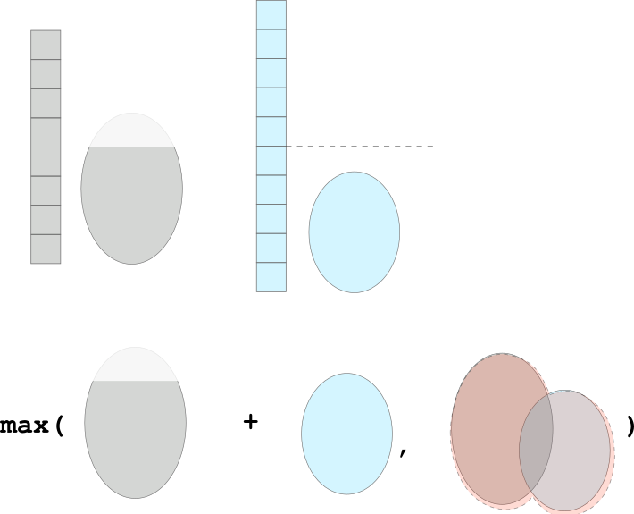

# 🚩 1-liner ^^

**Author:** andrii_khlevniuk
**Votes:** 0
**Link:** [https://leetcode.com/problems/maximum-size-of-a-set-after-removals/solutions/4757423/](https://leetcode.com/problems/maximum-size-of-a-set-after-removals/solutions/4757423/)

---



```
def maximumSetSize(self, x, y):
	return min(len(set(x+y)), min(len(set(x)), len(x)//2) + min(len(set(y)), len(y)//2))
```