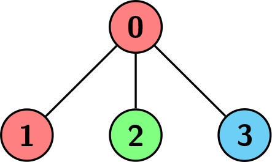
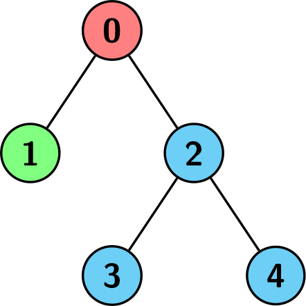

# [3004. Maximum Subtree of the Same Color](https://leetcode.com/problems/maximum-subtree-of-the-same-color/)

| Category | Difficulty | Likes | Dislikes |
| :------: | :--------: | :---: | :------: |
| Algorithms | Medium | 24 | 0 |

**Tags:** [`array`](https://leetcode.com/tag/array), [`dynamic-programming`](https://leetcode.com/tag/dynamic-programming), [`tree`](https://leetcode.com/tag/tree), [`depth-first-search`](https://leetcode.com/tag/depth-first-search)

**Companies:** `microsoft`

## Description

You are given a 2D integer array `edges` representing a tree with `n` nodes, numbered from `0` to `n - 1`, rooted at node `0`, where `edges[i] = [u_i, v_i]` means there is an edge between the nodes `v_i` and `u_i`.

You are also given a **0-indexed** integer array `colors` of size `n`, where `colors[i]` is the color assigned to node `i`.

We want to find a node `v` such that every node in the subtree of `v` has the **same** color.

Return *the size of such subtree with the **maximum** number of nodes possible.*

 

****

**Example 1:**

```

Input: edges = [[0,1],[0,2],[0,3]], colors = [1,1,2,3]
Output: 1
Explanation: Each color is represented as: 1 -&gt; Red, 2 -&gt; Green, 3 -&gt; Blue. We can see that the subtree rooted at node 0 has children with different colors. Any other subtree is of the same color and has a size of 1. Hence, we return 1.

```

**Example 2:**

```

Input: edges = [[0,1],[0,2],[0,3]], colors = [1,1,1,1]
Output: 4
Explanation: The whole tree has the same color, and the subtree rooted at node 0 has the most number of nodes which is 4. Hence, we return 4.

```

****

**Example 3:**

```

Input: edges = [[0,1],[0,2],[2,3],[2,4]], colors = [1,2,3,3,3]
Output: 3
Explanation: Each color is represented as: 1 -&gt; Red, 2 -&gt; Green, 3 -&gt; Blue. We can see that the subtree rooted at node 0 has children with different colors. Any other subtree is of the same color, but the subtree rooted at node 2 has a size of 3 which is the maximum. Hence, we return 3.

```

 

**Constraints:**

	- `n == edges.length + 1`

	- `1 <= n <= 5 * 10^4`

	- `edges[i] == [u_i, v_i]`

	- `0 <= u_i, v_i < n`

	- `colors.length == n`

	- `1 <= colors[i] <= 10^5`

	- The input is generated such that the graph represented by `edges` is a tree.

---

**Links:** [Submissions](https://leetcode.com/problems/maximum-subtree-of-the-same-color/) | [Solutions](https://leetcode.com/problems/maximum-subtree-of-the-same-color/)
