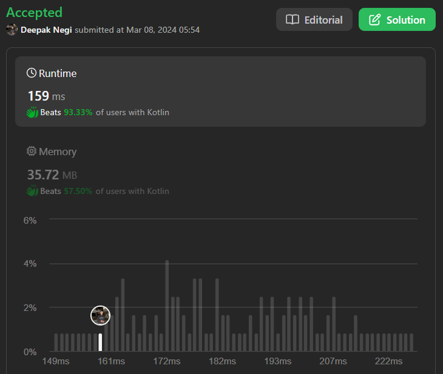

# Best Explanation ( Code with story ) | | C++ | | Java  | | Kotlin | | Python ✅✅✅

**Author:** Hunter_0718
**Votes:** 26
**Link:** [https://leetcode.com/problems/count-elements-with-maximum-frequency/solutions/4839873/](https://leetcode.com/problems/count-elements-with-maximum-frequency/solutions/4839873/)

---




**Intuition:**

To solve this problem, we need to find the maximum frequency among the elements in the given array. Then, we count the number of elements that have this maximum frequency.

**Approach:**

1. We'll use a HashMap to store the frequencies of each number in the array.
2. Iterate through the array and update the frequency count in the HashMap.
3. After obtaining the frequencies, we find the maximum frequency among all elements.
4. Finally, we iterate through the HashMap's values and count the elements with the maximum frequency.

**Complexity:**

- **Time complexity:** 
  - The time complexity for constructing the frequency map is O(n), where n is the number of elements in the input array.
  - Finding the maximum frequency and counting the elements with the maximum frequency will also take O(n) time.
  - Therefore, the overall time complexity is O(n).

- **Space complexity: **
  - We use a HashMap to store the frequencies, which can have a maximum of 'n' elements where 'n' is the size of the input array.
  - Hence, the space complexity is O(n).


**Code with Story:**

Let's dry run the provided code with the input array [1,2,2,3,1,4]:

1. HashMap `mp` will store the frequencies of each number:
   - {1: 2, 2: 2, 3: 1, 4: 1}

2. We find the maximum frequency, which is 2.

3. Then, we iterate through the HashMap values and count the elements with the maximum frequency:
   - Element 1 and 2 both have a frequency of 2, so the count becomes 4 (2 * 2).

4. Finally, we return the count, which is 4.

The code correctly identifies that elements 1 and 2 have the maximum frequency of 2 and returns the count accordingly.

Let me know if you need further clarification!

```c++ []
class Solution {
public:
    int maxFrequencyElements(vector<int>& nums) {
        unordered_map<int,int>mp;
        for(auto &num : nums){
            mp[num]++;
        }
        int count = 0;
        int max_Freq = INT_MIN;
        for(auto &m : mp){
            if(m.second > max_Freq)
                max_Freq = m.second; 
        }

        for(auto &m : mp){
            if(m.second == max_Freq)
                count += max_Freq;
        }
        return count;

    }
};
```
```java []
class Solution {
    public int maxFrequencyElements(int[] nums) {
        HashMap<Integer, Integer> mp = new HashMap<>();
        for (int num : nums) {
            mp.put(num, mp.getOrDefault(num, 0) + 1);
        }

        int count = 0;
        int maxFreq = Integer.MIN_VALUE;
        for (int freq : mp.values()) {
            maxFreq = Math.max(maxFreq, freq);
        }

        for (int freq : mp.values()) {
            if (freq == maxFreq)
                count += maxFreq;
        }
        return count;
    }
}

```
```python []
class Solution:
    def maxFrequencyElements(self, nums):
        mp = {}
        for num in nums:
            mp[num] = mp.get(num, 0) + 1

        count = 0
        max_freq = float('-inf')
        for freq in mp.values():
            max_freq = max(max_freq, freq)

        for freq in mp.values():
            if freq == max_freq:
                count += max_freq

        return count

```

```Kotlin []
class Solution {
    fun maxFrequencyElements(nums: IntArray): Int {
        val mp = mutableMapOf<Int, Int>()
        for (num in nums) {
            mp[num] = mp.getOrDefault(num, 0) + 1
        }

        var count = 0
        var maxFreq = Int.MIN_VALUE
        for (freq in mp.values) {
            maxFreq = maxOf(maxFreq, freq)
        }

        for (freq in mp.values) {
            if (freq == maxFreq) {
                count += maxFreq
            }
        }
        return count
    }
}

```


Let's dry run the provided input `[1, 2, 2, 3, 1, 4]` through the Kotlin code:

1. **Initialize Map:** 
   - Initially, the map is empty.

2. **Loop through the input array:**
   - First iteration: `num = 1`
     - Add `1` to the map with a count of `1`: `{1: 1}`
   - Second iteration: `num = 2`
     - Add `2` to the map with a count of `1`: `{1: 1, 2: 1}`
   - Third iteration: `num = 2`
     - Increment count for `2` to `2`: `{1: 1, 2: 2}`
   - Fourth iteration: `num = 3`
     - Add `3` to the map with a count of `1`: `{1: 1, 2: 2, 3: 1}`
   - Fifth iteration: `num = 1`
     - Increment count for `1` to `2`: `{1: 2, 2: 2, 3: 1}`
   - Sixth iteration: `num = 4`
     - Add `4` to the map with a count of `1`: `{1: 2, 2: 2, 3: 1, 4: 1}`

3. **Find Maximum Frequency:**
   - Maximum frequency is `2`.

4. **Count Elements with Maximum Frequency:**
   - Iterate over map values:
     - Frequency of `1`: `2`
     - Frequency of `2`: `2`
     - Frequency of `1`: `1`
     - Frequency of `1`: `1`
   - Increment count for frequencies equal to the maximum frequency: `2 + 2 = 4`

5. **Return Result:**
   - Return the count, which is `4`.

So, the Kotlin code correctly returns `4` for the input `[1, 2, 2, 3, 1, 4]`, indicating that there are `4` elements with the maximum frequency.
