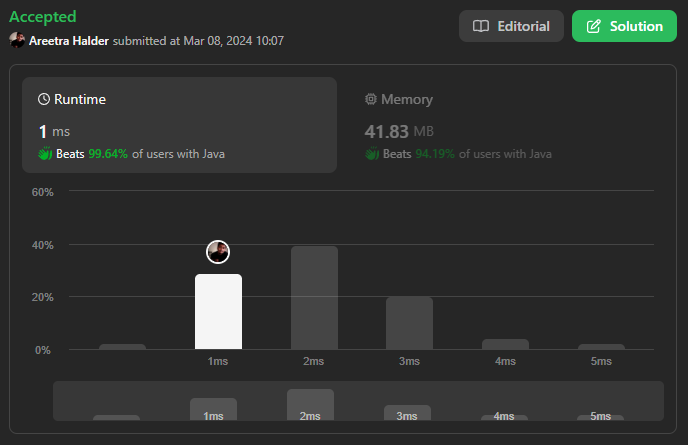

# 🔥✅✅ Beats 99.64% with Proof | Very Easy to Understand ✅✅🔥

**Author:** areetrahalder
**Votes:** 6
**Link:** [https://leetcode.com/problems/count-elements-with-maximum-frequency/solutions/4840826/](https://leetcode.com/problems/count-elements-with-maximum-frequency/solutions/4840826/)

---

# Proof - Upvote if you are watching the proof


> Time Zone: GMT +5:30, Location: India

# Intuition
<!-- Describe your first thoughts on how to solve this problem. -->
To solve this problem, we can use an array `freqCheck` to keep track of the frequency of each element in the given array nums. Another array `track` is used to keep track of distinct elements encountered in the array. We also maintain a variable `top` to keep track of the top index of the track array, and `maxFreq` to store the maximum frequency encountered so far.

# Approach
<!-- Describe your approach to solving the problem. -->
1. Initialize the arrays and variables: freqCheck to store frequencies, track to store distinct elements, top to keep track of the top index in track, and maxFreq to store the maximum frequency.
2. Iterate through the elements in the nums array.
    * Increment the frequency of the current element in freqCheck.
    * If the frequency becomes 1 (indicating a new distinct element), add it to the track array.
    * Update maxFreq if the current element's frequency surpasses the current maximum frequency.
3. Iterate through the track array and count the elements that have a frequency equal to maxFreq.
4. Return the product of the count and maxFreq.

# Complexity
- Time complexity: $$O(n)$$
<!-- Add your time complexity here, e.g. $$O(n)$$ -->
> where n is the length of the `nums` array. The algorithm iterates through the array once.

- Space complexity: $$O(1)$$
<!-- Add your space complexity here, e.g. $$O(n)$$ -->
> The `freqCheck` and `track` arrays both have a fixed size of 100 and is constant.

# Code
```Java []
class Solution {
    public int maxFrequencyElements(int[] nums) {
        int[] freqCheck = new int[101];
        int[] track = new int[100];
        int top = -1;
        int maxFreq = 0;

        for (int num : nums) {
            if (freqCheck[num]++ == 0) {
                track[++top] = num;
            }
            if (freqCheck[num] > maxFreq) {
                maxFreq = freqCheck[num];
            }            
        }

        int count = 0;
        int i = 0;
        while (i <= top) {
            if (freqCheck[track[i++]] == maxFreq) {
                count++;
            }
        }

        return count * maxFreq;
    }
}

```
```C []
int maxFrequencyElements(int* nums, int numsSize) {
    int freqCheck[101] = {0};
    int track[100];
    int top = -1;
    int maxFreq = 0;

    for (int i = 0; i < numsSize; i++) {
        int num = nums[i];
        if (num <= 100) {
            if (freqCheck[num] == 0) {
                track[++top] = num;
            }
            if (++freqCheck[num] > maxFreq) {
                maxFreq = freqCheck[num];
            }
        }
    }

    int count = 0;
    int i = 0;
    while (i <= top) {
        if (freqCheck[track[i++]] == maxFreq) {
            count++;
        }
    }

    return count * maxFreq;
}

```
```C++ []
class Solution {
public:
    int maxFrequencyElements(vector<int>& nums) {
        int freqCheck[101] = {0};
        int track[100];
        int top = -1;
        int maxFreq = 0;

        for (int num : nums) {
            if (num <= 100) {
                if (freqCheck[num] == 0) {
                    track[++top] = num;
                }
                if (++freqCheck[num] > maxFreq) {
                    maxFreq = freqCheck[num];
                }
            }
        }

        int count = 0;
        int i = 0;
        while (i <= top) {
            if (freqCheck[track[i++]] == maxFreq) {
                count++;
            }
        }

        return count * maxFreq;
    }
};

```
```C# []
public class Solution {
    public int MaxFrequencyElements(int[] nums) {
        int[] freqCheck = new int[101];
        int[] track = new int[100];
        int top = -1;
        int maxFreq = 0;

        foreach (int num in nums) {
            if (num <= 100) {
                if (freqCheck[num] == 0) {
                    track[++top] = num;
                }
                if (++freqCheck[num] > maxFreq) {
                    maxFreq = freqCheck[num];
                }
            }
        }

        int count = 0;
        int i = 0;
        while (i <= top) {
            if (freqCheck[track[i++]] == maxFreq) {
                count++;
            }
        }

        return count * maxFreq;
    }
}
```
```Python []
class Solution(object):
    def maxFrequencyElements(self, nums):
        """
        :type nums: List[int]
        :rtype: int
        """
        freqCheck = [0] * 101
        track = [0] * 100
        top = -1
        maxFreq = 0

        for num in nums:
            if freqCheck[num] == 0:
                top += 1
                track[top] = num
            freqCheck[num] += 1
            maxFreq = max(maxFreq, freqCheck[num])

        count = 0
        i = 0
        while i <= top:
            if freqCheck[track[i]] == maxFreq:
                count += 1
            i += 1

        return count * maxFreq

```
```Python3 []
class Solution:
    def maxFrequencyElements(self, nums: List[int]) -> int:
        freqCheck = [0] * 101
        track = [0] * 100
        top = -1
        maxFreq = 0

        for num in nums:
            if freqCheck[num] == 0:
                top += 1
                track[top] = num
            freqCheck[num] += 1
            maxFreq = max(maxFreq, freqCheck[num])

        count = 0
        i = 0
        while i <= top:
            if freqCheck[track[i]] == maxFreq:
                count += 1
            i += 1

        return count * maxFreq

```
```Javascript []
/**
 * @param {number[]} nums
 * @return {number}
 */
var maxFrequencyElements = function(nums) {
    let freqCheck = new Array(101).fill(0);
    let track = new Array(100).fill(0);
    let top = -1;
    let maxFreq = 0;

    for (let num of nums) {
        if (freqCheck[num]++ === 0) {
            track[++top] = num;
        }
        if (freqCheck[num] > maxFreq) {
            maxFreq = freqCheck[num];
        }            
    }

    let count = 0;
    let i = 0;
    while (i <= top) {
        if (freqCheck[track[i++]] === maxFreq) {
            count++;
        }
    }

    return count * maxFreq;
};

```
```Typescript []
function maxFrequencyElements(nums: number[]): number {
    const freqCheck: number[] = new Array(101).fill(0);
    const track: number[] = new Array(100).fill(0);
    let top: number = -1;
    let maxFreq: number = 0;

    for (const num of nums) {
        if (freqCheck[num]++ === 0) {
            track[++top] = num;
        }
        if (freqCheck[num] > maxFreq) {
            maxFreq = freqCheck[num];
        }            
    }

    let count: number = 0;
    let i: number = 0;
    while (i <= top) {
        if (freqCheck[track[i++]] === maxFreq) {
            count++;
        }
    }

    return count * maxFreq;
}

```

# Upvote - Please

