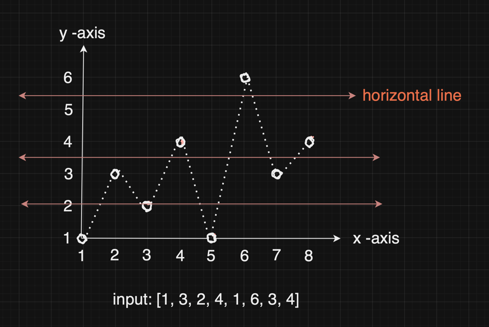
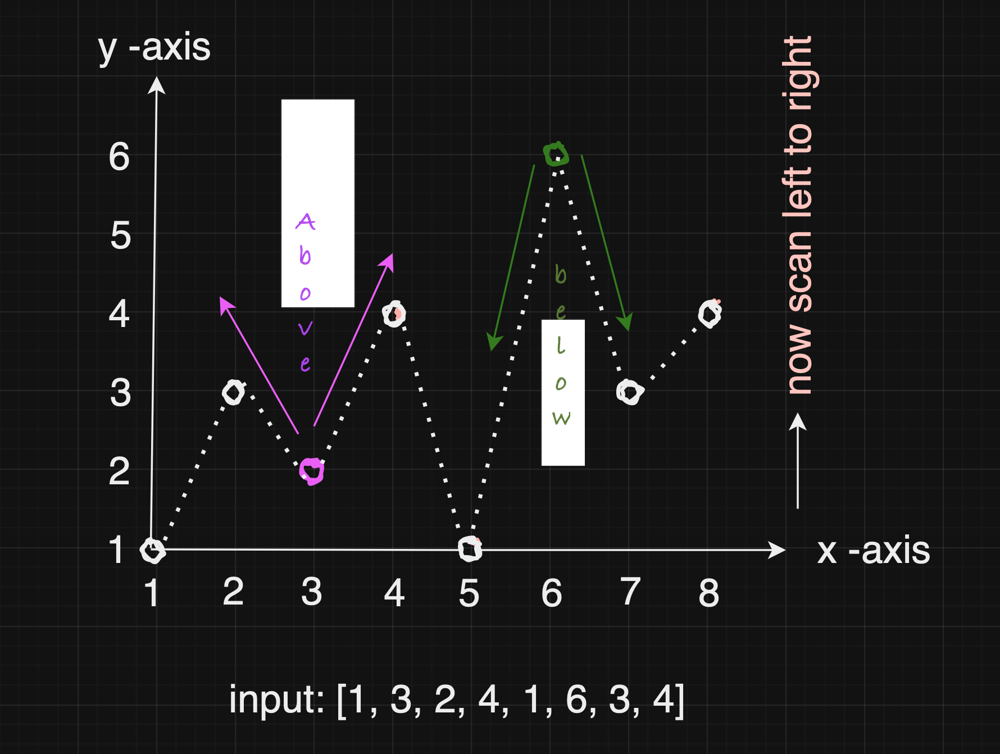

# Java O(n log n) Solution with diagram & comments

**Author:** _velasoka
**Votes:** 9
**Link:** [https://leetcode.com/problems/maximum-number-of-intersections-on-the-chart/solutions/4614070/](https://leetcode.com/problems/maximum-number-of-intersections-on-the-chart/solutions/4614070/)

---

**Understanding:** As per the problem description each `index` denoting `x-axis` & its `index value` denoting `y-axis`.

Problem asks how many max points is there if you draw `horizontal line at any place`. if you draw horizontal line `y is fixed`, `x goes [0, 1, 2, 3,....]`


_**Brute Force:** Iterate through array, for each `i` do the following_
1. _`y[i+1]>y[i]` you increment `0.5` each time in `y[i]` till you reach `y[i+1]`_
2. _`y[i+1]<y[i]` you decrement `0.5` each time in `y[i]` till you reach `y[i+1]`_

_Store all the values in the range between `y[i] to y[i+1]` into map to count the frequency of each element. Finally max frequency is your answer._

_**Time complexity:** O(n * m)_
_n = length of the array_
_m = max value in the y-axis_


**Optimal:** instead of storing all the intermediate value between `y[i]` & `y[i+1]`. You think the problem in different axis. 

Original Problem


`Fix one of the y[i] point` and see how many points are `above y[i]`, below `y[i]` and exactly in `y[i]`. If you know this info, we can calculate how many points are there in any of the `y=1,2,3,......`



**Approach:** 
1. Traverse array and calculate how many above & below points.
2. Sort the y-axis (Used TreeMap)
3. calculate final max points

**Time & Space complexity:** O(n log n) & O(n)

```
class Solution {
    class Pair {
        int nPoints, /* how many same points are there*/
        above, /* how many above points started from current */ 
        below; /* for how many points I am the end*/
    }
    public int maxIntersectionCount(int[] y) {
        //using treemap to sort the y-axis in ascending order
        TreeMap<Integer, Pair> yaxis = new TreeMap<>();
        int n = y.length;
        for(int i=0; i<n; i++) {
            Pair pair = yaxis.get(y[i]);
            if(pair == null) {
                pair = new Pair();
                yaxis.put(y[i], pair);
            }
            if(i!=0) { //when i==0 you will not have [i-1]
                updateLines(pair, y[i], y[i-1]);
            }
            if(i+1!=n) { //when i==n-1 you will not have [i+1]
                updateLines(pair, y[i], y[i+1]);
            }
            pair.nPoints++;
        }
        int answer = 0, soFar=0;
        for(Map.Entry<Integer, Pair> entry : yaxis.entrySet()) {
            Pair pair = entry.getValue();
            soFar-=pair.below;
            // I am at current point, 
            //Now my current point should include how many I had before without end
            answer = Math.max(soFar+pair.nPoints, answer);
            //I have to consider how many forward points from me + how many I had before without end
            soFar+=pair.above;
            answer=Math.max(soFar, answer);
        }
        return answer;
    }

    void updateLines(Pair pair, int current, int prevOrNext) {
        //check with current point with previous & next value
        if(current<prevOrNext) { 
            //prevOrNext point can be i-1 | i+1
            pair.above++;
        } else {
            pair.below++;
        }
    }
}
```
Please **UPVOTE** if you find the solution helpful