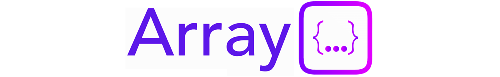
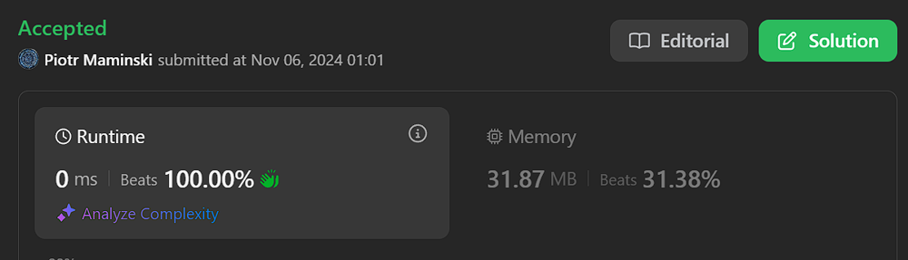
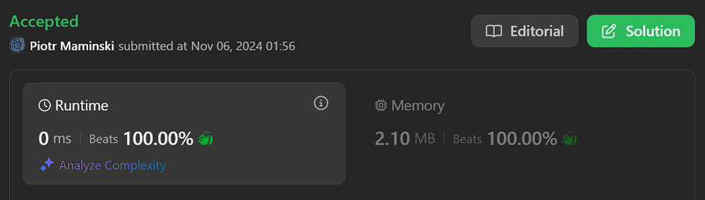

# ✅Beats 100% | Video | Explained Step by Step | List Most Common Array Interview Problems✅

**Author:** Piotr_Maminski
**Votes:** 9
**Link:** [https://leetcode.com/problems/find-if-array-can-be-sorted/solutions/6048699/](https://leetcode.com/problems/find-if-array-can-be-sorted/solutions/6048699/)

---

https://youtu.be/OpOPUeGFjxE?si=VbJebmlU5D8Ilxmu

### two-pass bubble /forward and backward pass (Almost all beats 100%)
```python3 []
class Solution:
    def canSortArray(self, nums: List[int]) -> bool:
        n = len(nums)
       
        # Create a copy of input array to work with
        values = nums.copy()
       
        # Forward pass - check and swap from left to right
        for i in range(n - 1):
            # Skip if elements are already in order
            if values[i] <= values[i + 1]:
                continue
            else:
                # Check if adjacent elements have same number of set bits
                if bin(values[i]).count('1') == bin(values[i + 1]).count('1'):
                    # Swap elements if they have same number of set bits
                    values[i], values[i + 1] = values[i + 1], values[i]
                else:
                    return False
       
        # Backward pass - check and swap from right to left
        for i in range(n - 1, 0, -1):
            # Skip if elements are already in order
            if values[i] >= values[i - 1]:
                continue
            else:
                # Check if adjacent elements have same number of set bits
                if bin(values[i]).count('1') == bin(values[i - 1]).count('1'):
                    # Swap elements if they have same number of set bits
                    values[i], values[i - 1] = values[i - 1], values[i]
                else:
                    return False
       
        # Array can be sorted if we reach here
        return True
```
```cpp []
class Solution {
public:
    bool canSortArray(vector<int>& nums) {
        int n = nums.size();
       
        // Create a copy of input array to work with
        vector<int> values = nums;


        // Forward pass - check and swap from left to right
        for (int i = 0; i < n - 1; i++) {
            // Skip if elements are already in order
            if (values[i] <= values[i + 1]) continue;
            else {
                // Check if adjacent elements have same number of set bits
                if (__builtin_popcount(values[i]) == __builtin_popcount(values[i + 1])) {
                    // Swap elements if they have same number of set bits
                    swap(values[i], values[i + 1]);
                }
                else return false; // Cannot swap elements with different number of set bits
            }
        }


        // Backward pass - check and swap from right to left
        for (int i = n - 1; i >= 1; i--) {
            // Skip if elements are already in order
            if (values[i] >= values[i - 1]) continue;
            else {
                // Check if adjacent elements have same number of set bits
                if (__builtin_popcount(values[i]) == __builtin_popcount(values[i - 1])) {
                    // Swap elements if they have same number of set bits
                    swap(values[i], values[i - 1]);
                }
                else return false; // Cannot swap elements with different number of set bits
            }
        }


        // Array can be sorted if we reach here
        return true;
    }
};
```
```java []
class Solution {
    // Determines if an array can be sorted by swapping adjacent elements with same number of set bits


    public boolean canSortArray(int[] nums) {
        int n = nums.length;
       
        // Create a copy of input array to work with
        int[] values = Arrays.copyOf(nums, n);


        // Forward pass - check and swap from left to right
        for (int i = 0; i < n - 1; i++) {
            // Skip if elements are already in order
            if (values[i] <= values[i + 1]) continue;
            else {
                // Check if adjacent elements have same number of set bits
                if (Integer.bitCount(values[i]) == Integer.bitCount(values[i + 1])) {
                    // Swap elements if they have same number of set bits
                    int temp = values[i];
                    values[i] = values[i + 1];
                    values[i + 1] = temp;
                }
                else return false; // Cannot swap elements with different number of set bits
            }
        }


        // Backward pass - check and swap from right to left
        for (int i = n - 1; i >= 1; i--) {
            // Skip if elements are already in order
            if (values[i] >= values[i - 1]) continue;
            else {
                // Check if adjacent elements have same number of set bits
                if (Integer.bitCount(values[i]) == Integer.bitCount(values[i - 1])) {
                    // Swap elements if they have same number of set bits
                    int temp = values[i];
                    values[i] = values[i - 1];
                    values[i - 1] = temp;
                }
                else return false; // Cannot swap elements with different number of set bits
            }
        }


        // Array can be sorted if we reach here
        return true;
    }
}
```
```csharp []
public class Solution {
    public bool CanSortArray(int[] nums) {
        int n = nums.Length;
       
        // Create a copy of input array to work with
        int[] values = new int[n];
        Array.Copy(nums, values, n);


        // Forward pass - check and swap from left to right
        for (int i = 0; i < n - 1; i++) {
            // Skip if elements are already in order
            if (values[i] <= values[i + 1]) continue;
            else {
                // Check if adjacent elements have same number of set bits
                if (BitCount(values[i]) == BitCount(values[i + 1])) {
                    // Swap elements if they have same number of set bits
                    int temp = values[i];
                    values[i] = values[i + 1];
                    values[i + 1] = temp;
                }
                else return false; // Cannot swap elements with different number of set bits
            }
        }


        // Backward pass - check and swap from right to left
        for (int i = n - 1; i >= 1; i--) {
            // Skip if elements are already in order
            if (values[i] >= values[i - 1]) continue;
            else {
                // Check if adjacent elements have same number of set bits
                if (BitCount(values[i]) == BitCount(values[i - 1])) {
                    // Swap elements if they have same number of set bits
                    int temp = values[i];
                    values[i] = values[i - 1];
                    values[i - 1] = temp;
                }
                else return false; // Cannot swap elements with different number of set bits
            }
        }


        // Array can be sorted if we reach here
        return true;
    }
   
    private int BitCount(int n) {
        int count = 0;
        while (n != 0) {
            count += n & 1;
            n >>= 1;
        }
        return count;
    }
}
```
```golang []
// import "math/bits"
func canSortArray(nums []int) bool {
    n := len(nums)
   
    // Create a copy of input array
    values := make([]int, n)
    copy(values, nums)


    // Forward pass - check and swap from left to right
    for i := 0; i < n-1; i++ {
        // Skip if elements are already in order
        if values[i] <= values[i+1] {
            continue
        } else {
            // Check if adjacent elements have same number of set bits
            if bits.OnesCount(uint(values[i])) == bits.OnesCount(uint(values[i+1])) {
                // Swap elements if they have same number of set bits
                values[i], values[i+1] = values[i+1], values[i]
            } else {
                return false // Cannot swap elements with different number of set bits
            }
        }
    }


    // Backward pass - check and swap from right to left
    for i := n - 1; i >= 1; i-- {
        // Skip if elements are already in order
        if values[i] >= values[i-1] {
            continue
        } else {
            // Check if adjacent elements have same number of set bits
            if bits.OnesCount(uint(values[i])) == bits.OnesCount(uint(values[i-1])) {
                // Swap elements if they have same number of set bits
                values[i], values[i-1] = values[i-1], values[i]
            } else {
                return false // Cannot swap elements with different number of set bits
            }
        }
    }


    // Array can be sorted if we reach here
    return true
}
```
```swift []
class Solution {
    // Determines if an array can be sorted by swapping adjacent elements with same number of set bits
    func canSortArray(_ nums: [Int]) -> Bool {
        let n = nums.count
       
        // Create a copy of input array to work with
        var values = nums
       
        // Forward pass - check and swap from left to right
        for i in 0..<(n-1) {
            // Skip if elements are already in order
            if values[i] <= values[i + 1] { continue }
            else {
                // Check if adjacent elements have same number of set bits
                if values[i].nonzeroBitCount == values[i + 1].nonzeroBitCount {
                    // Swap elements if they have same number of set bits
                    values.swapAt(i, i + 1)
                }
                else { return false } // Cannot swap elements with different number of set bits
            }
        }
       
        // Backward pass - check and swap from right to left
        for i in stride(from: n-1, through: 1, by: -1) {
            // Skip if elements are already in order
            if values[i] >= values[i - 1] { continue }
            else {
                // Check if adjacent elements have same number of set bits
                if values[i].nonzeroBitCount == values[i - 1].nonzeroBitCount {
                    // Swap elements if they have same number of set bits
                    values.swapAt(i, i - 1)
                }
                else { return false } // Cannot swap elements with different number of set bits
            }
        }
       
        // Array can be sorted if we reach here
        return true
    }
}
```
```javascript [JS]
// JavaScript


/**
 * @param {number[]} nums
 * @return {boolean}
 */
var canSortArray = function(nums) {
    const n = nums.length;
   
    // Create a copy of input array
    const values = [...nums];
   
    // Helper function to count set bits
    const countBits = (num) => {
        let count = 0;
        while (num > 0) {
            count += num & 1;
            num >>= 1;
        }
        return count;
    };
   
    // Forward pass - check and swap from left to right
    for (let i = 0; i < n - 1; i++) {
        if (values[i] <= values[i + 1]) continue;
        else {
            if (countBits(values[i]) === countBits(values[i + 1])) {
                // Swap elements
                [values[i], values[i + 1]] = [values[i + 1], values[i]];
            }
            else return false;
        }
    }
   
    // Backward pass - check and swap from right to left
    for (let i = n - 1; i >= 1; i--) {
        if (values[i] >= values[i - 1]) continue;
        else {
            if (countBits(values[i]) === countBits(values[i - 1])) {
                // Swap elements
                [values[i], values[i - 1]] = [values[i - 1], values[i]];
            }
            else return false;
        }
    }
   
    return true;
};
```
```typescript [TS]
// TypeScript


function canSortArray(nums: number[]): boolean {
    const n: number = nums.length;
   
    // Create a copy of input array to work with
    const values: number[] = [...nums];


    // Forward pass - check and swap from left to right
    for (let i = 0; i < n - 1; i++) {
        // Skip if elements are already in order
        if (values[i] <= values[i + 1]) continue;
        else {
            // Check if adjacent elements have same number of set bits
            if (countBits(values[i]) === countBits(values[i + 1])) {
                // Swap elements if they have same number of set bits
                [values[i], values[i + 1]] = [values[i + 1], values[i]];
            }
            else return false; // Cannot swap elements with different number of set bits
        }
    }


    // Backward pass - check and swap from right to left
    for (let i = n - 1; i >= 1; i--) {
        // Skip if elements are already in order
        if (values[i] >= values[i - 1]) continue;
        else {
            // Check if adjacent elements have same number of set bits
            if (countBits(values[i]) === countBits(values[i - 1])) {
                // Swap elements if they have same number of set bits
                [values[i], values[i - 1]] = [values[i - 1], values[i]];
            }
            else return false; // Cannot swap elements with different number of set bits
        }
    }


    // Array can be sorted if we reach here
    return true;
}


// Helper function to count set bits (1's) in a number
function countBits(num: number): number {
    let count = 0;
    while (num) {
        count += num & 1;
        num >>>= 1;
    }
    return count;
}
```
```rust []
impl Solution {
    pub fn can_sort_array(nums: Vec<i32>) -> bool {
        let n = nums.len();
        let mut values = nums.clone();


        // Forward pass
        for i in 0..n-1 {
            if values[i] <= values[i + 1] {
                continue;
            } else {
                if values[i].count_ones() == values[i + 1].count_ones() {
                    values.swap(i, i + 1);
                } else {
                    return false;
                }
            }
        }


        // Backward pass
        for i in (1..n).rev() {
            if values[i] >= values[i - 1] {
                continue;
            } else {
                if values[i].count_ones() == values[i - 1].count_ones() {
                    values.swap(i, i - 1);
                } else {
                    return false;
                }
            }
        }


        true
    }
}
```
```ruby []
def can_sort_array(nums)
    n = nums.length
    values = nums.dup
   
    # Forward pass
    (0...n-1).each do |i|
        next if values[i] <= values[i + 1]
       
        if count_bits(values[i]) == count_bits(values[i + 1])
            values[i], values[i + 1] = values[i + 1], values[i]
        else
            return false
        end
    end
   
    # Backward pass
    (n-1).downto(1) do |i|
        next if values[i] >= values[i - 1]
       
        if count_bits(values[i]) == count_bits(values[i - 1])
            values[i], values[i - 1] = values[i - 1], values[i]
        else
            return false
        end
    end
   
    true
end


def count_bits(num)
    num.to_s(2).count('1')
end
```
```java [Pseudocode]
ALGORITHM CanSortArray(nums)
    n = length of nums
   
    // Create working copy of input array
    values = copy of nums array
   
    // Forward pass
    FOR i = 0 TO n-2
        IF values[i] <= values[i+1] THEN
            CONTINUE
        ELSE
            IF CountSetBits(values[i]) EQUALS CountSetBits(values[i+1]) THEN
                // Swap elements
                temp = values[i]
                values[i] = values[i+1]
                values[i+1] = temp
            ELSE
                RETURN false
            END IF
        END IF
    END FOR
   
    // Backward pass
    FOR i = n-1 DOWN TO 1
        IF values[i] >= values[i-1] THEN
            CONTINUE
        ELSE
            IF CountSetBits(values[i]) EQUALS CountSetBits(values[i-1]) THEN
                // Swap elements
                temp = values[i]
                values[i] = values[i-1]
                values[i-1] = temp
            ELSE
                RETURN false
            END IF
        END IF
    END FOR
   
    RETURN true
END ALGORITHM


FUNCTION CountSetBits(number)
    count = 0
    WHILE number > 0
        IF number MOD 2 EQUALS 1 THEN
            INCREMENT count
        END IF
        number = number divided by 2
    END WHILE
    RETURN count
END FUNCTION
```


## without comments
```python3 []
class Solution:
    def canSortArray(self, nums: List[int]) -> bool:
        n = len(nums)
        values = nums.copy()
       
        for i in range(n - 1):
            if values[i] <= values[i + 1]:
                continue
            else:
                if bin(values[i]).count('1') == bin(values[i + 1]).count('1'):
                    values[i], values[i + 1] = values[i + 1], values[i]
                else:
                    return False
       
        for i in range(n - 1, 0, -1):
            if values[i] >= values[i - 1]:
                continue
            else:
                if bin(values[i]).count('1') == bin(values[i - 1]).count('1'):
                    values[i], values[i - 1] = values[i - 1], values[i]
                else:
                    return False
       
        return True
```
```cpp []
class Solution {
public:
    bool canSortArray(vector<int>& nums) {
        int n = nums.size();
        vector<int> values = nums;


        for (int i = 0; i < n - 1; i++) {
            if (values[i] <= values[i + 1]) continue;
            else {
                if (__builtin_popcount(values[i]) == __builtin_popcount(values[i + 1])) {
                    swap(values[i], values[i + 1]);
                }
                else return false;
            }
        }


        for (int i = n - 1; i >= 1; i--) {
            if (values[i] >= values[i - 1]) continue;
            else {
                if (__builtin_popcount(values[i]) == __builtin_popcount(values[i - 1])) {
                    swap(values[i], values[i - 1]);
                }
                else return false;
            }
        }


        return true;
    }
};
```
```java []
class Solution {
    public boolean canSortArray(int[] nums) {
        int n = nums.length;
        int[] values = Arrays.copyOf(nums, n);


        for (int i = 0; i < n - 1; i++) {
            if (values[i] <= values[i + 1]) continue;
            else {
                if (Integer.bitCount(values[i]) == Integer.bitCount(values[i + 1])) {
                    int temp = values[i];
                    values[i] = values[i + 1];
                    values[i + 1] = temp;
                }
                else return false;
            }
        }


        for (int i = n - 1; i >= 1; i--) {
            if (values[i] >= values[i - 1]) continue;
            else {
                if (Integer.bitCount(values[i]) == Integer.bitCount(values[i - 1])) {
                    int temp = values[i];
                    values[i] = values[i - 1];
                    values[i - 1] = temp;
                }
                else return false;
            }
        }


        return true;
    }
}
```
```csharp []
public class Solution {
    public bool CanSortArray(int[] nums) {
        int n = nums.Length;
        int[] values = new int[n];
        Array.Copy(nums, values, n);


        for (int i = 0; i < n - 1; i++) {
            if (values[i] <= values[i + 1]) continue;
            else {
                if (BitCount(values[i]) == BitCount(values[i + 1])) {
                    int temp = values[i];
                    values[i] = values[i + 1];
                    values[i + 1] = temp;
                }
                else return false;
            }
        }


        for (int i = n - 1; i >= 1; i--) {
            if (values[i] >= values[i - 1]) continue;
            else {
                if (BitCount(values[i]) == BitCount(values[i - 1])) {
                    int temp = values[i];
                    values[i] = values[i - 1];
                    values[i - 1] = temp;
                }
                else return false;
            }
        }


        return true;
    }
   
    private int BitCount(int n) {
        int count = 0;
        while (n != 0) {
            count += n & 1;
            n >>= 1;
        }
        return count;
    }
}
```
```golang []
func canSortArray(nums []int) bool {
    n := len(nums)
   
    values := make([]int, n)
    copy(values, nums)


    for i := 0; i < n-1; i++ {
        if values[i] <= values[i+1] {
            continue
        } else {
            if bits.OnesCount(uint(values[i])) == bits.OnesCount(uint(values[i+1])) {
                values[i], values[i+1] = values[i+1], values[i]
            } else {
                return false
            }
        }
    }


    for i := n - 1; i >= 1; i-- {
        if values[i] >= values[i-1] {
            continue
        } else {
            if bits.OnesCount(uint(values[i])) == bits.OnesCount(uint(values[i-1])) {
                values[i], values[i-1] = values[i-1], values[i]
            } else {
                return false
            }
        }
    }


    return true
}
```
```swift []
class Solution {
    func canSortArray(_ nums: [Int]) -> Bool {
        let n = nums.count
        var values = nums
       
        for i in 0..<(n-1) {
            if values[i] <= values[i + 1] { continue }
            else {
                if values[i].nonzeroBitCount == values[i + 1].nonzeroBitCount {
                    values.swapAt(i, i + 1)
                }
                else { return false }
            }
        }
       
        for i in stride(from: n-1, through: 1, by: -1) {
            if values[i] >= values[i - 1] { continue }
            else {
                if values[i].nonzeroBitCount == values[i - 1].nonzeroBitCount {
                    values.swapAt(i, i - 1)
                }
                else { return false }
            }
        }
       
        return true
    }
}
```
```javascript [JS]
// JavaScript


var canSortArray = function(nums) {
    const n = nums.length;
    const values = [...nums];
   
    const countBits = (num) => {
        let count = 0;
        while (num > 0) {
            count += num & 1;
            num >>= 1;
        }
        return count;
    };
   
    for (let i = 0; i < n - 1; i++) {
        if (values[i] <= values[i + 1]) continue;
        else {
            if (countBits(values[i]) === countBits(values[i + 1])) {
                [values[i], values[i + 1]] = [values[i + 1], values[i]];
            }
            else return false;
        }
    }
   
    for (let i = n - 1; i >= 1; i--) {
        if (values[i] >= values[i - 1]) continue;
        else {
            if (countBits(values[i]) === countBits(values[i - 1])) {
                [values[i], values[i - 1]] = [values[i - 1], values[i]];
            }
            else return false;
        }
    }
   
    return true;
};
```
```typescript [TS]
// TypeScript


function canSortArray(nums: number[]): boolean {
    const n: number = nums.length;
    const values: number[] = [...nums];


    for (let i = 0; i < n - 1; i++) {
        if (values[i] <= values[i + 1]) continue;
        else {
            if (countBits(values[i]) === countBits(values[i + 1])) {
                [values[i], values[i + 1]] = [values[i + 1], values[i]];
            }
            else return false;
        }
    }


    for (let i = n - 1; i >= 1; i--) {
        if (values[i] >= values[i - 1]) continue;
        else {
            if (countBits(values[i]) === countBits(values[i - 1])) {
                [values[i], values[i - 1]] = [values[i - 1], values[i]];
            }
            else return false;
        }
    }


    return true;
}


function countBits(num: number): number {
    let count = 0;
    while (num) {
        count += num & 1;
        num >>>= 1;
    }
    return count;
}
```
```rust []
impl Solution {
    pub fn can_sort_array(nums: Vec<i32>) -> bool {
        let n = nums.len();
        let mut values = nums.clone();


        for i in 0..n-1 {
            if values[i] <= values[i + 1] {
                continue;
            } else {
                if values[i].count_ones() == values[i + 1].count_ones() {
                    values.swap(i, i + 1);
                } else {
                    return false;
                }
            }
        }


        for i in (1..n).rev() {
            if values[i] >= values[i - 1] {
                continue;
            } else {
                if values[i].count_ones() == values[i - 1].count_ones() {
                    values.swap(i, i - 1);
                } else {
                    return false;
                }
            }
        }


        true
    }
}
```
```ruby []
def can_sort_array(nums)
    n = nums.length
    values = nums.dup
   
    (0...n-1).each do |i|
        next if values[i] <= values[i + 1]
       
        if count_bits(values[i]) == count_bits(values[i + 1])
            values[i], values[i + 1] = values[i + 1], values[i]
        else
            return false
        end
    end
   
    (n-1).downto(1) do |i|
        next if values[i] >= values[i - 1]
       
        if count_bits(values[i]) == count_bits(values[i - 1])
            values[i], values[i - 1] = values[i - 1], values[i]
        else
            return false
        end
    end
   
    true
end


def count_bits(num)
    num.to_s(2).count('1')
end
```


### Complexity
- Time complexity: O(n)


- Space complexity: O(n)


# Explanation


---


## Intuition
The problem requires us to determine if we can sort an array by only swapping adjacent elements that have the same number of set bits (1s in their binary representation).


 This is similar to bubble sort, but with an additional constraint on when we can swap elements.


## Approach


The solution uses a two-pass strategy (forward and backward) similar to bubble sort:


2. Forward Pass:


- Iterate through the array from left to right
- For each pair of adjacent elements, check if they're in order
- If they're out of order, verify if they have the same number of set bits
- If set bits match, swap them
- If set bits don't match, return False as we can't sort
3. Backward Pass:
- Iterate through the array from right to left
- Similar to forward pass, but checking elements in reverse
- This helps catch any remaining out-of-order elements


**Key Implementation Details:**
- Uses bin().count('1') to count set bits in binary representation
- Makes a copy of input array to preserve original
- Returns True only if all necessary swaps can be made


## Step by Step


1. Initial Setup


```
n = len(nums)
values = nums.copy()  # Create a working copy of the array
```
2. Forward Pass (Left to Right)


    1. Iterate through array from index 0 to n-2
    2. For each position i, compare values[i] and values[i+1]
    3. If values[i] \u2264 values[i+1]: Skip (already in order)
    4. If values[i] > values[i+1]:
        - Count set bits in both numbers
        - If set bits match: Swap the elements
        - If set bits differ: Return False (impossible to sort)
3. Backward Pass (Right to Left)


    1. Iterate through array from index n-1 to 1
    2. For each position i, compare values[i] and values[i-1]
    3. If values[i] \u2265 values[i-1]: Skip (already in order)
    4. If values[i] < values[i-1]:
        - Count set bits in both numbers
        - If set bits match: Swap the elements
        - If set bits differ: Return False (impossible to sort)
4. Final Result


- If both passes complete without returning **False**, return **True**


**Pseudocode:**
```
ALGORITHM CanSortArray(nums)
    n = length of nums
   
    // Create working copy of input array
    values = copy of nums array
   
    // Forward pass
    FOR i = 0 TO n-2
        IF values[i] <= values[i+1] THEN
            CONTINUE
        ELSE
            IF CountSetBits(values[i]) EQUALS CountSetBits(values[i+1]) THEN
                // Swap elements
                temp = values[i]
                values[i] = values[i+1]
                values[i+1] = temp
            ELSE
                RETURN false
            END IF
        END IF
    END FOR
   
    // Backward pass
    FOR i = n-1 DOWN TO 1
        IF values[i] >= values[i-1] THEN
            CONTINUE
        ELSE
            IF CountSetBits(values[i]) EQUALS CountSetBits(values[i-1]) THEN
                // Swap elements
                temp = values[i]
                values[i] = values[i-1]
                values[i-1] = temp
            ELSE
                RETURN false
            END IF
        END IF
    END FOR
   
    RETURN true
END ALGORITHM


FUNCTION CountSetBits(number)
    count = 0
    WHILE number > 0
        IF number MOD 2 EQUALS 1 THEN
            INCREMENT count
        END IF
        number = number divided by 2
    END WHILE
    RETURN count
END FUNCTION
```
---





# Still dont understand string/array/pointers


**Video with IMO best explained:** google "Pointers in C / C++ [Full Course]"


# Most common Array Interview Problems
List based on my research (interviews, reddit, github) Probably not 100% accurate but very close to my recruitments. Leetcode Premium is probably more accurate [I don't have]


**Easy:** [[1. Two Sum]](https://leetcode.com/problems/two-sum/solutions/5999466/beats-100-explained-step-by-step-list-most-common-array-inverview) **(common warm-up)** [[121. Best Time to Buy and Sell Stock]](https://leetcode.com/discuss/topic/6027720/solution/) [[88. Merge Sorted Array]](https://leetcode.com/problems/merge-sorted-array/solutions/6031394/beats-100-explained-step-by-step-list-most-common-string-interview-problems) [[27. Remove Element]](https://leetcode.com/problems/remove-element/solutions/6031528/beats-100-explained-step-by-step-list-most-common-array-interview-problems) [[929. Unique Email Addresses]](https://leetcode.com/problems/unique-email-addresses/solutions/6031687/explained-step-by-step-video-list-most-common-array-interview-problems) 


**Medium/Hard:** [[15. 3Sum]](https://leetcode.com/problems/3sum?envType=problem-list-v2&envId=atbyk0mj) [[42. Trapping Rain Water]](https://leetcode.com/problems/trapping-rain-water?envType=problem-list-v2&envId=atbyk0mj) [[56. Merge Intervals]](https://leetcode.com/problems/merge-intervals?envType=problem-list-v2&envId=atbyk0mj) [[57. Insert Interval]](https://leetcode.com/problems/insert-interval?envType=problem-list-v2&envId=atbyk0mj) [[46. Permutations]](https://leetcode.com/problems/permutations?envType=problem-list-v2&envId=atbyk0mj) [[53. Maximum Subarray]](https://leetcode.com/problems/maximum-subarray?envType=problem-list-v2&envId=atbyk0mj) [[73. Set Matrix Zeroes]](https://leetcode.com/problems/set-matrix-zeroes?envType=problem-list-v2&envId=atbyk0mj) [[284. Peeking Iterator]](https://leetcode.com/problems/peeking-iterator?envType=problem-list-v2&envId=atbyk0mj)

####  [Interview Questions and Answers Repository](https://github.com/RooTinfinite/Interview-questions-and-answers)


# Interview Priorities


| Patterns                | Difficulty | Interview Frequently           |
|----------------------|---------------------|----------------------|
| **Basic [Array](https://leetcode.com/problems/two-sum/solutions/5999466/beats-100-explained-step-by-step-list-most-common-array-inverview) / [String](https://leetcode.com/problems/valid-parentheses/solutions/6013115/solution)**                 | **Easy**              | **Very High**               |
| **Two Pointers**         | **Easy**                | **High**                 |
| **Sliding Window**       | **Easy**                | **High**                 |
| **Breadth-First Search** | **Easy**                | **High**                 |
| **Depth-First Search**   | **Medium**              | **High**                 |
| **[Backtracking](https://leetcode.com/problems/letter-combinations-of-a-phone-number/solutions/5976064/complex-backtracking-interview-prepare-list-of-backtracking-questions-beats-100)**         | **High**                | **High**                 |
| Heap                 | Medium              | Medium               |
| Binary Search        | Easy                | Medium               |
| [Dynamic Programming](https://leetcode.com/problem-list/atwflvk7/)  | High                | Medium               |
| Divide and Conquer   | Medium              | Low                  |
| Trie                 | Medium              | Low                  |
| Union Find           | Medium              | Low                  |
| Greedy               | High                | Low                  |





