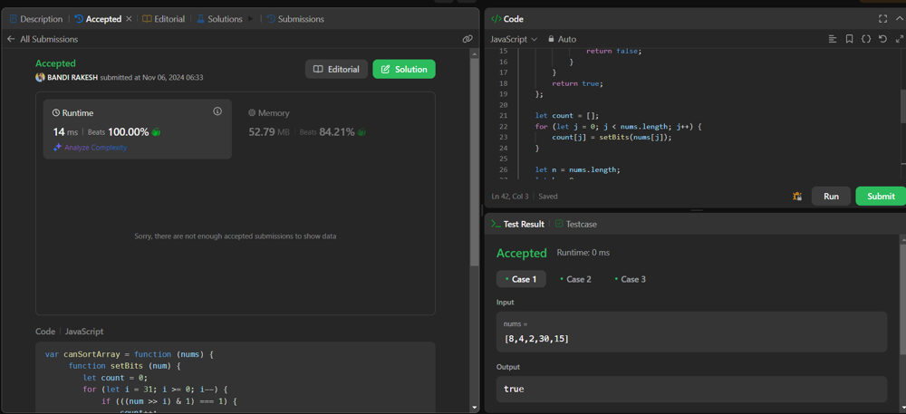

# Easiest solution | Beats 100% | Bubble sort | Interview Question

**Author:** iambandirakesh
**Votes:** 11
**Link:** [https://leetcode.com/problems/find-if-array-can-be-sorted/solutions/6013248/](https://leetcode.com/problems/find-if-array-can-be-sorted/solutions/6013248/)

---

Beats 100%


# Approach
<!-- Describe your approach to solving the problem. -->
### Overview
The canSortArray function aims to determine whether an array of integers can be sorted in non-decreasing order using a specific swapping mechanism based on the number of set bits (1s) in the binary representation of each integer.

### Breakdown of the Code

1. *Count Set Bits:*
   The setBits function counts the number of 1s in the binary representation of a given number. It iterates through each bit position from 31 to 0 and checks if the bit is set (1). If it is, it increments the count.

``` 
   function setBits(num) {
       let count = 0;
       for (let i = 31; i >= 0; i--) {
           if (((num >> i) & 1) === 1) {
               count++;
           }
       }
       return count;
   }
```

2. *Check If Already Sorted:*
   The check function verifies if the array is sorted in non-decreasing order. It compares each element with the next one; if any element is greater than the following element, it returns false.

```
   function check(nums) {
       for (var i = 0; i < nums.length - 1; i++) {
           if (nums[i] > nums[i + 1]) {
               return false;
           }
       }
       return true;
   }
```

3. *Count Set Bits for Each Element:*
   An array count is created to store the number of set bits for each element in the nums array.
```
   let count = [];
   for (let j = 0; j < nums.length; j++) {
       count[j] = setBits(nums[j]);
   }
```

4. *Attempt to Sort:*
   The function uses a while loop to attempt sorting the array. For each iteration, it checks pairs of adjacent elements. If the set bit count for those two elements is the same, it allows swapping them to achieve a sorted order.
```
   let n = nums.length;
   let k = 0;
   while (k < n) {
       for (var i = 1; i < n; i++) {
           if (count[i] === count[i - 1] && nums[i] < nums[i - 1]) {
               var temp = nums[i];
               nums[i] = nums[i - 1];
               nums[i - 1] = temp;
           }
       }
       if (check(nums)) {
           return true;
       }
       k++;
   }
```  

5. *Return Result:*
   After attempting sorting through the allowed swaps, if the array remains unsorted after n iterations, the function returns false. If at any point the array becomes sorted, it returns true.

### Complexity
- *Time Complexity:* O(n^2) in the worst case due to the nested loops for sorting and checking.
- *Space Complexity:* O(n) for the count array.

# Code
```javascript []
var canSortArray = function (nums) {
     function setBits (num) {
        let count = 0;
        for (let i = 31; i >= 0; i--) {
            if (((num >> i) & 1) === 1) {
                count++;
            }
        }
        return count;
    };

     function check (nums) {
        for (var i = 0; i < nums.length - 1; i++) {
            if (nums[i] > nums[i + 1]) {
                return false;
            }
        }
        return true;
    };

    let count = [];
    for (let j = 0; j < nums.length; j++) {
        count[j] = setBits(nums[j]);
    }

    let n = nums.length;
    let k = 0;
    while (k < n) {
        for (var i = 1; i < n; i++) {
            if (count[i] === count[i - 1] && nums[i] < nums[i - 1]) {
                var temp = nums[i];
                nums[i] = nums[i - 1];
                nums[i - 1] = temp;
            }
        }
        if (check(nums)) {
            return true;
        }
        k++;
    }
    return false;
};
```
``` python []
from typing import List

class Solution:
    def canSortArray(self, nums: List[int]) -> bool:
        # Helper function to count set bits
        def setBits(num):
            count = 0
            for i in range(31, -1, -1):
                if ((num >> i) & 1) == 1:
                    count += 1
            return count

        # Helper function to check if array is sorted
        def check(nums):
            for i in range(len(nums) - 1):
                if nums[i] > nums[i + 1]:
                    return False
            return True

        # Array to store the set bit count of each number
        count = [setBits(num) for num in nums]

        n = len(nums)
        k = 0
        while k < n:
            for i in range(1, n):
                if count[i] == count[i - 1] and nums[i] < nums[i - 1]:
                    nums[i], nums[i - 1] = nums[i - 1], nums[i]  # Swap elements
            if check(nums):
                return True
            k += 1

        return False
```
``` c++ []
#include <vector>
using namespace std;

class Solution {
public:
    // Helper function to count set bits in a number
    int setBits(int num) {
        int count = 0;
        for (int i = 31; i >= 0; --i) {
            if ((num >> i) & 1) {
                count++;
            }
        }
        return count;
    }

    // Helper function to check if the array is sorted
    bool check(const vector<int>& nums) {
        for (int i = 0; i < nums.size() - 1; i++) {
            if (nums[i] > nums[i + 1]) {
                return false;
            }
        }
        return true;
    }

    bool canSortArray(vector<int>& nums) {
        // Vector to store the set bit count of each number
        vector<int> count(nums.size());
        for (int j = 0; j < nums.size(); j++) {
            count[j] = setBits(nums[j]);
        }

        int n = nums.size();
        int k = 0;
        while (k < n) {
            for (int i = 1; i < n; i++) {
                if (count[i] == count[i - 1] && nums[i] < nums[i - 1]) {
                    swap(nums[i], nums[i - 1]);  // Swap elements
                }
            }
            if (check(nums)) {
                return true;
            }
            k++;
        }
        return false;
    }
};
```
``` java []
class Solution {
    // Helper function to count set bits in a number
    private int setBits(int num) {
        int count = 0;
        for (int i = 31; i >= 0; i--) {
            if ((num >> i & 1) == 1) {
                count++;
            }
        }
        return count;
    }

    // Helper function to check if the array is sorted
    private boolean check(int[] nums) {
        for (int i = 0; i < nums.length - 1; i++) {
            if (nums[i] > nums[i + 1]) {
                return false;
            }
        }
        return true;
    }

    public boolean canSortArray(int[] nums) {
        // Array to store the set bit count of each number
        int[] count = new int[nums.length];
        for (int j = 0; j < nums.length; j++) {
            count[j] = setBits(nums[j]);
        }

        int n = nums.length;
        int k = 0;
        while (k < n) {
            for (int i = 1; i < n; i++) {
                if (count[i] == count[i - 1] && nums[i] < nums[i - 1]) {
                    // Swap elements in nums array
                    int temp = nums[i];
                    nums[i] = nums[i - 1];
                    nums[i - 1] = temp;
                }
            }
            // Check if the array is sorted
            if (check(nums)) {
                return true;
            }
            k++;
        }
        return false;
    }
}
```