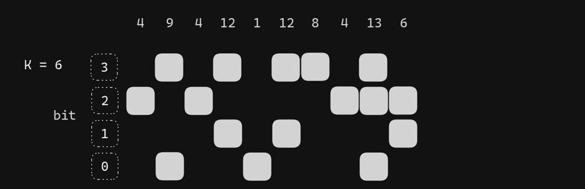
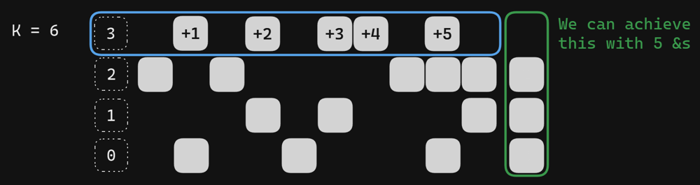
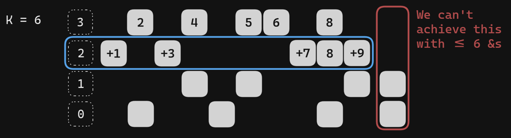
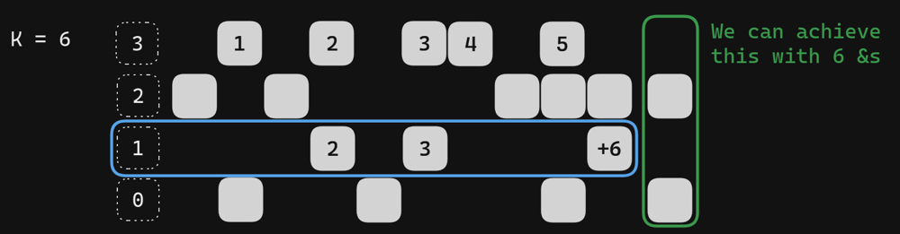
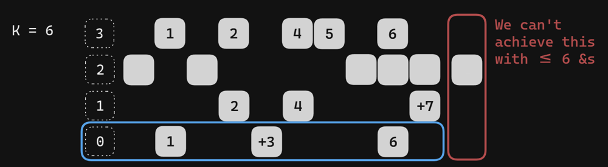

# JavaScript / Python / Kotlin - Bit-Manipulation + some diagrams

**Author:** ektegjetost
**Votes:** 1
**Link:** [https://leetcode.com/problems/minimize-or-of-remaining-elements-using-operations/solutions/4641101/](https://leetcode.com/problems/minimize-or-of-remaining-elements-using-operations/solutions/4641101/)

---

# Intuition
<!-- Describe your first thoughts on how to solve this problem. -->
1. We want to greedily remove bits from largest to smallest, because removing a bit is better than removing all the bits below it (e.g. 2^3 >  2^2 + 2^1 + 2^0)
2. we don't need to worry about the edge case where we can't remove any bits because all of them are set, because if that were the case we wouldn't be able to remove them all in ```k``` operations anyway since ```k < nums.length```.
3. We also ultimately won't need to worry about which nums get ```&```ed together. There's SOME way to remove an individual bit for any bit with ```<= k``` bits set in all nums, but which ones will be determined by which bits we can remove.

Say we have these nums / bits set, and k = 6



We start with the highest (3rd bit), and see if we can remove all of them, which we can in 5 moves



Now we try to remove the next bit while maintaining what we removed in the first pass, and we see that we'd need 9 ```&``` operations in order to do so, which is too many (there's only 1 column where the bits overlap). So we'll leave the 2nd bit set and ignore it as we try the next one.



Fortunately for the 1st bit, most of the nums overlap with the 3rd bit, so we can remove it in 6 ```&``` operations



Lastly, we can't remove the 0th bit, there's one set bit that doesn't overlap with the 3rd and 1st bit and we've used up ```k``` operations




# Approach
<!-- Describe your approach to solving the problem. -->

1. Iterate from the highest bit to lowest bit
2. We have a target bitmask which consists of all the previous bits we can remove turned off, and the bits we can't remove turned on, with the current bit we're attempting to remove turned off, and all lower bits turned on (e.g. ignored).
3. We have a current bitmask, which starts off as all bits turned on.
4. Iterate through nums, ```&``` the current bitmask with the current ```num```.
    a. If the current bitmask is not a subset of the target bitmask, then the current num has some of the bits we want turned off, which means we'll need to spend an ```&``` operation to turn them off. 
    b. If the current bitmask is now a subset of the target bitmask (e.g. all the bits we want turned off are turned off), then we don't need to spend an operation (e.g. this num either doesn't have those bits turned on, or our previous op). Reset the current bitmask to have all bits turned on.
5. Count the number of times we needed an ```&``` operation
    a. if it's > ```k``` then we're unable to turn off the current bit, so our next target bitmask will have the current bit turned on.
    b. if it's <= ```k```, then we were able to remove that bit in <= ```k``` operations, so turn that bit off for the next target bitmask
6. The bits we were able to turn off vs had ot leave on will be our eventual ```or```, which is our answer.

# Complexity
- Time complexity: $$O(n log(m))$$ where ```m``` is the max num in ```nums```
<!-- Add your time complexity here, e.g. $$O(n)$$ -->

- Space complexity: $$O(1)$$
<!-- Add your space complexity here, e.g. $$O(n)$$ -->


# Code
``` javascript []
var minOrAfterOperations = function(nums, k) {
    const ALL = 2 ** 30 - 1;
    const maxBit = Math.floor(Math.log2(Math.max(...nums)));

    let minOr = 0;
    for (let bit = maxBit; bit >= 0; bit -= 1) {
      const lowerMask = (1 << bit) - 1;
      const targetMask = minOr | lowerMask
      
      let currMask = ALL;
      let count = 0;

      for (const num of nums) {
        currMask &= num;
        if ((currMask | targetMask) === targetMask) currMask = ALL;
        else count += 1;
      }

      if (count > k) minOr |= 1 << bit;
    }

    return minOr;
};
```
``` python []
class Solution:
    def minOrAfterOperations(self, nums: List[int], k: int) -> int:
        ALL = (1 << 30) - 1
        min_or = 0

        for bit in range(29,-1,-1):
            lower_mask = (1 << bit) - 1
            target_mask = min_or | lower_mask
            
            curr_mask = ALL
            count = 0

            for num in nums:
                curr_mask &= num
                if (curr_mask | target_mask) == target_mask:
                    curr_mask = ALL
                else:
                    count += 1
            
            if count > k:
                min_or |= 1 << bit
        
        return min_or
```
``` kotlin []
class Solution {
    fun minOrAfterOperations(nums: IntArray, k: Int): Int {
        val ALL = (1 shl 30) - 1
        val maxBit = log2(nums.max().toDouble()).toInt()
        var minOr = 0

        for (bit in maxBit downTo 0) {
            val lowerMask = (1 shl bit) - 1
            val targetMask = minOr or lowerMask

            var currMask = ALL
            var count = 0

            for (num in nums) {
                currMask = currMask and num
                if ((currMask or targetMask) == targetMask) currMask = ALL
                else count += 1
            }

            if (count > k) minOr = minOr or (1 shl bit)
        }   

        return minOr
    }
}
```