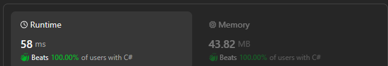

# ✅Beats 100.00% of users || Best Method🔥 || C# || Easy Explanation || Beginner Friendly🔥🔥🔥

**Author:** Sayan98
**Votes:** 1
**Link:** [https://leetcode.com/problems/type-of-triangle/solutions/4676021/](https://leetcode.com/problems/type-of-triangle/solutions/4676021/)

---

# Intuition
- **Problem**: Determine the type of triangle that can be formed from three given side lengths.
- **Approach**: Sort the lengths, check triangle inequality and side equality conditions to classify the triangle.




# Approach
- Sort the lengths: Ensure smallest to largest order for easier comparisons.
- Check triangle inequality: If the sum of the two shortest sides is less than or equal to the longest side, no triangle can be formed ("**none**").
- Check for equilateral: If all three sides are equal, it's an equilateral triangle ("**equilateral**").
- Check for isosceles: If any two sides are equal, it's an isosceles triangle ("**isosceles**").
- Otherwise, it's a scalene triangle: All sides have different lengths ("**scalene**").

# Complexity
- Time complexity:
    - O(N log N), dominated by the sorting algorithm (Array.Sort()).
    - The remaining comparisons and logic take constant time.

- Space complexity:
    - O(1), constant space.

# Code
```
public class Solution {
    public string TriangleType(int[] nums) {
        
        Array.Sort(nums);
        
        if( nums[0] + nums[1] <= nums[2]) return "none";
        else if(nums[0] == nums[1] && nums[0] == nums[2]) return "equilateral";
        else if(nums[0] == nums[1] || nums[1] == nums[2]) return "isosceles";
        else return "scalene";
    }
}
```