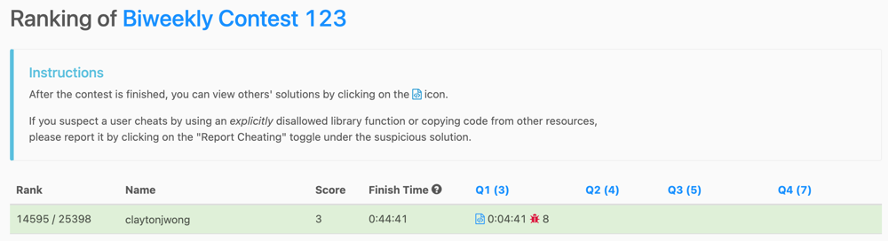

# a few solutions

**Author:** claytonjwong
**Votes:** 2
**Link:** [https://leetcode.com/problems/type-of-triangle/solutions/4671712/](https://leetcode.com/problems/type-of-triangle/solutions/4671712/)

---

# Game Plan

\uD83D\uDEAB We cannot form a triangle if the sum of the minimum two side lengths is less-than-or-equal-to the maximum side length.
* `'none'`

\u2705 Otherwise we return the type of triangle based on the **cardinality of the set of side lengths:**

1. `'equilateral'`
2. `'isosceles'`
3. `'scalene'`

---

*Kotlin*
```
class Solution {
    var triangleType = { A: IntArray -> if (A.sorted().slice(0..1).sum() <= A.max()!!) "none" else if (1 == A.toSet().size) "equilateral" else if (2 == A.toSet().size) "isosceles" else "scalene" }
}
```

*Javascript*
```
let triangleType = A => _.sum(A.sort((a, b) => a - b).slice(0, 2)) <= Math.max(...A) ? 'none' : 1 == new Set(A).size ? 'equilateral' : 2 == new Set(A).size ? 'isosceles' : 'scalene';
```

*Python3*
```
class Solution:
    triangleType = lambda self, A: 'none' if sum(sorted(A)[:2]) <= max(A) else "equilateral" if len(set(A)) == 1 else "isosceles" if len(set(A)) == 2 else "scalene"
```

*Rust*
```
use std::collections::HashSet;
impl Solution {
    pub fn triangle_type(mut A: Vec<i32>) -> String {
        let f = (|s| String::from(s));
        A.sort();
        let (lo, hi) = (A[0] + A[1], A[2]);
        if lo <= hi {
            return f("none");
        }
        let S: HashSet<i32> = A.drain(..).collect();
        let N = S.len();
        if N == 1 { f("equilateral") } else if N == 2 { f("isosceles") } else { f("scalene") }
    }
}
```

*C++*
```
class Solution {
public:
    using VI = vector<int>;
    using Set = unordered_set<int>;
    string triangleType(VI& A) {
        sort(A.begin(), A.end());
        auto [lo, hi] = make_pair(A[0] + A[1], A[2]);
        if (lo <= hi)
            return "none";
        auto N = Set{ A.begin(), A.end() }.size();
        return N == 1 ? "equilateral" : N == 2 ? "isosceles" : "scalene";
    }
};
```

---

# Supplemental

\uD83D\uDE35 I totally bombed today's contest \uD83D\uDC7B



\uD83E\uDD2A After TLE via Hidden TC for [Q3](https://leetcode.com/problems/maximum-good-subarray-sum/description/), I went back to [Q2](https://leetcode.com/contest/biweekly-contest-123/problems/find-the-number-of-ways-to-place-people-i/) and ran out of time \u231B\uFE0F


## Q3: [3026. Maximum Good Subarray Sum](https://leetcode.com/problems/maximum-good-subarray-sum/description/)
```
# track previously seen i-th value and index

# then for each current j-th value index, lookup A[j] - K     <=== was that previously seen?  if so, then consider prefix sums from i..j inclusive for best solution

# class Solution:
#     def maximumSubarraySum(self, A: List[int], K: int, INF = int(1e123)) -> int:
#         best = INF
#         N = len(A)
#         S = [0] * (N + 1)
#         for i in reversed(range(N)):
#             S[i] = S[i + 1] + A[i]
#         m = defaultdict(set)
#         for j in range(N):
#             T = A[j] - K
#             if T in m:
#                 for i in m[T]:
#                     cand = S[j + 1] - S[i]
#                     best = max(best, cand)
#             m[A[j]].add(j)
#         return best if best < INF else 0

# 7:45am - debug code

# [-1,-2,-3,-4], k = 2

# [-10, -9, -7, -4, 0]
# target: -3
# not found in m
# target: -4
# not found in m
# target: -5
# not found in m
# target: -6
# not found in m
# defaultdict(<class 'set'>, {-1: {0}, -2: {1}, -3: {2}, -4: {3}})

# [-1,3,2,4,5], k = 3

# [13, 14, 11, 9, 5, 0]
# target: 2
# not found in m
# target: 6
# not found in m
# target: 5
# not found in m
# target: 7
# not found in m
# target: 8
# not found in m
# defaultdict(<class 'set'>, {-1: {0}, 3: {1}, 2: {2}, 4: {3}, 5: {4}})

# class Solution:
#     def maximumSubarraySum(self, A: List[int], K: int, INF = -int(1e123)) -> int:
#         best = INF
#         N = len(A)
#         S = [0] * (N + 1)
#         for i in reversed(range(N)):
#             S[i] = S[i + 1] + A[i]
#         print(S)
#         m = defaultdict(set)
#         for j in range(N):
#             T = A[j] + (-K if 0 <= A[j] else K)
#             print(f'target: {T}')
#             if T in m:
#                 print('found in m ok')
#                 for i in m[T]:
#                     cand = S[i] - S[j + 1]
#                     print(f'cand: {cand}  best: {best}')
#                     best = max(best, cand)
#             else:
#                 print('not found in m')
#             m[A[j]].add(j)
#         print(m)
#         print()
#         print()
#         return best if best != INF else 0

# Submission Result: Wrong Answer 
# Input:
# [1,4,3]
# 1
# Output:
# 0
# Expected:
# 7

# [1,4,3]
# 1
# Your stdout
# [8, 7, 3, 0]
# target: 0
# not found in m
# target: 3
# not found in m
# target: 2
# not found in m
# defaultdict(<class 'set'>, {1: {0}, 4: {1}, 3: {2}})

# Submission Result: Time Limit Exceeded 
# Last executed input:
# Hidden for this testcase during contest.

# class Solution:
#     def maximumSubarraySum(self, A: List[int], K: int, INF = -int(1e123)) -> int:
#         best = INF
#         N = len(A)
#         S = [0] * (N + 1)
#         for i in reversed(range(N)):
#             S[i] = S[i + 1] + A[i]
#         m = defaultdict(set)
#         for j in range(N):
#             for offset in [-K, K]:
#                 T = A[j] + offset
#                 if T in m:
#                     for i in m[T]:
#                         cand = S[i] - S[j + 1]
#                         best = max(best, cand)
#             m[A[j]].add(j)
#         return best if best != INF else 0
    
# Submission Result: Time Limit Exceeded 
# Last executed input:
# Hidden for this testcase during contest.

# class Solution:
#     def maximumSubarraySum(self, A: List[int], K: int, INF = -int(1e123)) -> int:
#         best = INF
#         N = len(A)
#         S = [0] * (N + 1)
#         for i in reversed(range(N)):
#             S[i] = S[i + 1] + A[i]
#         m = defaultdict(set)
#         for j in range(N):
#             for offset in [-K, K]:
#                 T = A[j] + offset
#                 if T in m:
#                     for i in m[T]:
#                         cand = S[i] - S[j + 1]
#                         best = max(best, cand)
#             m[A[j]].add(j)
#         return best if best != INF else 0
```

## Q2: [3025. Find the Number of Ways to Place People I](https://leetcode.com/problems/find-the-number-of-ways-to-place-people-i/description/)
```
# just a linear scan of sorted values?

# so we can have "buckets" per x-coordinate which have sorted y-coordinate

# use rule-of-product?  we just need counts per bucket

# Submission Result: Wrong Answer 
# Input:
# [[0,0],[0,3]]
# Output:
# 0
# Expected:
# 1

# we are looking for all current x bucket values which are less-than-or-equal-to the lowest previoux x bucket value

# [[1,1],[2,2],[3,3]]
# pre: -1  last: 1234567890
# y: 1  in cur: 1
# pre: 1  last: 1
# y: 2  in cur: 2
# last: 1 <= y: 2
# pre: 2  last: 2
# y: 3  in cur: 3
# last: 2 <= y: 3


# [[6,2],[4,4],[2,6]]

# 2,6
# 4,4

# pre: -1  last: 1234567890
# y: 6  in cur: 2
# pre: 2  last: 6
# y: 4  in cur: 4
# pre: 4  last: 4
# y: 2  in cur: 6

# from sortedcontainers import SortedList
# class Solution:
#     def numberOfPairs(self, A: List[List[int]], t = 0, pre = -1) -> int:
#         m = defaultdict(SortedList)
#         for x, y in A:
#             m[x].add(y)
#         for cur in sorted(m.keys()):
#             same = len(m[cur])
#             t += same - 1  # corner case for same bucket
#             last = m[pre][-1] if pre in m else -1234567890
#             print(f'pre: {pre}  last: {last}')
#             for y in m[cur]:
#                 print(f'y: {y}  in cur: {cur}')
#                 if y <= last:
#                     print(f'y: {y} <= last: {last}')
#                     t += 1
#             pre = cur
#         print()
#         print()
#         print()
#         return t

# Submission Result: Wrong Answer 
# Input:
# [[0,1],[1,3],[6,1]]
# Output:
# 1
# Expected:
# 2

# from sortedcontainers import SortedList
# class Solution:
#     def numberOfPairs(self, A: List[List[int]], t = 0, pre = -1) -> int:
#         m = defaultdict(SortedList)
#         for x, y in A:
#             m[x].add(y)
#         for cur in sorted(m.keys()):
#             same = len(m[cur])
#             t += same - 1  # corner case for same bucket
#             last = m[pre][-1] if pre in m else -1234567890
#             for y in m[cur]:
#                 if y <= last:
#                     t += 1
#             pre = cur
#         return t

# Submission Result: Wrong Answer 
# Input:
# [[0,5],[4,4],[1,6]]
# Output:
# 1
# Expected:
# 2

# from sortedcontainers import SortedList
# class Solution:
#     def numberOfPairs(self, A: List[List[int]], t = 0, pre = -1) -> int:
#         m = defaultdict(SortedList)
#         rows = Counter()
#         for x, y in A:
#             m[x].add(y)
#             rows[y] += 1
#         for cur in sorted(m.keys()):
#             same = len(m[cur])
#             t += same - 1  # corner case for same bucket
#             last = m[pre][0] if pre in m else -1234567890
#             for y in m[cur]:
#                 if y < last:
#                     t += 1
#             pre = cur
#         for cnt in rows.values():
#             t += cnt - 1
#         return t

# count of bottom-most previous-bucket values above top-most current-bucket values (inclusive)

# [[6,2],[4,4],[2,6]]

from sortedcontainers import SortedList
class Solution:
    def numberOfPairs(self, A: List[List[int]], t = 0, pre = -1, INF = 1234567890) -> int:
        m = defaultdict(SortedList)
        for x, y in A:
            m[x].add(y)
        seen = []
        for cur in sorted(m.keys()):
            if pre in m:
                bottom = m[pre][0]
                top = m[cur][-1]
                print(f'bottom: {bottom}  top: {top}')
                i = bisect_left(seen, top)
                print(f'seen: {seen}  t: {t}  +=  len(seen): {len(seen)} - i: {i} = {len(seen) - i}')
                print()
                t += len(seen) - i
            seen.append(m[cur][0])  # bottom of current
            pre = cur
        return t

# class Solution:
#     def numberOfPairs(self, A: List[List[int]], t = 0, pre = -1) -> int:
#         m = defaultdict(list)
#         for x, y in A:
#             m[x].append(y)
#         for x in m.keys():
#             m[x].sort()
#         for cur in sorted(m.keys()):
#             last = m[pre][-1]
#             for x in m[cur]:
#                 if last <= x:
#                     t += 1
#             pre = cur
#         return t
```